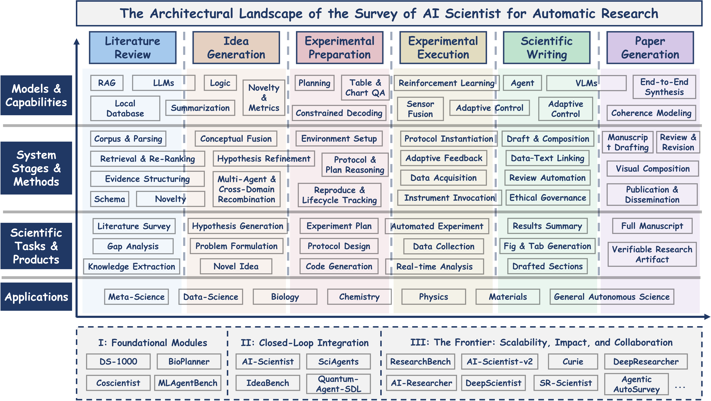
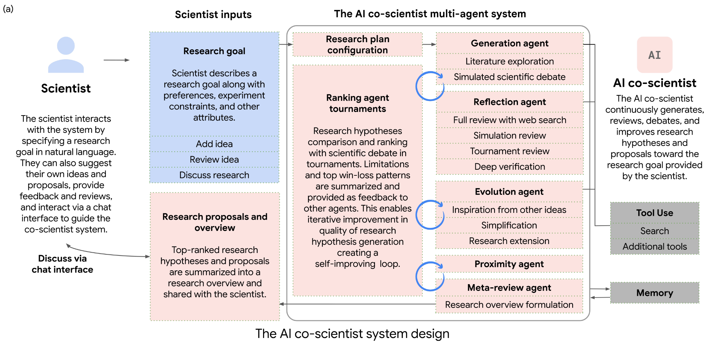
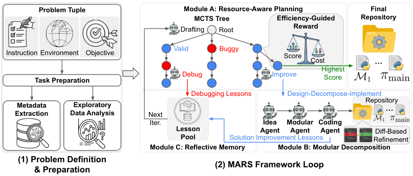
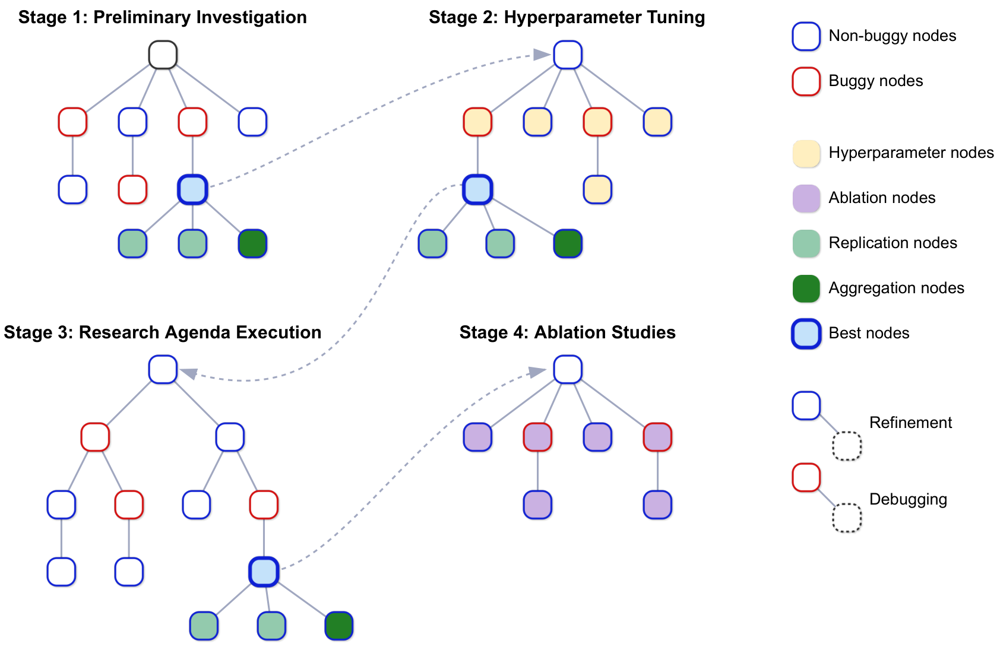
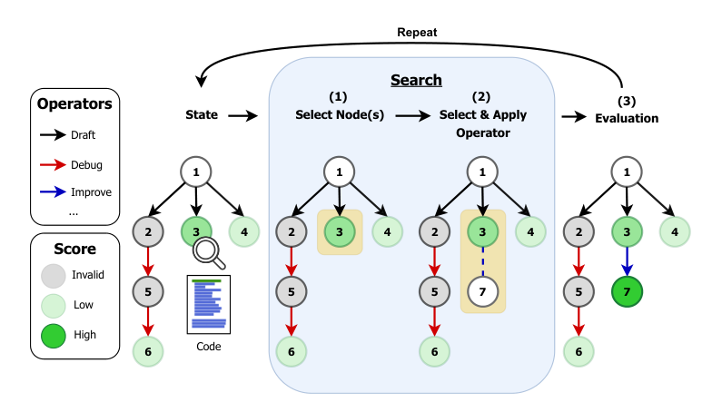
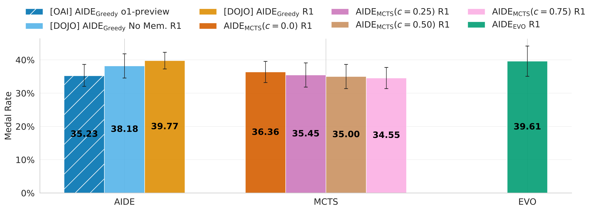
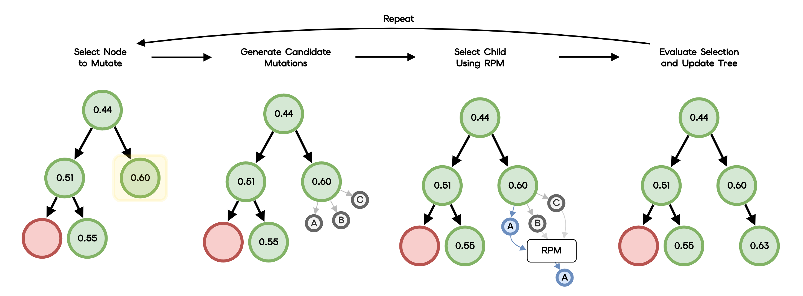
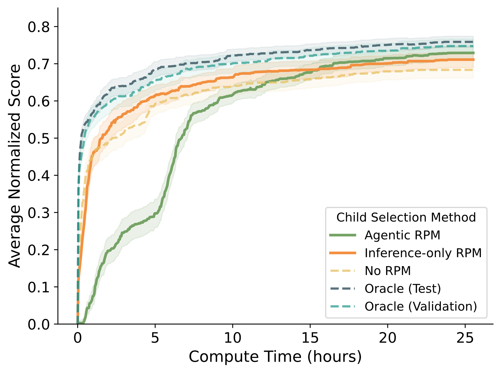
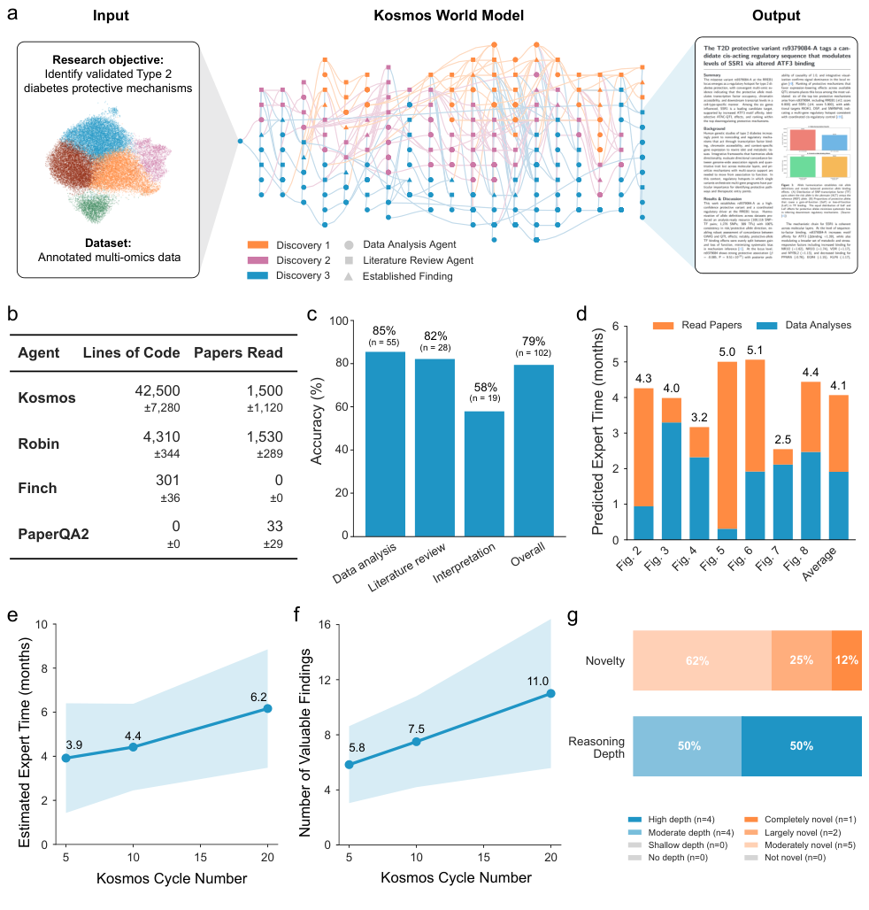
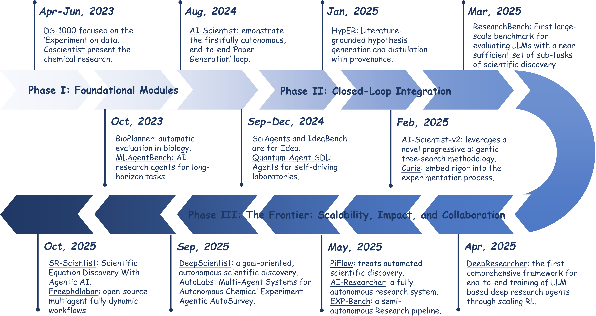

## 1. The basic framework of auto-research

<b>A Survey of AI Scientists (Tie et al., 2025)</b> divides end-to-end research into six stages and overlays four levels of abstraction, forming a 4×6 matrix.

<b>Literature review → Idea generation → Experiment preparation → Experiment execution → Paper writing → Paper generation</b>

{: loading="lazy" decoding="async"}

## 2. Six stages of development

### 2.1 Literature review: the bottleneck is judgment, not retrieval (deep research)

Early approaches used RAG and multi-agent pipelines. <b>Deep Research Survey (Zhang et al., 2025)</b> divides the process into four steps: planning, asking questions, exploring the web, and generating a report. This is itself a fairly general framework.

### 2.2 Idea generation: from producing more complete content to choosing what is most worth testing

From 2024 to 2025, multi-agent debate was the dominant approach to screening ideas. A representative example is <b>AI co-scientist (Gottweis et al., 2025)</b>. Its six agent roles cover generation, reflection, ranking, proximity, evolution, and meta-review. Tournament-style self-play debate eliminates weaker ideas.

For example, it proposed 5 candidate compounds for drug repurposing, but only 3 inhibited cancer cells at clinically relevant concentrations.

{: loading="lazy" decoding="async"}

At the same time, <b>The AI Scientist (Lu et al., 2024)</b> took another route. It connected ideas, experiments, figures, writing, and automated review in a fully automated loop, bringing the cost per paper below 15 dollars.

In 2026, the focus shifted to screening under a <b>limited budget</b>.

One bottleneck in these approaches is <b>whether ideas can be evaluated</b>. Structured debate suits open-ended ideas, but objective scoring is difficult. Brute-force search in a fixed space is easier to score, although its view of the broader problem is limited.

### 2.3 Experiment preparation: the least automated stage

This stage includes choosing baselines and datasets and designing protocols. Automation remains limited because these decisions depend on domain-specific <b>tacit knowledge</b>. There is no standard answer to whether a baseline is appropriate or how much ablation is enough; agents tend to run many ablations.

- <b>Agent Laboratory (Schmidgall et al., 2025)</b> assigns work to PhD, Postdoc, ML Engineer, and Professor roles in a three-stage pipeline, supporting both autonomous and human-assisted modes.
- <b>MARS (Chen et al., 2026)</b> introduces Resource-Aware Planning and uses <b>Budget-Aware MCTS</b> to weight performance relative to cost during planning.

{: loading="lazy" decoding="async"}

Overview of the MARS framework

Given the role of tacit knowledge, this stage inevitably needs human participation.

### 2.4 Experiment execution: four routes in the most active area of development

#### (a) Tree search: AI Scientist-v2

<b>AI Scientist-v2 (Yamada et al., 2025)</b> organizes experiments into a tree through <b>Agentic Tree Search</b>. Search proceeds through four stages: Preliminary Investigation, Hyperparameter Tuning, Agenda Execution, and Ablation. Nodes without bugs undergo refinement; nodes with bugs enter a debugging branch.

{: loading="lazy" decoding="async"}

The four-stage agentic tree search in AI Scientist-v2

It submitted 3 papers to an ICLR 2025 workshop. Of these, 1 was accepted with a mean score of 6.33/10, becoming the first entirely AI-generated paper to pass peer review. However, a self-audit found approximately 57% overlap between its training and test sets, and none of the three papers met the main conference standard.

#### (b) The decision layer

<b>AIRA (Toledo et al., 2025)</b> formalizes an agent as the triple <b>(Search Policy, Operator Set, Fitness Function)</b>. Nodes in the search graph are partial solutions. Each round mainly involves selecting a node, choosing an operator, and scoring the result with the fitness function.

{: loading="lazy" decoding="async"}

Its finding is somewhat counterintuitive: the bottleneck is the operator set, not the search policy. Once AIDE's operator set is restricted, more sophisticated search policies no longer produce gains.

{: loading="lazy" decoding="async"}

That finding leads to another question. If the operator set is the bottleneck, how should we choose among the candidates it produces? This is what <b>RPM (Foster et al., 2026)</b> addresses. It inserts a preference-modeling and screening layer before the executor.

{: loading="lazy" decoding="async"}

1. <b>Select a parent node</b>: choose a node worth mutating from the active search tree.
2. <b>Generate candidates</b>: use the mutation operator to produce N unexecuted child candidates in parallel.
3. <b>Screen with RPM</b>: use context from previously executed solutions and a pairwise elimination tournament to choose 1 candidate from N.
4. <b>Execute only the winner</b>: train and score only the selected candidate.

The important design choice is to simplify the prediction problem. Instead of predicting a candidate's absolute score, ask which of two candidates is better. Absolute scores require calibration; relative rankings only need consistency. The latter is much easier for a frozen pretrained model.

| Variant | Mechanism | Characteristics |
| --- | --- | --- |
| <b>Inference-only</b> | LLM-as-a-Judge evaluates the plan, code, and history through inference alone | Fast, no additional GPU; the prompt is optimized with DSPy MIPROv2 |
| <b>Agentic</b> | Runs a small pilot in an H200 sandbox before deciding | Slower but more accurate; only an experiment summary needs to be submitted |

One engineering detail is worth noting. The pilot's actual budget is 300 seconds, but the prompt deliberately reports 2700 seconds, 9 times as much. <b>If the model knows time is very tight, it becomes unwilling to pursue useful exploration.</b>

{: loading="lazy" decoding="async"}

#### (c) A minimal loop: karpathy/autoresearch

Karpathy's open-source project has no paper and consists of only three files. <code>prepare.py</code> contains the frozen evaluation logic and defines the trust boundary. <code>train.py</code> is the only file the agent may modify. <code>program.md</code> contains the research goals written by a person.

The agent repeats a simple cycle: change the code, run for 5 minutes, and inspect the result. If the metric improves, commit; if it worsens, reset. On a single H100, it runs about 100 experiments overnight and reduces Time-to-GPT-2 from 2.02h to 1.80h.

#### (d) A world model: Kosmos

<b>Kosmos (Mitchener et al., 2025)</b> uses a structured world model to share information between data-analysis and literature-retrieval agents. A single run involves about 200 rollouts, an average of 42,000 lines of code, and 1,500 full-text papers read.

{: loading="lazy" decoding="async"}

One pattern in the results is revealing. Accuracy is 85.5% for data-analysis statements and 82.1% for literature statements, but only 57.9% for statements synthesizing both. Individual capabilities can be accurate; <b>combining evidence across sources to reach a result</b> is the real weakness. This also helps explain why choosing a research direction is harder to automate than running experiments.

---

The relationships between the four layers are:

1. <b>The pipeline provides the foundation</b>: establish a skeleton that identifies the six stages.
2. <b>Tree search changes exploration</b>: turn a linear process into a tree with branches, backtracking, and debugging.
3. <b>The decision layer reduces cost</b>: screen candidates when expanding the tree, before executing unpromising ones.
4. <b>The world model supports synthesis</b>: reconcile information from different sources within a shared state.

---

## 4. Four observations across stages

<b>First, the structure is moving from pipelines to loops and then to recursive processes</b>

- In 2023, the <b>linear pipeline</b> linked stages in one direction and stopped on failure.
- From 2024 to 2025, the <b>loop</b> turned failure into information and returned to earlier stages to retry.
- In 2026, <b>recursive</b> processes learn across rounds, with experience from the previous round influencing the next search.

{: loading="lazy" decoding="async"}

<b>Second, compute budget has become a first-class decision variable</b>

There are three approaches. RPM formalizes it through preference ranking. MARS adds an efficiency penalty through Budget-Aware MCTS. Karpathy directly fixes the budget at 5 minutes to constrain the search space.

Evidence from <b>RE-Bench (Wijk et al., 2024)</b> points in another direction. With a 2-hour budget, AI scores 4 times the human median. At 8 hours, humans take the lead; at 32 hours, humans score twice as high as AI. <b>Humans gain more at the margin from additional time.</b>

<b>Third, human-in-the-loop is an interface-design problem</b>

The question has shifted from whether people should be in the loop to where they should enter. High-leverage points are irreversible decisions: choosing a direction, changing a public interface, or making a high-risk modification. It is not about asking a person at every step.

<b>Fourth, benchmarks have moved from "can it finish?" to "how far is it from humans?"</b>

| Benchmark | Date | Evaluation philosophy | Key figures |
| --- | --- | --- | --- |
| MLE-bench | 2024-10 | Can it win medals in real Kaggle competitions? | o1-preview: 16.9% bronze-medal rate |
| ScienceAgentBench | 2024-10 | Can it produce correct, executable research code? | Best agent: 32.4% |
| RE-Bench | 2024-11 | <b>Comparison with human experts under the same conditions</b> | At 2h, AI scores 4 times as high as humans; at 8h, humans take the lead |
| PaperBench | 2025-04 | How far is it from human experts? | Best agent: 21.0%; PhD: 41.4% |
| AIRS-Bench | 2026-02 | The full lifecycle, without baseline code | 20 tasks; 4 results above the human SOTA |
| RCBench | 2026-05 | <b>Can it rediscover a paper?</b> | A score of 50 is anchored to the target paper; best score: 21.5 |

RCBench's design makes the change particularly clear. A score of 50 means reproducing the target paper; only scores above 50 count as a new discovery. <b>The evaluation target has shifted from surpassing humans to whether the system can rediscover the science itself.</b>
