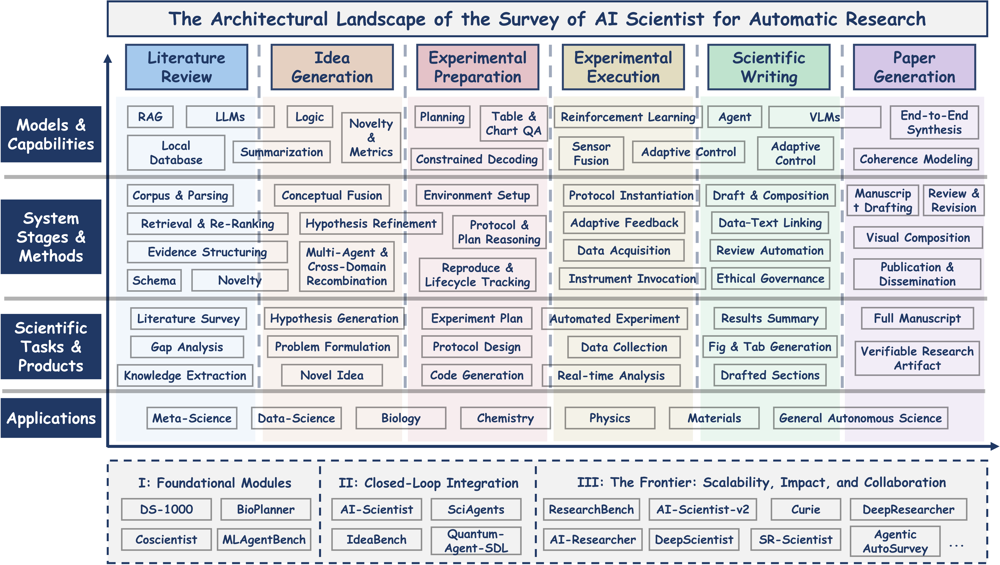
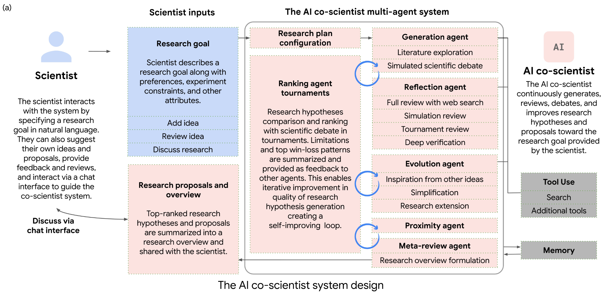
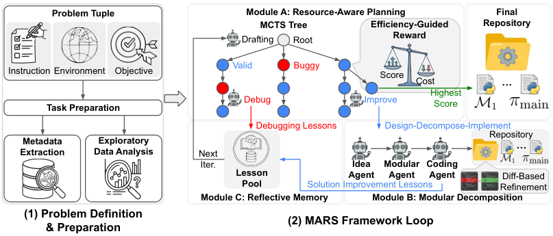
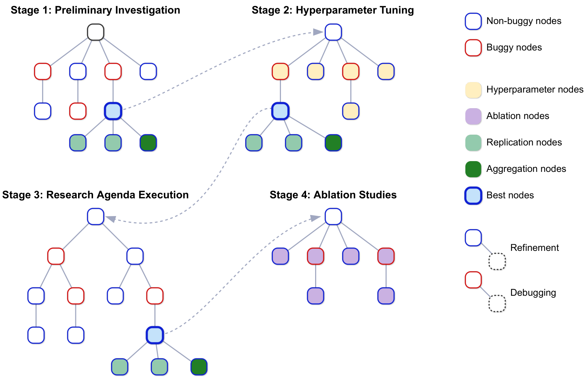
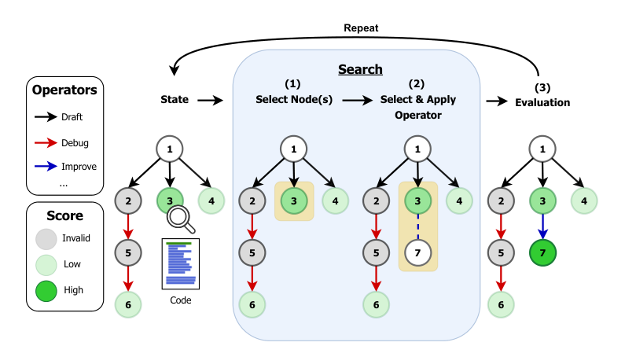
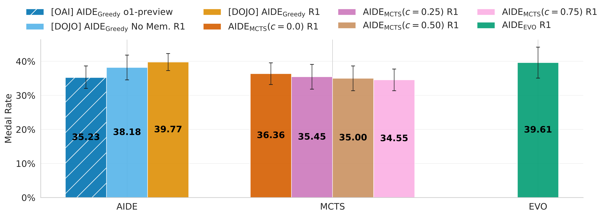
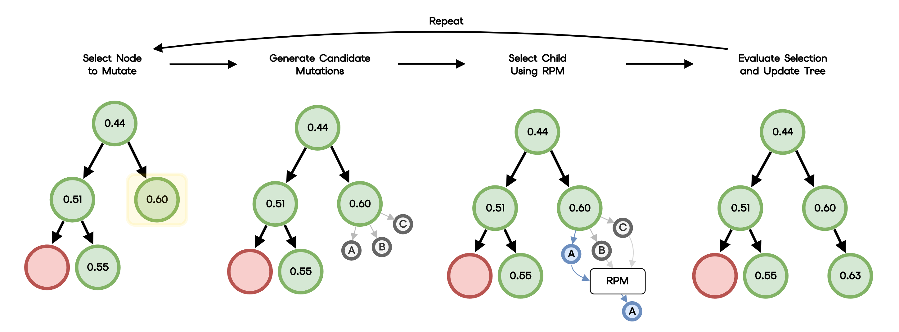
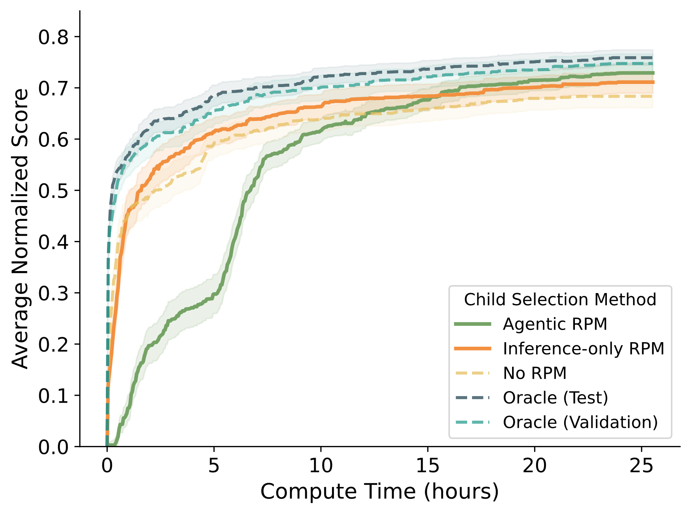
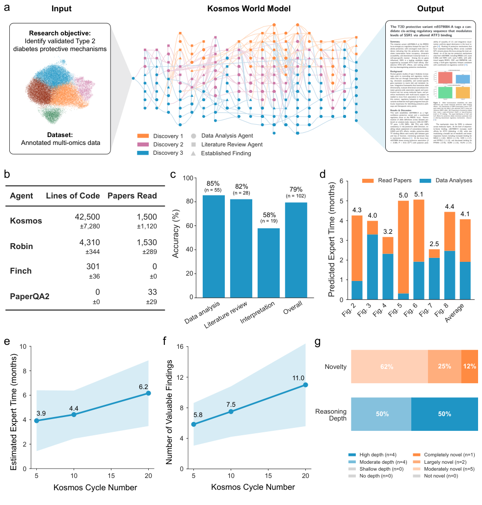
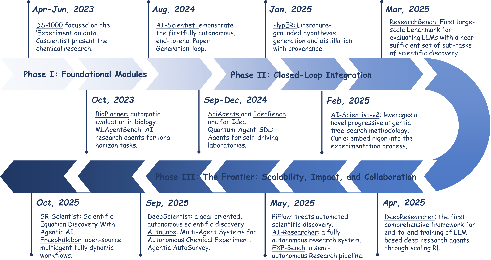

## 1. Auto-Research的基本框架

<b>A Survey of AI Scientists（Tie et al., 2025）</b> 把端到端科研拆成六阶段，再叠上四层抽象，拼成一个 4×6 矩阵。

<b>文献调研 → Idea 生成 → 实验准备 → 实验执行 → 论文写作 → 论文生成</b>

{: loading="lazy" decoding="async"}

## 2. 六个发展阶段

### 2.1 文献调研，瓶颈在判断不在检索（deep research）

早期做法是 RAG+多 agent 流水线。<b>Deep Research Survey（Zhang et al., 2025）</b> 把它拆成四步，【规划、提问、网页探索、生成报告】(本身是比较通用的框架）。

### 2.2 Idea 生成，重心从「生成更完整的内容」移到「选出最值得验证的内容」

2024 到 2025 年，主流是多 agent 辩论来进行idea的筛选。代表作是 <b>AI co-scientist（Gottweis et al., 2025）</b>，六类 agent 分工成【生成、反思、排序、邻近、进化、元评审】，靠锦标赛式的自博弈辩论把劣质项淘汰掉。

例如：药物重定位任务上给出 5 个候选化合物，其中只3 个在临床相关浓度下抑制癌细胞。

{: loading="lazy" decoding="async"}

同期， <b>The AI Scientist（Lu et al., 2024）</b> 走另一条路，把 idea、实验、图表、写作、自动评审串成全自动闭环，单篇成本压到 15 美元以下。

2026 年重心移到<b>有限预算</b>下如何进行筛选。

上述idea生成存在的一个卡点是 <b>idea 的可评估性</b>。结构化的辩论适合开放式想法，但不容易有一个客观的打分方式。固定搜索空间的暴力搜索便于打分，但全局的视野比较受限。

### 2.3 实验准备，自动化程度最低的一环

这一环包括选 baseline、选数据集、设计协议。自动化程度非常低，因为它吃的是领域<b>隐性知识</b>。baseline是否合理，消融做到什么规模算够（agent倾向于做很多ablation），这类判断没有标准答案。

- <b>Agent Laboratory（Schmidgall et al., 2025）</b>，PhD、Postdoc、ML Engineer、Professor 四个角色分工，串成三阶段流水线，支持自主和人类辅助两种模式
- <b>MARS（Chen et al., 2026）</b>，引入 Resource-Aware Planning，用 <b>Budget-Aware MCTS</b> 在规划阶段就给「性能除以成本」加权

{: loading="lazy" decoding="async"}

MARS 框架总览

考虑到“隐性知识”，这一段注定是需要人参与的。

### 2.4 实验执行，进展最密集，四条路线

#### (a) 树搜索，AI Scientist-v2

<b>AI Scientist-v2（Yamada et al., 2025）</b> 用 <b>Agentic Tree Search</b> 把实验组织成一棵树，经过四个阶段（Preliminary Investigation、Hyperparameter Tuning、Agenda Execution、Ablation)进行树搜索。没 bug 的节点走 refinement，有 bug 的节点进 debugging 分支。

{: loading="lazy" decoding="async"}

AI Scientist-v2 的四阶段 agentic tree search

它投了 3 篇论文到 ICLR 2025 workshop，1 篇被接收，均分 6.33/10。这是第一篇通过同行评审的纯 AI 论文。不过自查指出该文约 57% 训练集和测试集重叠，三篇都没到主会标准。

#### (b) 决策层

<b>AIRA（Toledo et al., 2025）</b> 把 agent 形式化成三元组，<b>(Search Policy, Operator Set, Fitness Function)</b>。搜索图的节点是部分解，每轮主要是选节点、选算子、用 fitness 打分。

{: loading="lazy" decoding="async"}

它的发现有点反直觉。瓶颈不在搜索策略，在于算子集。把 AIDE 的算子集限制住之后，再高级的搜索策略也拿不到增益。

{: loading="lazy" decoding="async"}

顺着这个发现往下推一层。既然算子集是瓶颈，那算子产出的候选怎么选。这就是 <b>RPM（Foster et al., 2026）</b> 要回答的问题。它在 executor 前面插一层 preference进行建模与筛选。

{: loading="lazy" decoding="async"}

1. <b>选父节点</b>，从活跃搜索树里挑一个值得变异的节点
2. <b>生成候选</b>，用 mutation operator 并行产出 N 个还没执行的子候选
3. <b>RPM 筛选</b>，结合历史已执行解的上下文，用两两淘汰赛从 N 个里选出 1 个
4. <b>只执行冠军</b>，仅对选中的候选做训练和打分

关键设计是问题降级。把「预测候选能拿多少分」改成「这两个候选哪个更好」。绝对分数需要校准，相对排序只需要一致，后者对冻结的预训练模型友好得多。

| 变体 | 机制 | 特点 |
| --- | --- | --- |
| <b>Inference-only</b> | LLM-as-a-Judge 纯推理判断 plan、code、历史 | 快，零额外 GPU，prompt 用 DSPy MIPROv2 优化 |
| <b>Agentic</b> | 在 H200 沙箱先跑小规模 pilot 再决策 | 慢但更准，只要求提交实验总结 |

有个工程细节值得单独说。pilot 实验的真实预算是 300 秒，但 prompt 里故意往上报成 2700 秒，夸了 9 倍。<b>模型要是知道时间很紧，就不肯去做有价值的探索了。</b>

{: loading="lazy" decoding="async"}

#### (c) 极简闭环，karpathy/autoresearch

Karpathy 的开源项目，没有论文。只有三个文件。<code>prepare.py</code> 是冻结的评测逻辑，构成信任边界。<code>train.py</code> 是 agent 唯一能动的地方。<code>program.md</code> 是人类写的科研目标。

agent 只做一件事，循环往复，改代码、跑 5 分钟、看后面的结果。指标变好就 commit，变差就 reset。单张 H100 一晚上跑约 100 个实验，Time-to-GPT-2 从 2.02h 降到 1.80h。

#### (d) World model，Kosmos

<b>Kosmos（Mitchener et al., 2025）</b> 用结构化 world model 在数据分析 agent 和文献检索 agent 之间共享信息。单次运行约 200 次 rollout，平均 42,000 行代码，读 1,500 篇全文。

{: loading="lazy" decoding="async"}

数据里有个现象很说明问题。数据分析陈述准确率 85.5%，文献陈述 82.1%，两者综合起来只剩 57.9%。单项能力可以很准，<b>跨源综合起来得到结果</b>才是真短板。这也解释了为什么选方向比跑实验更难自动化。

---

四层之间的关系：

1. <b>Pipeline 打底</b>，先有骨架，知道要做哪六件事
2. <b>Tree Search 改造探索</b>，把线性流程变成可分支、可回退、可调试的树
3. <b>Decision Layer 优化开销</b>，树扩展时插一层筛选，不跑没希望的候选
4. <b>World Model 补综合</b>，让不同来源的信息在同一个状态里对上

---

## 4. 四条跨阶段的 Insight

<b>第一条，循环结构在升级，pipeline 到 loop 再到 recursive</b>

- 2023 年，<b>linear pipeline</b>，阶段单向串联，失败就终止
- 2024 到 2025 年，<b>loop</b>，失败变成信息，回退到上游重试
- 2026 年，<b>recursive</b>，跨轮学习，上一轮的经验影响下一轮的搜索

{: loading="lazy" decoding="async"}

<b>第二条，算力预算变成了一等决策变量</b>

三种处理方式。RPM 把它形式化成偏好排序，MARS 用 Budget-Aware MCTS 加效率惩罚项，karpathy 直接固定 5 分钟预算来约束搜索空间。

反方向的证据来自 <b>RE-Bench（Wijk et al., 2024）</b>。AI 在 2 小时预算下得分是人类中位数的 4 倍，放到 8 小时人类反超，32 小时人类做到 AI 的两倍。<b>人类对增加时间预算的边际回报更高。</b>

<b>第三条，Human-in-the-loop 是界面设计问题</b>

问题已经从要不要人在环，变成在哪儿让人进来。高杠杆的位置是那些不可逆的决策，方向选择、公共接口变更、高风险修改。不是每一步都问一遍。

<b>第四条，Benchmark 从「能不能完成」走到「距离人类多远」</b>

| Benchmark | 时间 | 评测哲学 | 关键数字 |
| --- | --- | --- | --- |
| MLE-bench | 2024-10 | 能否在真实 Kaggle 拿牌 | o1-preview 16.9% 铜牌率 |
| ScienceAgentBench | 2024-10 | 能否产出正确可执行的科研代码 | 最强 agent 32.4% |
| RE-Bench | 2024-11 | <b>与人类专家同条件对比</b> | 2h AI 是人类 4 倍，8h 人类反超 |
| PaperBench | 2025-04 | 距离人类专家多远 | 最强 agent 21.0%，PhD 41.4% |
| AIRS-Bench | 2026-02 | 全生命周期，且不给 baseline 代码 | 20 个任务，4 个超人类 SOTA |
| RCBench | 2026-05 | <b>能否重新发现一篇论文</b> | 50 分锚定目标论文，最强 21.5 |

RCBench 的设计最能说明转向。它的 50 分定义为复现出目标论文，超过 50 分才算有新发现。<b>评测目标从超越人类，改成了能否重新发现科学本身。</b>

