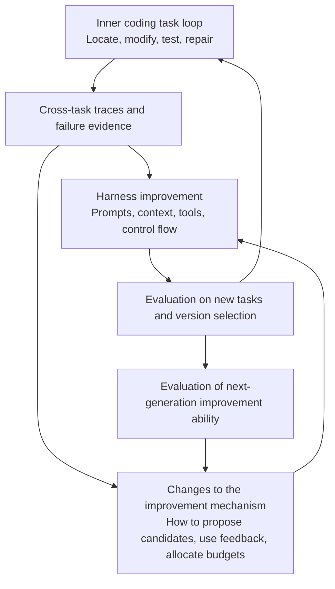
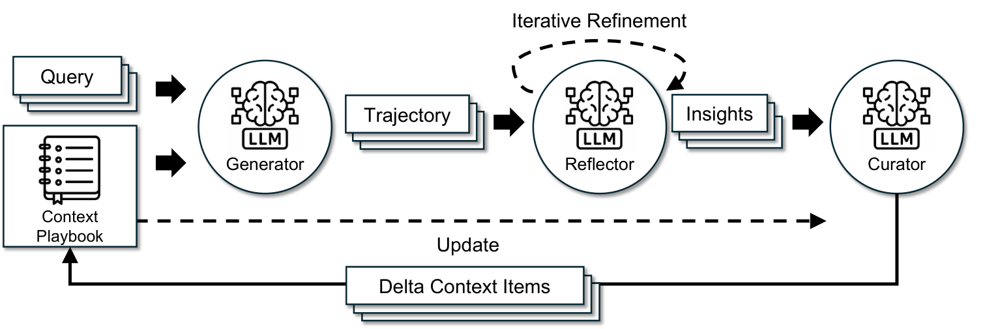
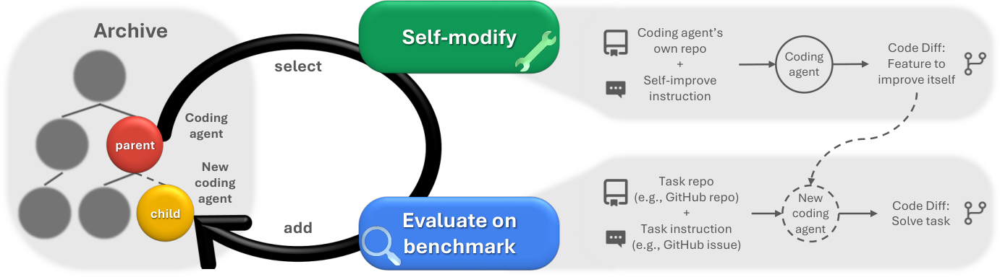
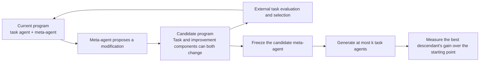
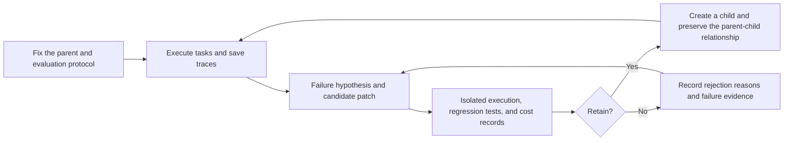

## 1. From correcting a task to improving the way improvements are made

In [Coding](/blog/harness/coding/en/), the inner task loop completes an individual modification, while the outer harness loop uses traces from multiple tasks to adjust tools, context, memory, and verification. Coding RSI asks a further question about that outer loop: if a system can change how it works, can the method that produces those changes improve too?

It helps to distinguish three kinds of change before reading the papers below.

- <b>Within-task correction</b>: a patch fails a test, so it is repaired again. The current problem may be solved, but subsequent tasks still begin with the original harness.
- <b>Cross-task improvement</b>: reusable prompts, context strategies, or program modifications are retained from repeated failures, and subsequent tasks run with the new harness.
- <b>Improvement of the improvement mechanism</b>: the new system is better not only at tasks, but also at proposing, selecting, and validating the next version's modifications.

There are already many observable examples of the first two. The third is harder to establish: a higher task success rate tells us that the current version is better, but not directly whether it will produce better descendants.

<i>Figure 1. My synthesis of the three loops. Each additional outer layer introduces another object that needs separate validation. Not every self-modifying system allows every path in the diagram to change.</i>

The discussion here mainly concerns system-side changes with fixed model weights. Because a harness can be written as a program, prompts, tools, context organization, subtask allocation, and recovery logic can all become objects of search. The approaches below differ first in which parts they open up for modification.

## 2. Changing context and workflows first

### 2.1 Turning failure traces into instructions for the next round

<b>GEPA (Agrawal et al., 2025)</b> lets an optimizer read execution traces, use natural-language reflection to propose prompt changes, and test them through task feedback. It retains complementary candidates on a Pareto frontier rather than collapsing all experience too early into a single prompt that is best on average. [Paper](https://arxiv.org/abs/2507.19457)

For coding, traces carry more information than pass or fail. Two failures may both appear as timeouts, but one may result from repeatedly reading irrelevant files, while the other comes from a test command that never exits. The first calls for a change to search or context strategy; the second calls for a change to tool use. Whether an optimizer can identify this difference determines how targeted the next prompt will be.

GEPA searches over prompts. That does not automatically make the optimizer's own code an object of search. It can therefore serve as a method for the outer harness loop, but prompt improvement alone is not enough to call it complete RSI.

### 2.2 Experience does not have to be rewritten as a summary every time

<b>ACE (Zhang et al., 2025)</b> focuses on the long-term evolution of context. A Generator produces traces, a Reflector extracts lessons, and a Curator merges incremental updates into a structured playbook. It aims to avoid losing detail through repeated rewrites of the entire context, until only a few generic suggestions remain. [Paper v3](https://arxiv.org/html/2510.04618v3)

{: loading="lazy" decoding="async"}

<i>Figure 2. ACE uses a Generator, Reflector, and Curator to add experience from traces incrementally to context. Source: Qizheng Zhang et al., Agentic Context Engineering, Figure 4. Original figure unchanged.</i> [<i>Original paper</i>](https://arxiv.org/html/2510.04618v3), [<i>CC BY 4.0</i>](https://creativecommons.org/licenses/by/4.0/)

This is the same kind of problem as maintaining Memory and Skills in the outer coding loop. Experience must be specific enough to help before the next similar failure, but also remain open to revision by new evidence. Retaining more logs is not the same as building a better experience library: retrieval, deduplication, and invalidation still need to be handled.

### 2.3 Making the order of collaboration searchable too

<b>AFlow (Zhang et al., 2024)</b> represents agent workflows in code and searches over them with an MCTS variant. An expansion can change operator combinations, connections, and prompts, with execution feedback returned to the search process. [Paper v4](https://arxiv.org/html/2410.10762v4)

One distinction is easy to miss: <b>a node in the search tree is an entire workflow</b>, not an individual action within a workflow. The system can compare workflows such as reviewing before editing, generating multiple answers and combining them, or adding tests. The paper's searcher still follows a predefined mechanism, so it addresses how to find better workflows without also establishing that MCTS itself improves.

These three approaches progressively widen the scope of modification: instructions, accumulated context, and executable workflows. The next step is to open up the entire agent program.

## 3. Self-modification of executable harnesses

### 3.1 DGM: retaining branches and versions that are not strong yet

<b>Darwin Gödel Machine (DGM; Zhang et al., 2025)</b> lets a coding agent modify its own program and evaluates the modified version on coding benchmarks. The base model remains fixed; changes occur in the executable harness around it. [Paper v3](https://arxiv.org/html/2505.22954v3)

Instead of maintaining a single active version that is patched repeatedly, it maintains an agent archive. It selects a parent from existing versions, performs self-modification, and adds runnable new versions to the archive. A version with an unremarkable current task score may still contain a structure that proves useful later. This allows search to pass through intermediate steps that offer no immediate advantage.

{: loading="lazy" decoding="async"}

<i>Figure 3. DGM selects a parent from the archive, lets it modify itself, and accumulates new versions through task evaluation. Source: Jenny Zhang et al., Darwin Gödel Machine, Figure 1. Original figure unchanged.</i> [<i>Original paper</i>](https://arxiv.org/html/2505.22954v3), [<i>CC BY 4.0</i>](https://creativecommons.org/licenses/by/4.0/)

On a <b>200-task subset</b> of SWE-bench Verified, the paper reports that the pass rate rises from 20.0% to 50.0% after 80 search iterations. A separate full Polyglot pass@1 evaluation increases from 14.2% to 30.7%. These are different tasks and evaluation settings; they should not be combined into a single overall gain.

More relevant to RSI is an ablation comparing the evolved self-modifying agent with a setup that keeps the initial modifier frozen throughout. This provides experimental support for the claim that the improved agent is also better able to perform improvement work. Describing DGM solely as a fixed optimizer finding better programs would miss that point.

The boundaries are also specific: archive maintenance and parent selection remain outside the editable agent. DGM demonstrates self-modification and self-improvement within a controlled search framework; it does not hand the entire selection, evaluation, and search process over to evolution.

### 3.2 Self-Harness: changing one evidence-backed weakness at a time

<b>Self-Harness (Zhang et al., 2026)</b> defines a tighter loop: Weakness Mining → Harness Proposal → Proposal Validation. Its evaluation system organizes traces by verifier-supported failure modes and produces evidence packets. The same fixed model uses them to propose bounded changes, which are retained or rejected through regression checks and promotion thresholds. [Paper v3](https://arxiv.org/html/2606.09498v3)

This setup is close to the outer coding loop. A candidate should connect to a specific failure mechanism, such as losing a caller during context compression or failing to consume a tool's return value correctly. Targeted changes make it easier to explain why a version works and to roll it back when it does not.

The paper's use of held-out data deserves careful reading. The proposer cannot see held-out traces, but held-out scores repeatedly inform the promotion gate. This makes it an evaluation split used for version selection, not a completely untouched final confirmation set. The SWE-bench Verified experiment also uses only a fixed set of 100 tasks, split into 67 held-in and 33 held-out tasks.

### 3.3 RRSI: controlling complexity and gaming as search grows

<b>RRSI (Xia et al., 2026)</b> introduces constraints into evolution. On the proposal side, it controls edit sparsity, uses evidence for attribution, and organizes exploration. On the selection side, it adds leakage checks, noise-aware acceptance thresholds, and controls on resources and complexity. [Paper v3](https://arxiv.org/html/2609.24972v3)

It addresses a practical problem. As candidate patches accumulate, higher scores may come from memorizing a benchmark, using more computation, or adding rules that are difficult to maintain. Selecting versions only by their current scores rewards all of these changes. RRSI tries to consider both the source of a gain and its cost during selection. The paper studies tasks beyond coding, so it should not be reduced to a single coding leaderboard.

These works all make the harness editable, but differ in the scope of permitted changes and how versions are selected. When reading about self-improvement, it is worth asking who generates modifications, who selects parents, who determines success, and which of these mechanisms remain fixed.

## 4. Bringing the improver itself into the experiment

### 4.1 HGM: current strength and descendant potential are different quantities

<b>Huxley-Gödel Machine (HGM; Wang et al., 2025)</b> introduces clade-level metaproductivity. It estimates a lineage's potential to keep producing good versions from the performance of its descendants and allocates expansion opportunities through Thompson sampling. [Paper v3](https://arxiv.org/html/2510.21614v3)

This changes the signal used for parent selection. One version may score highly now but be hard to improve further. Another may be average now but repeatedly produce better descendants. Current scores alone conflate the two.

The implemented system uses an estimate of descendant potential. The paper's discussion of an ideal optimal machine depends on additional assumptions; it should not be read as proof that practical search is optimal. A selection objective closer to improvement productivity also does not mean that the selector has autonomously rewritten itself.

### 4.2 Hyperagents: putting the task agent and meta-agent in one program

<b>Hyperagents / DGM-H (Zhang et al., 2026)</b> places the task agent that executes tasks and the meta-agent that modifies agents together in an editable program. Candidate changes can therefore improve task execution or alter how the next modification is produced. [Paper v1](https://arxiv.org/html/2603.19461v1)

<i>Figure 4. An editable schematic based on the Hyperagents method. The main experiments retain human-designed external selection and evaluation mechanisms; the diagram does not depict them as freely self-modifying components.</i> [<i>Source</i>](https://arxiv.org/html/2603.19461v1)

The system uses <b>imp@k</b> to test part of its meta-improvement ability directly. It fixes a meta-agent, starts from an initial task agent, generates at most k candidates, and measures how much the best descendant improves over the starting point. The 50 in imp@50 is therefore a candidate-generation budget, not a probability of success. Nor does it guarantee that the two sides consume exactly the same number of tokens, amount of time, or cost.

The paper also transfers a meta-agent evolved on other tasks to an Olympiad mathematics grading task, testing whether it can improve a new task agent. This is closer to testing whether an improvement method transfers than merely looking at the original benchmark score. It is not, however, a purely coding-based imp@50 result, and it does not establish that all outer mechanisms have autonomously updated themselves.

## 5. Evaluation needs two scorecards

The first concerns the task agent: success on unseen tasks, regressions, patch quality, and completion cost. The second concerns the improver: given an improvement budget, how many valid candidates it produces, how much the best descendant improves, and whether those changes transfer.

A simplified notation can make the distinction explicit. Let h be the task harness, I the improver, and E the external evaluation:

$$
Q(h)=\mathbb{E}_{x\sim D_{test}}[E(h,x)]
$$

Q measures the current version's task ability. If I generates candidates h₁ through hₖ starting from h, we can separately examine:

$$
G_k(I;h)=\mathbb{E}\left[\max_{0\leq j\leq k}Q(h_j)-Q(h)\right],\qquad h_0=h
$$

This is a simplified form used here for explanation, not a unified standard for the field. It separates being better at the current task from being better at finding the next version. Actual experiments must also specify how candidates inherit from one another, how evaluation budgets are allocated, and whether token use and runtime are comparable.

| Approach | What changes | Distinction to preserve when reading results |
| --- | --- | --- |
| GEPA / ACE | Prompts, context, and experience | Task improvement does not mean improvement of the optimizer program. |
| AFlow | Entire workflows | Workflow search is separate from evolution of the searcher. |
| DGM / Self-Harness / RRSI | Executable agents or harnesses | Examine self-modification ability, task ability, and the fixed outer framework separately. |
| HGM | Selection guided by a lineage's descendant potential | Estimating metaproductivity is separate from a self-modifying selector. |
| Hyperagents | The task agent and meta-agent | A candidate-count budget is separate from actual computational cost. |

To compare two improvers, each can run independently from the same starting harness, task distribution, and budget, then have its next generation compared under a shared external protocol. This avoids mistaking a better starting point for a better ability to improve. Multiple seeds, paired differences, and confidence intervals are experimental-design recommendations here, not a shared protocol that every paper above has already implemented in full.

## 6. Runtime: preserving a modification as a replayable experiment

What a paper calls self-modification becomes an actual code change at execution time. At a minimum, the parent, patch, task version, model, evaluator, budget, and results need to be linked. Failed candidates also contain information; retaining only the final winner is not enough.

<i>Figure 5. The minimal experimental loop retained here. Implementation suggestions are separate from paper results: worktrees, disposable containers, read-only evaluators, and promotion strategies are engineering controls that can be adopted, not evidence that all research prototypes use the same deployment method.</i>

In a self-modifying environment, the evaluator must remain independent of the candidate. Otherwise, code that becomes better at passing tests may simply have changed the tests. The external execution layer should manage editable file boundaries, resource limits, and rollback versions. A candidate's explanation of why it is safe cannot replace that boundary.

Engineering supplement: a minimal reproducible experiment

First freeze the task split, model, environment, budget, seeds, and evaluator commit. Run the parent and save its complete traces. Each candidate addresses only one main failure hypothesis, recording the parent\_id, patch hash, modified files, raw trials, and cost.

Run candidates in isolated worktrees and disposable containers without production credentials. The evaluator, test labels, and confirmation set remain outside the editable scope. Perform static checks and regression tests first, then compare quality, cost, and transfer. Archive failed candidates; they must not overwrite the currently usable version.

Define effect sizes and acceptable degradation before viewing results. If the same selection set is repeatedly used for promotion, acknowledge that it has participated in optimization. Confirm final conclusions on new tasks. Returning only aggregate signals can reduce leakage, but it cannot make a repeatedly queried set untouched again.

These steps support reproducibility and failure diagnosis. Real teams can add canary releases and rollback procedures, but those test deployment controls, not RSI ability.

## 7. Several unresolved questions

### Evaluation feedback gradually becomes a training signal

Not showing the test questions themselves does not mean that no information reaches the optimizer. Whether a candidate passes or fails promotion already provides some feedback for the next round. Repeated queries to the same set can still lead to adaptation to those tasks over time. Self-Harness's use of held-out data is an example that needs to be made explicit.

### The best descendant's score and the reliable production of improvements are different observations

Best-of-k can show the upper limits of a search, but an exceptionally good descendant may be a chance outcome rather than evidence of stable improvement ability. Candidate counts, the proportion of valid candidates, distributions across seeds, and total cost are therefore worth retaining. Finding a better version with a larger budget and being more efficient under the same budget should be reported separately.

### A larger editable space creates opportunities and makes attribution harder

When only the prompt changes, modifications are relatively easy to locate. Once context, tools, workflows, and the meta-agent change together, gains may come from several interacting components. Limiting individual changes, retaining lineages, and running ablations reduce freedom within a search but help identify which changes transfer.

### Outer boundaries can move, but they cannot disappear from the account

DGM's fixed selection framework and the fixed parts of Hyperagents' outer mechanisms in the main experiments are parts of their experimental setups. More components may be included in optimization later. Each additional layer still requires answers about who evaluates it, how gaming is prevented, and whether the extra budget is worthwhile. Expanding the scope of self-modification is research progress; there remains an experimental gap between that and sustained long-term acceleration.

## 8. Comparing these systems with other harnesses

Coding provides a great deal of fast feedback: compilation, type checking, unit tests, and some behavioral verification can run automatically. This makes improvement loops easy to start, while also making fixed tests easy to optimize repeatedly against.

In [Auto-Research Harness](/blog/harness/auto-research/en/), the expensive parts become experimental design and the value of a discovery. In [EDA harnesses](/blog/harness/eda/en/), factual correctness and useful insights are again different things. Quantitative research must also handle temporal leakage and changes in markets. Across these domains, whether an improver generalizes depends substantially on whether the feedback itself can be trusted.

Coding RSI poses a clear research question: with comparable starting points and budgets, can a new system more reliably identify the next modification worth retaining? This can be broken down into experiments without first describing the entire system as fully autonomous evolution.

References and notes on evaluation settings

- Agrawal et al., <b>GEPA: Reflective Prompt Evolution Can Outperform Reinforcement Learning</b>, 2025. [Paper](https://arxiv.org/abs/2507.19457)
- Zhang et al., <b>Agentic Context Engineering: Evolving Contexts for Self-Improving Language Models</b>, 2025. The text and figure use v3. [Paper](https://arxiv.org/html/2510.04618v3)
- Zhang et al., <b>AFlow: Automating Agentic Workflow Generation</b>, 2024. Uses v4; each workflow-tree node is an entire workflow. [Paper](https://arxiv.org/html/2410.10762v4)
- Zhang et al., <b>Darwin Gödel Machine: Open-Ended Evolution of Self-Improving Agents</b>, 2025. Uses v3; the 200-task SWE-bench subset and full Polyglot pass@1 evaluation are separate. The Polyglot search phase uses a separate 50-task subset and must not be conflated with the full evaluation. [Paper](https://arxiv.org/html/2505.22954v3)
- Wang et al., <b>Huxley-Gödel Machine: Human-Level Coding Agent Development by an Approximation of the Optimal Self-Improving Machine</b>, 2025. Uses v3; human-level in the title refers to comparisons with human-designed agents under specified benchmarks and models, not a determination of general programming ability. [Paper](https://arxiv.org/html/2510.21614v3)
- Zhang et al., <b>Hyperagents</b>, 2026. Uses v1; the 50 in imp@50 is a budget for candidate-modification iterations. Transfer experiments in the main paper include a mathematics grading task. [Paper](https://arxiv.org/html/2603.19461v1)
- Zhang et al., <b>Self-Harness: Harnesses That Improve Themselves</b>, 2026. Uses v3; two attempts are averaged into a single-attempt success rate, not pass@2. Held-out scores participate in multiple rounds of version selection. [Paper](https://arxiv.org/html/2606.09498v3)
- Xia et al., <b>RRSI: Regularized Recursive Self-Improvement of Agent Harnesses</b>, 2026. Uses v3; sparsity and norm terminology is an analogy for controlling discrete edits, not direct continuous gradient optimization of a program. [Paper](https://arxiv.org/html/2609.24972v3)

