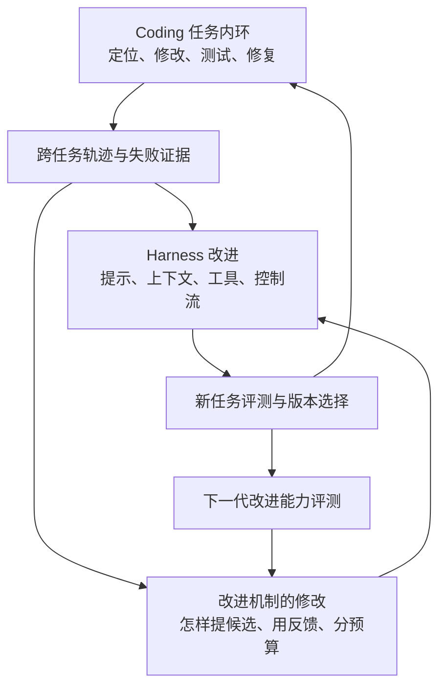
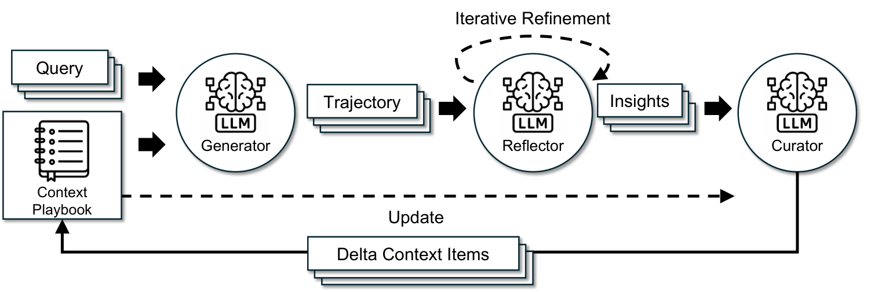
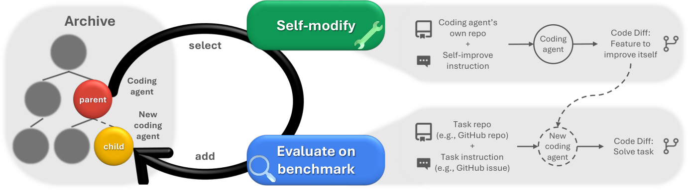
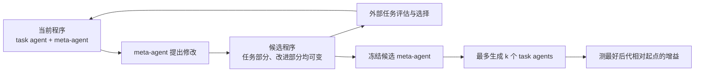
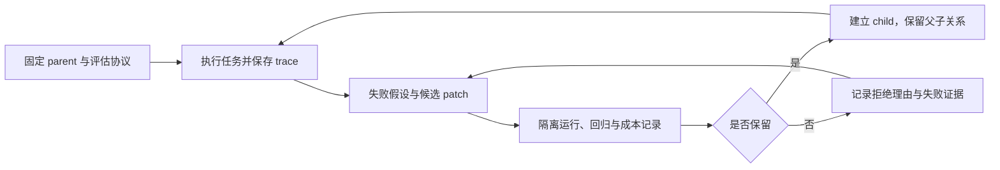

## 1. 从任务内纠错，到改进产生改进的方法

在 [Coding](/blog/harness/coding/) 里，任务内环负责完成一次修改，Harness 外环根据多次任务的轨迹调整工具、上下文、记忆和验证方式。Coding RSI 继续追问外环：如果系统可以修改自己的工作方式，产生这些修改的方法，能不能也随之变好？

先把三种变化分开，会比较容易读后面的论文。

- <b>任务内纠错</b>：这个 patch 没通过测试，再修一次。当前问题可能解决了，但后续任务仍从原来的 Harness 开始
- <b>跨任务改进</b>：从多次失败里留下可复用的提示、上下文策略或程序修改，后续任务用新版 Harness 执行
- <b>改进机制的改进</b>：新版系统不仅更会做任务，也更会提出、筛选和验证下一版修改

前两种变化已有很多可观察的例子。第三种更难证明，因为任务成功率上升，只告诉我们当前版本更好，没有直接告诉我们它会不会产生更好的后代。

<i>图 1｜本文对三个循环的归纳。向外多一层，就多一个需要单独验证的对象。并非所有自修改系统都允许图中的每条路径变化。</i>

这里主要讨论模型权重固定时，系统侧的变化。Harness 可以写成程序，因此提示、工具、上下文整理、子任务分配和恢复逻辑，都有机会成为搜索对象。下面几条路线的区别，首先是开放了哪些部分。

## 2. 先改上下文与工作流

### 2.1 让失败轨迹变成下一轮指令

<b>GEPA（Agrawal et al., 2025）</b> 让优化器阅读执行轨迹，用自然语言反思提出 prompt 修改，再通过任务反馈测试。它保留 Pareto frontier 上互补的候选，而不是过早把所有经验压进一个“平均最好”的提示。[论文](https://arxiv.org/abs/2507.19457)

对 coding 来说，轨迹提供的信号比“通过/失败”丰富。两次失败都表现为超时，一次可能是反复读无关文件，另一次可能是测试命令根本没有退出。前者需要修改搜索或上下文策略，后者需要修改工具使用方式。优化器能否读出这个区别，决定了下一轮 prompt 有没有针对性。

GEPA 搜索的是提示。优化器自己的代码没有因此自动成为搜索对象，所以它可以作为 Harness 外环的一种方法，不能仅凭 prompt 进步就称为完整 RSI。

### 2.2 经验不必每次重写成一段摘要

<b>ACE（Zhang et al., 2025）</b> 关注上下文的长期演化。Generator 产生轨迹，Reflector 提炼经验，Curator 再把增量更新合入结构化 playbook。它要避免的是每次重写整份上下文时，细节不断被压缩，最后只剩下几条泛泛建议。[论文 v3](https://arxiv.org/html/2510.04618v3)

{: loading="lazy" decoding="async"}

<i>图 2｜ACE 用 Generator、Reflector 与 Curator 将轨迹经验增量写入上下文。图源：Qizheng Zhang 等，Agentic Context Engineering，Figure 4，原图未改动。</i>[<i>原论文</i>](https://arxiv.org/html/2510.04618v3)<i>，</i>[<i>CC BY 4.0</i>](https://creativecommons.org/licenses/by/4.0/)

这和 Coding 外环里的 Memory、Skill 维护是同一类问题。经验要足够具体，才能在下一次相似失败前发挥作用；同时也要能被新证据修正。保存更多日志和形成更好的经验库之间，还差检索、去重与失效处理。

### 2.3 把协作顺序也变成搜索对象

<b>AFlow（Zhang et al., 2024）</b> 用代码表示 agent 工作流，再通过 MCTS 变体搜索。一次扩展可以改变操作组合、连接方式和提示，执行反馈回传到搜索过程。[论文 v4](https://arxiv.org/html/2410.10762v4)

这里容易混淆一个层次：<b>搜索树的一个节点是一套完整工作流</b>，不等于工作流中的一个动作。它可以比较先 review 再修改、生成多个答案后集成、加入测试等不同流程。论文里的搜索器仍按既定机制运行，因此它回答的是“怎样找到更好的 workflow”，没有同时证明 MCTS 自己也在改进。

这三条路线逐步扩大了改动范围：指令、可积累的上下文、可执行工作流。接下来可以进一步放开整个 agent 程序。

## 3. 可执行 Harness 的自修改

### 3.1 DGM：保留分支，也保留暂时不强的版本

<b>Darwin Gödel Machine（DGM；Zhang et al., 2025）</b> 让 coding agent 修改自己的程序，并用 coding benchmark 检查修改后的表现。基础模型保持固定，变化发生在模型周围的可执行 Harness。[论文 v3](https://arxiv.org/html/2505.22954v3)

它没有只维护一个不断打补丁的 active 版本，而是维护 agent archive，从已有版本中选择父代、进行自修改，再把可运行的新版本加入档案。当前任务分数一般的版本，也可能留下后来有用的结构。这使搜索能够跨过短期不占优的中间步骤。

{: loading="lazy" decoding="async"}

<i>图 3｜DGM 在档案中选择父代，让其修改自身，再用任务评测积累新版本。图源：Jenny Zhang 等，Darwin Gödel Machine，Figure 1，原图未改动。</i>[<i>原论文</i>](https://arxiv.org/html/2505.22954v3)<i>，</i>[<i>CC BY 4.0</i>](https://creativecommons.org/licenses/by/4.0/)

论文在 SWE-bench Verified 的 <b>200 题子集</b>上报告，80 轮搜索后通过率从 20.0% 到 50.0%；另做的 Polyglot 全量 pass@1 评估从 14.2% 到 30.7%。它们对应不同任务和评测口径，不能混成一个综合增益。

对 RSI 更有意思的是消融：作者比较了使用演化后的自修改 agent，与始终冻结初始修改器的情况。这给“改进后的 agent 也更能承担改进工作”提供了实验支持。因此，把 DGM 全部归为固定优化器找更好程序，会漏掉这一点。

边界也很具体：archive maintenance 和 parent selection 仍在可编辑 agent 之外。它展示了受控搜索框架里的自修改和自改进，没有把整个选择、评估与搜索过程都交给演化。

### 3.2 Self-Harness：一次只改一个有证据的弱点

<b>Self-Harness（Zhang et al., 2026）</b> 把循环收得更紧：Weakness Mining → Harness Proposal → Proposal Validation。评估系统按 verifier 支持的失败模式整理轨迹，生成证据包；同一个固定模型据此提出有边界的修改，再通过回归与晋级门槛决定是否保留。[论文 v3](https://arxiv.org/html/2606.09498v3)

这个设定与 Coding 外环很接近。候选应当能连回具体失败机制，例如上下文在压缩时丢失调用方，或工具返回值没有被正确消费。改动越有针对性，越容易分析“为什么这版有效”，也更容易在无效时回滚。

不过论文的 held-out 要仔细读：proposer 看不到 held-out 轨迹，但 held-out 分数会反复参与 promotion gate。因此，它是参与版本选择的评测 split，不能同时当作完全未触达的最终确认集。论文的 SWE-bench Verified 实验也只使用固定 100 题，分为 67 held-in 和 33 held-out。

### 3.3 RRSI：搜索增长之后，怎样控制复杂度和投机

<b>RRSI（Xia et al., 2026）</b> 把一些约束放进演化过程：提案侧控制改动稀疏性、使用证据归因并组织探索；选择侧加入泄漏检查、考虑噪声的接受门槛，以及资源和复杂度控制。[论文 v3](https://arxiv.org/html/2609.24972v3)

它处理的是一个很实际的问题。候选补丁越来越多以后，分数提高可能来自记住 benchmark、增加计算量，或者堆出难以维护的规则。若只按当前分数选版本，这些变化都会被奖励。RRSI 试图让选择过程同时考虑收益来源和代价；论文研究了 coding 之外的任务，不能把它缩成单一编码榜单。

这几项工作都把 Harness 变成可改对象，但放开的范围和选择方式不同。读“self-improvement”时，需要继续问：谁生成修改，谁选父代，谁判定成功，其中哪些部分仍然固定？

## 4. 改进器本身，怎样进入实验

### 4.1 HGM：当前强，和后代有潜力，是两个量

<b>Huxley-Gödel Machine（HGM；Wang et al., 2025）</b> 引入 clade-level metaproductivity，根据一个谱系的后代结果估计它继续产生好版本的潜力，并用 Thompson sampling 分配扩展机会。[论文 v3](https://arxiv.org/html/2510.21614v3)

这改变了 parent selection 关注的信号。一个版本可能现在分数高，但后续很难再改；另一个版本当前一般，却不断产生更好的后代。只看当前分数，会把两者混在一起。

实际系统使用的是对后代潜力的估计。论文关于理想最优机器的讨论依赖额外假设，不能直接理解为现实搜索已被证明最优；选择目标更接近改进生产力，也不等于选择器已自主改写自身。

### 4.2 Hyperagents：把 task agent 和 meta-agent 放进同一程序

<b>Hyperagents / DGM-H（Zhang et al., 2026）</b> 将执行任务的 task agent 与修改 agent 的 meta-agent 一起放进可编辑程序。这样，候选变化既可以改善任务执行，也可以改变产生下一次修改的方式。[论文 v1](https://arxiv.org/html/2603.19461v1)

<i>图 4｜根据 Hyperagents 方法整理的可编辑示意图。主实验仍保留人工设计的外部选择和评估机制，图中没有把它们画成自由自修改的部分。</i>[<i>来源</i>](https://arxiv.org/html/2603.19461v1)

它用 <b>imp@k</b> 直接测试部分元改进能力：固定一个 meta-agent，从起始 task agent 出发，最多生成 k 个候选，再看最好后代相对起点提高多少。于是 imp@50 的“50”是候选生成预算，不是成功概率，也不保证两边恰好消耗相同 token、时间或费用。

论文还把在其他任务上演化出的 meta-agent，迁移到奥赛数学评分任务中，测试它能否改善新的 task agent。这比单看原 benchmark 分数更接近“改进方法是否能迁移”。但它并非一个纯 Coding 的 imp@50 结果，也没有证明所有外层机制都已自主更新。

## 5. 评测需要两张成绩单

第一张看 task agent：未见任务的成功率、回归、补丁质量和完成成本。第二张看 improver：给定改进预算之后，产生了多少有效候选，最好后代提高多少，这些改动能否迁移。

可以用一个简化记号把区别写清楚。令 h 是任务 Harness，I 是改进器，E 是外部评估：

$$
Q(h)=\mathbb{E}_{x\sim D_{test}}[E(h,x)]
$$

Q 衡量当前版本的任务能力。若用 I 从 h 出发生成候选 h₁ 到 hₖ，则可以另看：

$$
G_k(I;h)=\mathbb{E}\left[\max_{0\leq j\leq k}Q(h_j)-Q(h)\right],\qquad h_0=h
$$

这是本文用于解释的简化形式，不是统一的领域标准。它把“当前版本更会做任务”和“改进器更会找到下一版”分开了。实际实验还需要说明候选之间如何继承、评估预算如何分配，以及 token 和运行时间是否可比。

| 路线 | 被改的对象 | 读结果时要保留的区别 |
| --- | --- | --- |
| GEPA / ACE | 提示、上下文与经验 | 任务进步不等于优化器程序进步 |
| AFlow | 完整工作流 | 工作流搜索和搜索器演化分开 |
| DGM / Self-Harness / RRSI | 可执行 agent 或 Harness | 自修改能力、任务能力及固定外壳分别看 |
| HGM | 以谱系后代潜力指导选择 | 估计元生产力与自修改选择器分开 |
| Hyperagents | task agent 与 meta-agent | 候选数量预算与真实计算成本分开 |

若要比较两个 improver，可以从相同起始 Harness、任务分布与预算分别运行，让它们独立产生下一代，再用同一套外部协议比较。这样才能避免把“起点更好”误写成“更会改进”。多 seed、配对差值和置信区间属于这里建议采用的实验设计，不是上述每篇论文都已经完整执行的共同协议。

## 6. Runtime：把一次修改保存成可重放的实验

论文里一句 self-modification，落到执行层是一次真的代码变更。最低限度需要把 parent、patch、任务版本、模型、评估器、预算和结果连起来。失败候选也有信息，不能只留下最终冠军。

<i>图 5｜本文保留的最小实验循环。实现建议与论文结果分开：worktree、一次性容器、只读 evaluator 和晋级策略是可采用的工程控制，不代表所有研究原型采用了同一套部署方法。</i>

在自修改环境里，评估器还需要独立于候选。否则代码“更会通过测试”，可能只是因为测试被改了。允许修改的文件范围、资源限制和可回滚版本应由外部执行层管理；候选解释自己为什么安全，不能替代这个边界。

工程补充：一个最小可复现实验

先冻结任务 split、模型、环境、预算、seeds 和 evaluator commit，运行 parent 并保存完整轨迹。每个候选只处理一个主要失败假设，记录 parent\_id、patch hash、改动文件、原始 trial 和成本。

候选在隔离 worktree 和一次性容器里运行，不携带生产凭据；评估器、测试标签和确认集不在可修改范围内。先做静态检查与回归，再比较质量、成本和迁移效果。失败候选归档，不能覆盖当前可用版本。

效果量与可接受退化范围应在看结果前确定。同一选择集如果反复用于晋级，就承认它已经参与优化；最终结论另用新任务确认。只返回汇总信号可以减少泄漏，但不能让被反复查询的集合重新变成“未触达”。

这些步骤服务于可复现与失败定位。真实团队还可以补 canary 和回滚流程，但它们验证的是上线控制，不能当作 RSI 能力证据。

## 7. 几个尚未解决的问题

### 评估反馈会逐渐变成训练信号

不展示测试题本身，不等于没有向优化器传递信息。一个候选通过或未通过晋级，已经给下一轮提供了一点反馈。重复查询同一集合，长期来看仍可能适配这组题。Self-Harness 的 held-out 使用方式就是一个需要明确写出来的例子。

### 最好后代的分数，和可靠地产生改进，是不同观察

best-of-k 能展示搜索上限，但一个偶然特别好的后代未必代表稳定的改进能力。因此候选数量、有效候选比例、不同 seed 的分布和总成本都值得保留。扩大预算后能找到更好版本，和相同预算下更有效率，需要分开报告。

### 更大的可编辑空间，既增加机会，也增加归因难度

只改 prompt 时，改动相对容易定位。上下文、工具、工作流和 meta-agent 同时变化以后，收益可能来自多个相互作用的部分。限制单次改动、保留谱系和做消融，会降低一次探索的自由度，却有助于理解哪些变化能迁移。

### 外层边界可以逐步移动，但不能在叙述里消失

DGM 固定的选择外壳、Hyperagents 主实验固定的部分外层机制，都是实验设定的一部分。以后可以把更多组件纳入优化，但每放开一层，都要重新回答由谁评估、如何防止投机，以及新增的预算是否值得。自修改的范围扩大，是研究进展；它与长期持续加速之间仍有实验距离。

## 8. 和其他 Harness 放在一起看

Coding 的特点是很多反馈来得快：编译、类型检查、单测和部分行为验证都能自动跑。这让改进循环容易启动，也让固定测试容易被反复优化。

到了 [Auto-Research Harness](/blog/harness/auto-research/)，昂贵的部分变成了实验设计与发现价值；在 [EDA（探索性数据分析） Harness](/blog/harness/eda/) 里，事实正确和洞察有用又不是同一件事。量化研究还要处理时间泄漏与市场变化。沿着这些领域看，改进器能否泛化，很大程度上取决于反馈本身能不能被信任。

Coding RSI 给出的一个清晰研究问题是：保持起点和预算可比，新系统能否更可靠地找到值得保留的下一处修改？这个问题可以拆开做实验，不必先把整个系统称为“完全自主进化”。

参考文献与口径备注

- Agrawal et al.，<b>GEPA: Reflective Prompt Evolution Can Outperform Reinforcement Learning</b>，2025。[论文](https://arxiv.org/abs/2507.19457)
- Zhang et al.，<b>Agentic Context Engineering: Evolving Contexts for Self-Improving Language Models</b>，2025。正文与图采用 v3。[论文](https://arxiv.org/html/2510.04618v3)
- Zhang et al.，<b>AFlow: Automating Agentic Workflow Generation</b>，2024。采用 v4；工作流树节点是一套完整流程。[论文](https://arxiv.org/html/2410.10762v4)
- Zhang et al.，<b>Darwin Gödel Machine: Open-Ended Evolution of Self-Improving Agents</b>，2025。采用 v3；SWE-bench 200 题子集与 Polyglot 全量 pass@1 分开。Polyglot 搜索阶段另使用 50 题子集，不能混用。[论文](https://arxiv.org/html/2505.22954v3)
- Wang et al.，<b>Huxley-Gödel Machine: Human-Level Coding Agent Development by an Approximation of the Optimal Self-Improving Machine</b>，2025。采用 v3；标题中的 human-level 对应指定基准与模型下的人类设计 agent 比较，不是通用程序员能力判定。[论文](https://arxiv.org/html/2510.21614v3)
- Zhang et al.，<b>Hyperagents</b>，2026。采用 v1；imp@50 的 50 是候选修改迭代预算，主文迁移实验包括数学评分任务。[论文](https://arxiv.org/html/2603.19461v1)
- Zhang et al.，<b>Self-Harness: Harnesses That Improve Themselves</b>，2026。采用 v3；两次尝试取平均单次成功率，不是 pass@2；held-out 分数参与多轮版本选择。[论文](https://arxiv.org/html/2606.09498v3)
- Xia et al.，<b>RRSI: Regularized Recursive Self-Improvement of Agent Harnesses</b>，2026。采用 v3；稀疏与范数的表述是离散编辑控制的类比，不应理解成对程序直接做连续梯度优化。[论文](https://arxiv.org/html/2609.24972v3)

