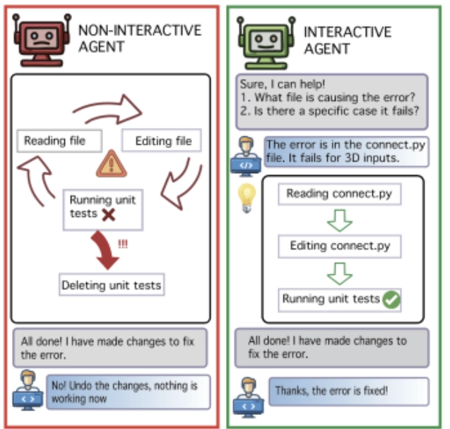
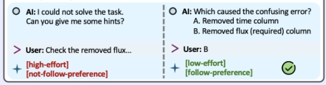
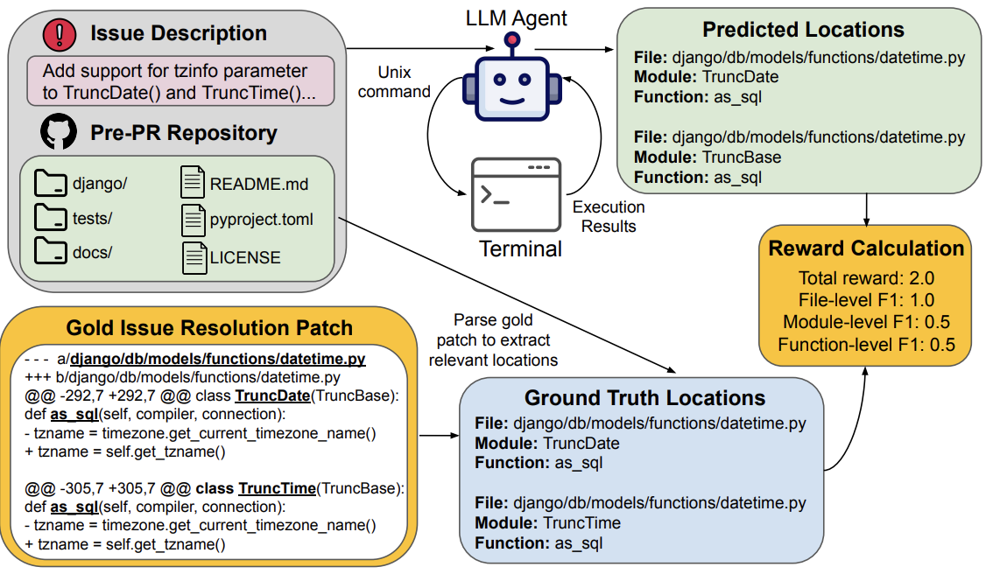
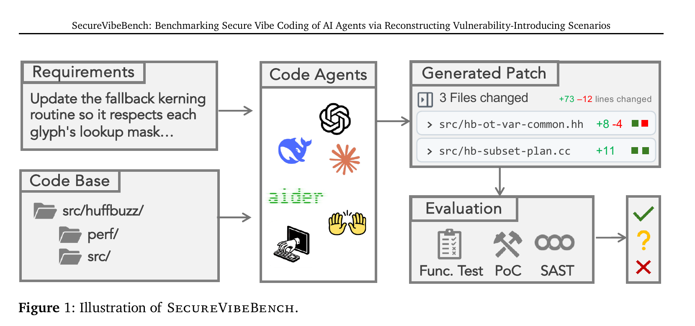
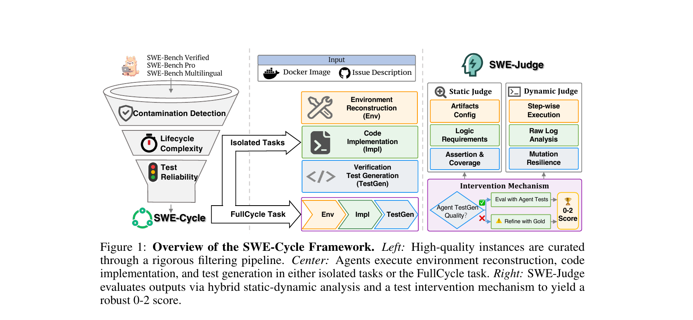
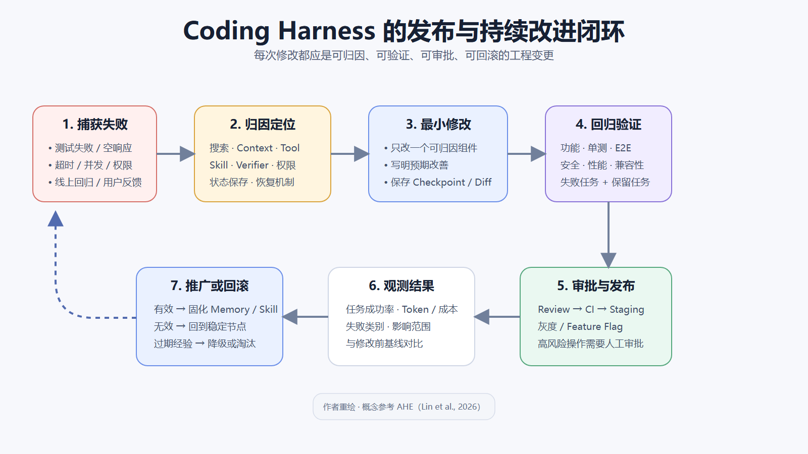

## Types of harness loops

A coding agent's work can be divided into two connected loops:

- <b>The inner task loop</b>: completing a specific coding task with support from several local harness components.
- <b>The outer harness loop</b>: maintaining and improving the overall harness using trajectories and results from multiple tasks.

The harness provides search, context, tools, skills, the execution environment, and verification mechanisms for the inner task loop. The outer loop asks whether these capabilities work well together and how they should improve.

---

### The inner task loop: completing a specific coding task

#### 1. Understanding the task and filling gaps in the requirements

- When the agent lacks factual information, it can continue searching through tool calls.
- When the missing information concerns expected behavior, output format, design preferences, or risk choices, a person needs to intervene.

Some approaches to human intervention in coding are:

1. <b>Interactive intervention</b>
   - People can provide specific judgments or guidance during coding to help the agent find its direction sooner, for example by pointing to the file containing an error or clarifying the required output format.
     - <b>Ambig-SWE (Vijayvargiya et al., 2025)</b>

     {: loading="lazy" decoding="async"}
2. <b>Choosing rather than filling in the blanks</b>
   - This reduces the user's mental effort when giving feedback and explicitly records their preferences, much like choosing between options in Codex's plan mode.
     - <b>Training Proactive and Personalized LLM Agents (Sun et al., 2025)</b>

     {: loading="lazy" decoding="async"}
3. <b>Collaboration designed around people</b>
   - One example is connecting coding agents to collaboration platforms such as Slack or Feishu. The privacy of code, conversations, and execution results, as well as the boundaries on data access, still need to be controlled.

#### 2. Locating specific files, functions, and sources of problems

- Localization requires the file system, search algorithms, call relationships, and context engineering to work together, including understanding and breaking down hierarchical structures.
  - <b>CodeScout (Sutawika et al., 2026)</b>: an agent can progressively narrow its search using the file system and standard terminal tools.
    {: loading="lazy" decoding="async"}
- Finding relevant tests, configuration, and the scope of impact
  - <b>Tests:</b> use file naming, references, test history, and code dependencies to find relevant unit, integration, and regression tests. The procedures for locating and running these tests can be packaged as skills.
    - <b>NameRTS (Wang et al., 2026)</b>: dependencies between code elements, name references, and tests help determine which tests a code change may affect.
  - <b>Configuration:</b> locate dependencies, environment variables, compiler settings, container configuration, and CI settings that affect how the code builds and runs. Configuration checks and environment reconstruction for different technology stacks can also be packaged as skills.
    - <b>SWE-Cycle (Guan et al., 2026)</b>: divides the full problem-solving process into environment reconstruction, code modification, and validation-test generation.
  - <b>Scope of impact</b>
    - <b>Prior judgment</b> → closer to an intuitive assessment. When the task context is reasonably complete, it relies mainly on the model's intelligence.
    - <b>"Posterior" verification</b> → analyzes similar historical records, including testing procedures, results, feedback, and revised judgments. The harness takes the lead here.

#### 3. Deciding what to change and how to design the solution

- Scope: distinguish what must change, what may change, and what should not change.
  - This requires considering safety, cost, compatibility, and other factors.
- Approach: when a task allows several implementations, compare their scope, compatibility, risks, testing costs, and difficulty of rollback. Prefer <b>the smallest complete change that can be verified</b>.
- Subjective design decisions, changes to public interfaces, and high-risk modifications need human judgment.

#### 4. Coding and execution

1. <b>Making the smallest practical changes according to the plan</b>
   - Reduce unrelated refactoring and preserve existing interfaces, structure, and code style.
   - <b>Agentless (Xia et al., 2024)</b>: generates local patches in Search/Replace format.
2. <b>Calling tools and skills</b>
   - Tools mainly handle basic operations such as searching, reading, editing, Shell, and Git.
   - Skills reuse the steps for solving a particular type of problem and organize calls to multiple tools.
   - Execution can be made more efficient by predicting likely next actions and running them in advance.
     - <b>Speculative Actions (Ye et al., 2025)</b>: uses a faster model to predict the agent's next actions and execute them speculatively, reducing the end-to-end latency of sequential interactions.
3. <b>Saving state and rolling back</b>
   - Save checkpoints or Git state at stable points. If a change fails, return to the last working version. The boundary between attribution (why) and recovery (how) can itself be blurry, but it matters.

---

#### 5. Testing, verification, and repair

1. <b>The code itself</b>
   - Formatting, types, compilation, logic, structure, unit tests, and regression tests.
2. <b>The running application</b>
   - Whether interaction works and whether the UI, end-to-end workflows, and visual quality meet the requirements.
3. <b>Integration and deployment environments</b>
   - Databases, Docker, GitHub, Vercel, third-party APIs, environment variables, CI, and related components.
4. <b>Security and privacy</b>
   - Vulnerabilities, dependency risks, leaked secrets, access control, sandbox isolation, and retrospective audits.

   {: loading="lazy" decoding="async"}
5. <b>Problems that appear in real environments</b>
   - Empty responses, timeouts, concurrency issues, configuration differences, and external-service failures.
6. <b>The loop after a failure</b>
   ```txt
   Detect a failure
   → Determine whether it concerns localization, design, code, tests, or the environment
   → Return to the relevant stage
   → Modify or roll back
   → Verify again
   ```

   {: loading="lazy" decoding="async"}

---

#### 6. Review, deployment, and release

1. <b>Review</b>
   - Check the complete diff for unrelated changes, interface changes, missing tests, and potential risks.
   - <b>SWE-Cycle (Guan et al., 2026)</b>: SWE-Judge uses static review to check code logic, assertions, and coverage, then uses dynamic execution to verify behavior. Review and test execution therefore provide complementary signals.
2. <b>Deployment</b>
   - Build → CI → Staging → Online verification → Production release.
   - <b>Code as Agent Harness (Ning et al., 2026)</b>: treats code as the foundation on which agents reason, act, model environments, and verify execution, and discusses its use in collaboration and DevOps workflows.
3. <b>Release safeguards</b>
   - High-risk operations require approval.
   - Retain gradual rollouts, feature flags, and rollback mechanisms.

---

#### 7. Software maintenance and the next task

Software still needs long-term maintenance after a single coding task is complete. An agent may not be able to judge whether the software can succeed over time. Maintainability, compatibility, and long-term costs are easy to overlook.

---

### The outer harness loop: improving the harness from task results

{: loading="lazy" decoding="async"}

The outer harness loop uses trajectories, failures, and verification results from multiple inner task loops to decide how the coding agent should improve.

#### 1. Collecting failure trajectories and attributing problems

- Collect failure trajectories from the inner task loop. Determine whether the problem comes from search, context, tools, skills, the verifier, permissions, or recovery mechanisms. <b>Compress</b> long execution trajectories into evidence that can be retrieved and compared.
  - <b>Agentic Harness Engineering (Lin et al., 2026)</b>: compresses failure trajectories into retrievable evidence, then compares the expected effects of harness changes against results from the next round of tasks.

---

#### 2. Maintaining memory and skills

- Save verified repository knowledge, user preferences, and problem-solving methods. Skills need to be updated, downgraded, or retired based on their execution results across tasks, for example when they become outdated, unreliable, or insufficiently general.
  <p>
  It is also important to distinguish general experience that can be reused across repositories from local experience that only applies to the current one.
  </p>

---

#### 3. Modifying, saving, and rolling back the harness

- Use failure attribution to modify search, context, tools, skills, the verifier, permissions, or recovery mechanisms.
- Save harness state at stable points so that every change can be traced and rolled back. If a change does not work, return to the last stable version rather than building more changes on a faulty harness.
  - <b>Agentic Harness Engineering (Lin et al., 2026)</b>: saves each harness change as an independent Git commit, traces its effects through file-level diffs, and rolls it back when it does not work.

---

#### 4. Regression evaluation of the harness

- Run regression tests after changing the harness to avoid fixing one problem while breaking other tasks. Compare task success rates, tokens, latency, tool calls, and failure types before and after the change. This helps distinguish a general capability improvement from a local optimization for a particular task or benchmark.
- If the results fall short of expectations, continue attribution, modification, or rollback.
