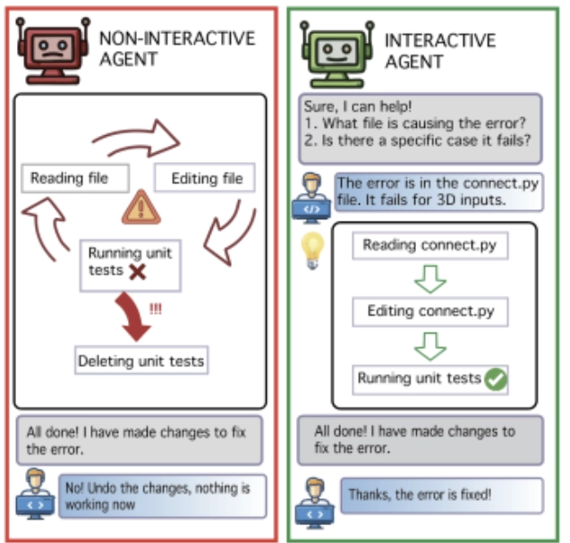
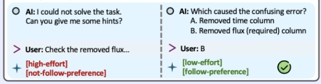
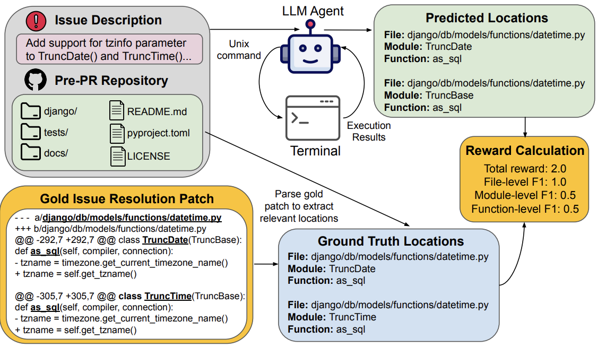
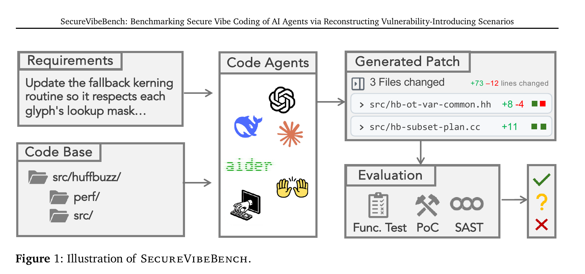
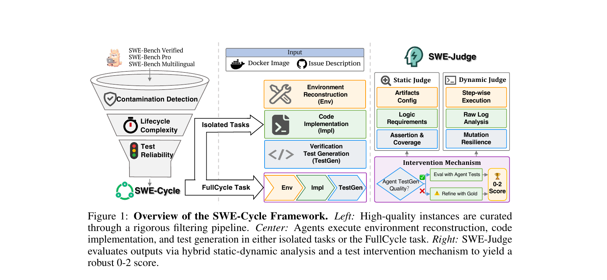
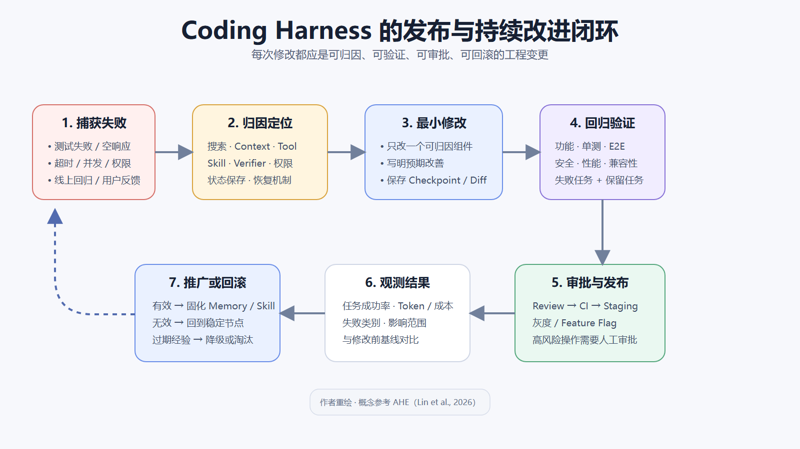

## Harness分类

Coding Agent 的工作可以分为两个相互连接的循环：

- <b>任务内环</b>：在 多个局部的Harness 的支持下，完成一次具体的 Coding 任务。
- <b>Harness 外环</b>：根据多个任务产生的轨迹和结果，持续维护和改进整体的Harness。

任务内环中的搜索、上下文、Tool、Skill、执行环境和验证机制都由 Harness 提供；Harness 外环更像是判断这些能力总体是否有效，以及应该如何改进。

---

### 任务内环：完成一次具体的 Coding 任务

#### 1. 理解任务以及补全需求

- 在agent信息不足时（客观缺少），可以使用工具调用继续搜索。
- 当缺少的是预期行为、输出格式、设计偏好或风险选择时，需要人干预。

人为干预在 Coding 中的一些方法和特点有：

1. <b>交互式介入</b>
   - 通过在 Coding 过程中介入具体的人为判断或引导，使 Coding Agent 尽快找到方向，例如指出具体错误的文件位置或者输出格式。
     - <b>Ambig-SWE（Vijayvargiya et al., 2025）</b>

     {: loading="lazy" decoding="async"}
2. <b>做选择而不是做填空</b>
   - 减少 User 在 Feedback 中的 mental effort，并且明确地记录用户偏好，和使用 Codex 计划模式时做选择类似。
     - <b>Training Proactive and Personalized LLM Agents（Sun et al., 2025）</b>

     {: loading="lazy" decoding="async"}
3. <b>人类工程学上的协作</b>
   - 例如将 Coding Agent 接入 Slack、飞书等协作平台。但代码、对话和执行结果的隐私性以及数据边界需要控制。

#### 2. 定位具体文件、函数以及问题来源

- 在定位上，需要文件系统、搜索算法、调用关系以及上下文工程（层级结构理解/拆分）的配合完成。
  - <b>CodeScout（Sutawika et al., 2026）</b>：Agent 可以通过文件系统和标准终端工具逐步缩小搜索范围。
    {: loading="lazy" decoding="async"}
- 找相关测试、配置和影响范围
  - <b>测试：</b>根据文件命名、引用关系、测试历史和代码依赖，找到相关的单元测试、集成测试以及回归测试。而具体的测试定位和执行流程可以封装成 Skill。
    - <b>NameRTS（Wang et al., 2026）</b>：通过代码元素、名称引用和测试之间的依赖关系，判断一次代码修改可能影响哪些测试。
  - <b>配置：</b>找到影响代码构建和运行的依赖、环境变量、编译配置、容器配置以及 CI 配置。不同技术栈下的配置检查和环境重建流程也可以封装为 Skill。
    - <b>SWE-Cycle（Guan et al., 2026）</b>：将完整的问题解决过程拆分为环境重建、代码修改和验证测试生成。
  - <b>影响范围</b>
    - <b>先验判断</b> → 更像直觉判断，在任务的上下文比较完整的情况下主要依赖于模型智能。
    - <b>”后验”验证</b> → 根据类似的历史记录（涵盖测试过程、结果、反馈、修正判断等）进行分析，harness为主导

#### 3. 明确代码修改的主次以及设计方案

- 范围：区分必须修改、可以修改和不应该修改的内容。
  - 需要安全性、成本、兼容性等多方面的考虑。
- 方式：对存在多种实现方式的任务，比较不同方案的修改范围、兼容性、风险、测试成本以及回滚难度。优先选择<b>能够被验证的最小完整修改</b>。
- 而主观设计、公共接口变化或者高风险修改需要引入人为判断。

#### 4. 编码与执行

1. <b>按照计划进行尽量小的修改</b>
   - 减少无关重构，保持已有接口、结构和代码风格。
   - <b>Agentless（Xia et al., 2024）</b>：使用 Search/Replace 格式生成局部补丁。
2. <b>Tool 和 Skill 的调用</b>
   - Tool 主要负责搜索、读取、编辑、Shell、Git 等基础操作。
   - Skill 负责复用某一类具体问题的解决步骤，并组织多个 Tool 的调用。
   - 在执行效率上，可以预测并提前执行可能的后续动作。
     - <b>Speculative Actions（Ye et al., 2025）</b>：使用较快模型预测 Agent 接下来可能采取的动作，并提前进行推测执行，从而降低串行交互带来的端到端延迟。
3. <b>状态保存以及回滚</b>
   - 在稳定节点保存 Checkpoint 或 Git 状态。修改失败时回到上一个可以正常运行的版本。归因（why）和恢复（how）的边界本身可能是模糊但是非常重要的。

---

#### 5. 测试、验证以及修复

1. <b>代码本身</b>
   - 格式、类型、编译、逻辑、结构、单元测试和回归测试。
2. <b>应用运行</b>
   - 是否能够正常交互，UI、端到端流程以及视觉质量是否符合要求。
3. <b>集成和部署环境</b>
   - 数据库、Docker、GitHub、Vercel、第三方 API、环境变量和 CI……
4. <b>安全以及隐私</b>
   - 漏洞、依赖风险、Secret 泄露、权限控制、沙箱隔离和事后审计。

   {: loading="lazy" decoding="async"}
5. <b>真实环境产生的问题</b>
   - 空响应、超时、并发问题、配置差异以及外部服务失败。
6. <b>失败后的 Loop</b>
   ```txt
   发现失败
   → 判断是定位、设计、代码、测试还是环境问题
   → 返回对应阶段
   → 修改或回滚
   → 再次验证
   ```

   {: loading="lazy" decoding="async"}

---

#### 6. Review、部署以及发布

1. <b>Review</b>
   - 检查完整 Diff、无关修改、接口变化、测试遗漏以及潜在风险。
   - <b>SWE-Cycle（Guan et al., 2026）</b>：SWE-Judge 使用静态审查检查代码逻辑、断言和覆盖范围，再使用动态执行验证行为，说明 Review 与运行测试提供的是互补信号。
2. <b>部署</b>
   - Build → CI → Staging → 线上验证 → 正式发布。
   - <b>Code as Agent Harness（Ning et al., 2026）</b>：从 Harness 的视角，将代码视为 Agent 进行推理、行动、环境建模和执行验证的基础，并讨论其在协作和 DevOps 等工作流中的应用。
3. <b>发布保护</b>
   - 高风险操作需要审批。
   - 保留灰度发布、Feature Flag 和 Rollback。

---

#### 7. 软件维护以及进入下一轮任务

单次 Coding 任务完成后，软件仍然需要长期维护。Agent 本身不一定具备判断软件能否长期成功的能力，容易忽视可维护性、兼容性和长期成本等问题。

---

### Harness 外环：根据任务结果持续改进 Harness

{: loading="lazy" decoding="async"}

Harness 外环是根据多个任务内环产生的轨迹、失败和验证结果，判断 Coding Agent 应该如何改进。

#### 1. 收集失败轨迹以及问题归因

- 收集任务内环中的失败轨迹。判断问题来自 Search、Context、Tool、Skill、Verifier、权限还是恢复机制。将较长的执行轨迹<b>压缩</b>为可以检索和比较的证据。
  - <b>Agentic Harness Engineering（Lin et al., 2026）</b>：把失败轨迹压缩为可检索证据，再将 Harness 修改的预期效果与下一轮任务结果进行对比。

---

#### 2. 维护 Memory 和 Skill

- 保存经过验证的仓库知识、用户偏好和问题解决方法。Skill 需要根据不同任务中的执行结果不断更新、降级或者淘汰（过期、效果不稳定、不泛用）。
  <p>
  另外需要区分能够跨仓库复用的通用经验和只适用于当前仓库的局部经验。
  </p>

---

#### 3. 修改、保存以及回滚 Harness

- 根据失败归因修改 Search、Context、Tool、Skill、Verifier、权限或者恢复机制。
- 在稳定节点保存 Harness 状态，使每次修改都可以被追踪和回滚。修改无效时回到上一个稳定版本，避免继续在错误的 Harness 上叠加修改。
  - <b>Agentic Harness Engineering（Lin et al., 2026）</b>：把每次 Harness 修改保存为独立 Git commit，以文件级 Diff 追踪效果，并在修改无效时回滚。

---

#### 4. Harness 回归评估

- 修改 Harness 后重新进行回归测试，避免只解决一个问题，却破坏其他任务。将 Harness 修改前后的任务成功率、Token、延迟、Tool 调用和失败类型进行对比，从而判断改进是通用能力提升，还是只针对某个任务或 Benchmark 的局部优化。
- 如果结果没有达到预期，则继续归因、修改或者回滚。


