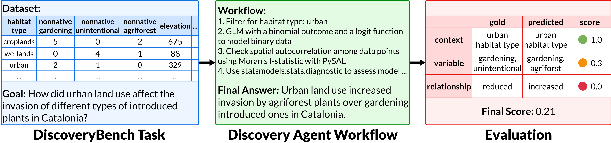
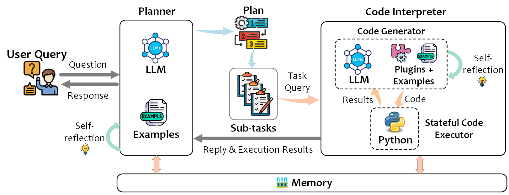
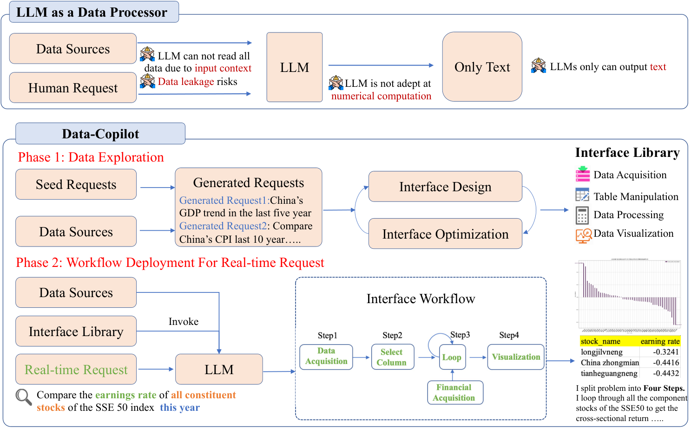
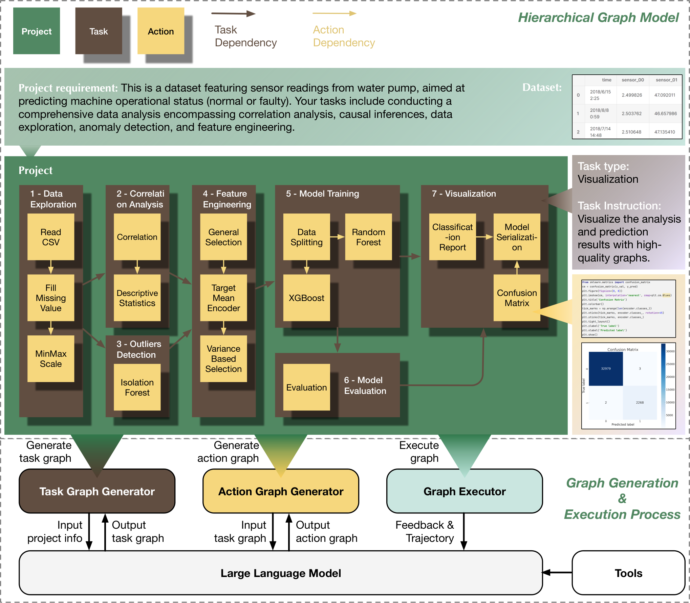
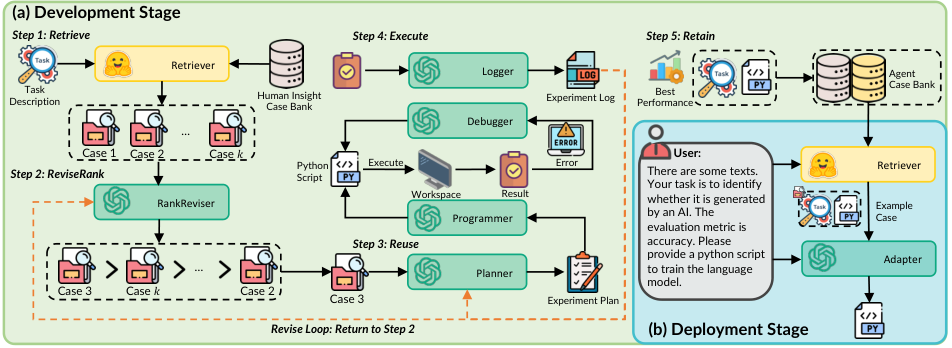
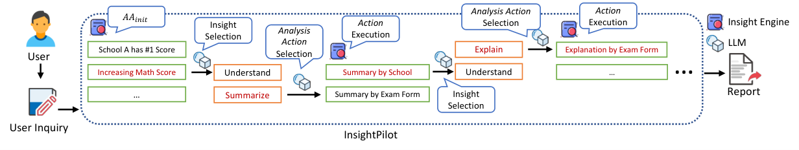
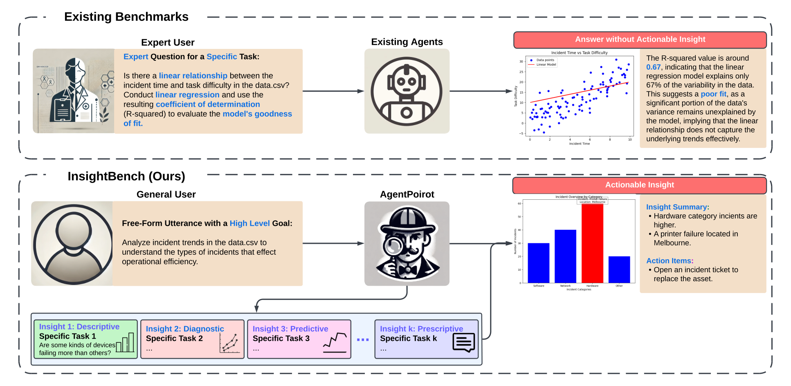
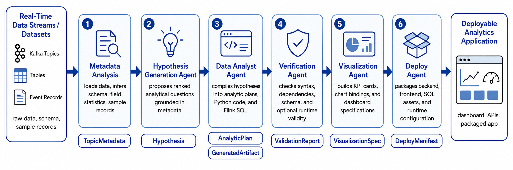

## 1. The basic structure of an EDA harness

An EDA agent starts with a fairly fixed kind of input: a data table and a broad question. The expected output is a set of usable insights. A general workflow looks roughly like this:

<b>Understand intent → Ground the analysis in data → Plan the exploration → Execute computations → Synthesize insights → Write a narrative report</b>

Compared with the auto-research and coding systems discussed earlier, EDA seems to <b>combine their capabilities</b>. During execution, whether the code runs and whether its results are correct are coding problems. During insight generation, <b>there is no objective right or wrong answer</b> to what makes an insight valuable, much like idea generation in research.

For example, <b>DiscoveryBench (Majumder et al., 2024)</b> turns data-driven discovery into an evaluable task. Each task is reconstructed from a real paper. Given a dataset, metadata, and a natural-language objective, systems are scored by matching at three levels: context, variable, and relationship. Here is one of its actual tasks:

{: loading="lazy" decoding="async"}

<i>The objective and data appear on the left, the statistical and semantic reasoning needed to solve the task in the middle, and the layered scoring of results on the right.</i>

## 2. Four current implementation approaches

Before 2023, the approach was <b>statistical heuristics</b>. In <b>QuickInsight (Ding et al., 2019)</b> and <b>MetaInsight (Ma et al., 2021)</b>, engineers defined a set of interestingness measures: fixed scoring rules specified in advance. The system exhaustively searched multidimensional subspaces for point anomalies, trends, and unimodal distributions, then grouped recurring patterns into generalities and exceptions. The limits are clear: <b>static rules do not capture business semantics</b>, and all the data must first be organized into a clean, wide table.

<b>2023 - 2024: controlled collaboration with LLMs.</b> Rapid advances in LLMs made them capable of acting as the brain of an EDA system. One approach assigns the LLM only intent interpretation and action selection, while a deterministic engine performs the calculations. <b>InsightPilot (Ma et al., 2023)</b> follows this approach, using QuickInsight and MetaInsight from the earlier phase as mining engines. Another approach lets the LLM generate restricted code directly and run experiments in a sandbox, as in TaskWeaver and LIDA.

<b>Today: compound agents.</b> This phase moves away from one-shot generation and linear workflows toward dynamic graphs, tree search, and autonomous iteration in persistent sandboxes. The focus of optimization shifts to the harness. Four main approaches follow.

### 2.1 Code first: compiling analysis into executable code

This is the mainstream approach. The LLM still does not access the data directly; it generates code that does.

<b>TaskWeaver (Qiao et al., 2023)</b> is a representative framework. A Planner breaks the user's request into subtasks. A Code Interpreter generates Python code with plugins and executes it in a stateful sandbox, then sends the results back to the Planner. Three design features matter: DataFrames can be passed directly as variables, examples and RAG plugins supply domain knowledge, and intermediate results persist across rounds.

{: loading="lazy" decoding="async"}

<b>Data-Copilot (Zhang et al., 2023)</b> adds an <b>interface layer</b> above the code. During an offline phase, the agent designs and optimizes its own set of interfaces for data retrieval, table operations, data processing, visualization, and other functions. Once deployed, the LLM responds to live requests by orchestrating those interfaces. The motivation is straightforward: if an LLM cannot read all the data because of limited context and attention, and is not good at arithmetic involving complex logic, let it work only with interfaces it has already defined. This seems to trade some exploratory potential, since the LLM is not directly involved, for more stable execution.

{: loading="lazy" decoding="async"}

### 2.2 Structured workflows: from linear pipelines to dynamic graphs

The intermediate results in EDA are data, not text. A change upstream can change everything downstream. Linear pipelines struggle with these dependencies, which motivates graphs.

<b>Data Interpreter (Hong et al., 2024)</b> uses hierarchical graphs. The Task Graph Generator <b>breaks requirements into task nodes with dependencies</b>. The Action Graph Generator expands each task into action nodes, and the Graph Executor runs them node by node. Dynamic node updates are important: when a node fails or the data changes, the system <b>modifies part of the graph and reruns it</b>.

{: loading="lazy" decoding="async"}

<b>DS-Agent (Guo et al., 2024)</b> changes a different part of the system: memory rather than search. Using case-based reasoning (CBR), it builds a case library from Kaggle winners' technical reports and high-scoring code. During development, it follows a Retrieve, ReviseRank, Reuse, Execute, Retain loop. At deployment, this is simplified to Adapt.

{: loading="lazy" decoding="async"}

### 2.3 Insight engines: navigating a predefined insight space

<b>InsightPilot (Ma et al., 2023)</b> formalizes analysis actions as AA: <b>Insight → Insight\\</b>. <i>Each action starts from an existing insight and produces a set of new insights, with two special actions for initialization and backtracking.</i> The LLM selects actions and insights; an underlying insight engine performs the calculations. A second-order approximation then ranks the results for high individual quality and low redundancy. The paper identifies two major obstacles to automated EDA at the time: hallucinations and limited context capacity, since a single table can contain millions of cells. The insight engine keeps both problems outside the LLM.

{: loading="lazy" decoding="async"}

<i>The InsightPilot workflow. Selected insights and actions are highlighted in red.</i>

<b>InsightBench (Sahu et al., 2024)</b> provides an evaluation framework for this approach. It introduces 100 business datasets, each with human-reviewed, multistep insights organized into four levels: descriptive, diagnostic, predictive, and prescriptive. Its baseline agent, <b>AgentPoirot</b>, progresses through a loop of recommending questions and extracting insights from the answers. The evaluator uses LLaMA-3 for bidirectional scoring. The contribution is that, given an objective, the agent follows an entire insight chain and returns recommendations for action.

{: loading="lazy" decoding="async"}

### 2.4 Open-ended discovery and real-time analysis: from answering questions to finding them

The first three approaches assume that a question has already been provided. After 2025, that assumption is also removed.

<b>AutoDiscovery (Agarwal et al., 2025)</b> explores without a predefined objective: the agent generates its own hypotheses and decides which experiment to run next, somewhat like auto-research. This creates the same difficulty as idea generation in a research harness: <b>interestingness is too subjective to serve as a reward</b>. Its solution is Bayesian surprise. It takes the difference between the LLM's prior belief in a hypothesis and its posterior belief after an experiment as the reward. Surprisal drives MCTS search, while LLM-based hierarchical clustering removes duplicates.

<b>Discovery Agents for Real-Time Analytics (Rossiello & Subramanian, 2026)</b> moves the discovery workflow to streaming data. The stream first undergoes metadata analysis and is converted into structured metadata. It then passes through five agents for hypothesis generation, data analysis, validation, visualization, and deployment. Each stage produces a contract-defined artifact: Hypothesis, AnalyticPlan, ValidationReport, VisualizationSpec, or DeployManifest. The final output is a deployable monitoring application. Analysis becomes a persistent system rather than a one-off session, with insights changing as the stream changes.

{: loading="lazy" decoding="async"}

## 3. Four runtime layers

Looking inside individual systems, harnesses in the compound-agent phase tend to have these four layers:

| Layer | How it works | Examples |
| --- | --- | --- |
| Data access | Compress millions of rows into statistical profiles before adding them to context: means, quantiles, and missingness rates for numerical columns; cardinality and top-K values for categorical columns. Structural anchors compress nonstandard reports by up to 25 times. | SpreadsheetLLM, BRTR |
| Planning | A single ReAct chain can accumulate cascading errors beyond five steps. Hierarchical graphs or MCTS provide alternatives, with backtracking when several steps yield no information gain. | QUIS, R&D-Agent, AFlow |
| Execution | Firecracker microVMs provide hardware-level isolation and cold starts on the order of hundreds of milliseconds. Persistent Jupyter kernels avoid rereading DataFrames from disk. Errors are repaired by patching only the affected lines. | E2B, Modal |
| Insights | An insight is a triple of subspace, pattern type, and interestingness score. Pareto filtering removes marginal perturbations. Multimodal LLMs review charts, and defective charts are redrawn. | LIDA, MatPlotAgent |

## 4. How evaluation has evolved

| Benchmark | Date | Evaluation approach | Key figures |
| --- | --- | --- | --- |
| InfiAgent-DABench (Hu et al.) | 2024-01 | Single-round CSV question answering. Format-prompting turns open questions into closed formats that can be scored automatically. | 257 questions / 52 CSVs; GPT-4 78.99%, AutoGen(GPT-4) 71.48% |
| SpreadsheetBench (Ma et al.) | 2024-06 | Precise, multistep operations on nonstandard workbooks with merged cells, nested headers, and formula dependencies. | 912 real workbooks from forums; online judging uses multiple test cases and dynamic assertions. |
| InsightBench (Sahu et al.) | 2024-07 | Multistep business insights with predefined insight chains and an open-source evaluator using bidirectional scoring. | 100 datasets; AgentPoirot outperforms a single-query Pandas Agent. |
| DiscoveryBench (Majumder et al.) | 2024-07 | Data-driven discovery through hypothesis search and validation, scored by matching at three levels. | 264 tasks / 6 domains; the best system reaches only 25%. |
| DSBench (Jing et al.) | 2024-09 | Realistic tasks with long context, multiple modalities, and multiple tables (ModelOff + Kaggle). | 466 analysis + 74 modeling tasks; the best agent solves only 34.12% of analysis tasks. |
| DABstep (Egg et al.) | 2025-06 | Real business tasks requiring multistep reasoning (Adyen), with objective scoring of factual questions. | 450+ tasks, 84% hard; the strongest agent reaches only 14.55% on hard tasks. |
| DataClawBench (Zhang et al.) | 2026-05 | Low prior knowledge: schemas and cleaning rules are hidden, native noise is retained, and intermediate milestones support diagnosis. | About 2.06 million cross-domain records and 492 multistep tasks. |
| DataGovBench (Hasegawa et al.) | 2026-07 | Government open data with external policy knowledge, testing narrative depth. | Millions of records across tables; two tasks, Table QA + Table Insight. |
| InsightEval (Zhu et al.) | 2026 | Expert-curated evaluation with Insight F1 and novelty, revisiting evaluation itself. | 1000 insights / 6 types; F1 aligns more closely with human ratings than Insight Recall. |

Arranged chronologically, these nine benchmarks trace a downward line of increasing difficulty:

DABench shows that open-ended analysis can be scored automatically.

DiscoveryBench requires a complete hypothesis-validation process.

DABstep adds multistep reasoning across documents.

DataClawBench hides prior knowledge and asks agents to find chains of evidence in noisy data.

Scoring can be divided into three levels:

1. An LLM judge scores outputs against a <b>list of facts</b>. <b>AgentGym2 (Xi et al., 2026)</b> reports 98.9% agreement with human experts.
2. <b>Process</b>: <b>DataClawBench (Zhang et al., 2026)</b> uses <b>intermediate milestones</b> to locate where an agent fails, whether in retrieval, cleaning, or induction.
3. Stability: <b>AgentGym2</b> measures both Pass@k and Pass\^k. In supply-chain simulations, <b>Łabędzki et al. (2026)</b> make a related point: beyond average scores, <b>repeatability</b> determines whether an agent can be trusted.

Among the remaining two, InsightEval examines the evaluator itself. Insight Recall <b>rewards duplicate insights and inflates scores</b>; replacing it with Insight F1 produces more reasonable judgments.

## 5. Academia and industry: exploring the ceiling and protecting the floor

The two sides pursue different things. Academia focuses on the upper limits of cognitive autonomy, while industry emphasizes minimum guarantees of safety and compliance.

- Academic systems generally assume white-box exploration. For example, <b>Data Interpreter (Hong et al., 2024)</b> and AIDE allow an agent to write arbitrary Python and persist through dozens of error-and-retry rounds. Industry systems such as Databricks Genie and Microsoft Fabric put governance first. An LLM cannot run unrestricted scripts on enterprise data: natural language must first become validated SQL or a restricted DSL, then pass controls such as Unity Catalog permissions and row- and column-level masking.

| Dimension | Academia (Data Interpreter, AIDE) | Industry (Genie, Fabric ecosystem) |
| --- | --- | --- |
| Optimization objective | Planning depth and exploratory potential | Compliance, reproducibility, and low latency |
| Data environment | Local files and open datasets | Lakehouses with unified metadata and ACLs |
| Execution strategy | Freely generate full-featured Python | Prefer reviewable SQL |
| Anti-hallucination mechanism | Prompt-based self-reflection and traceback-driven iteration | Strong typing in the semantic layer, AST validation, and outbound blocking |
