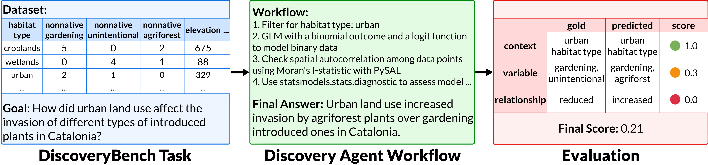
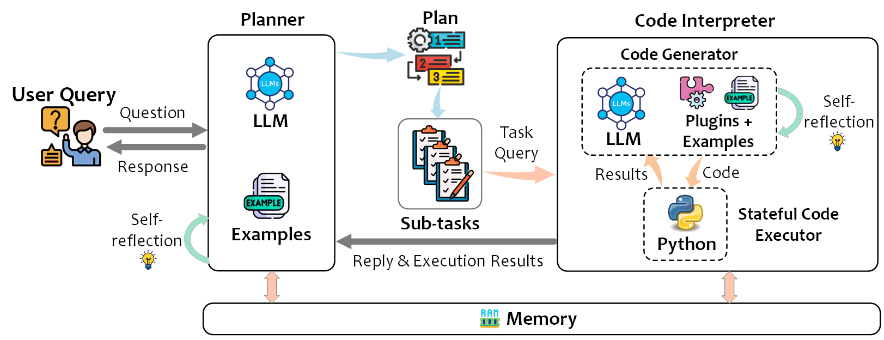
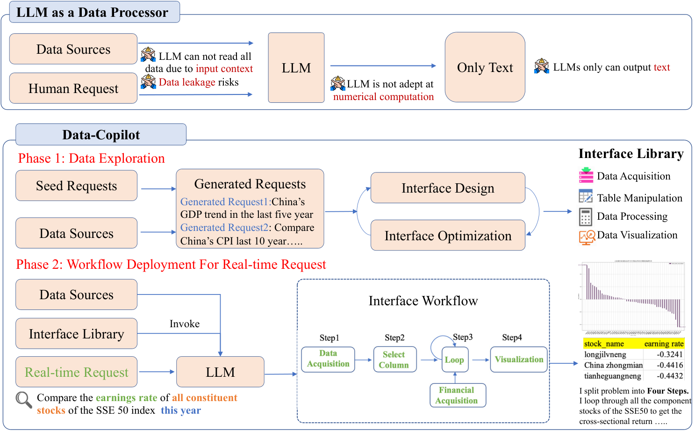
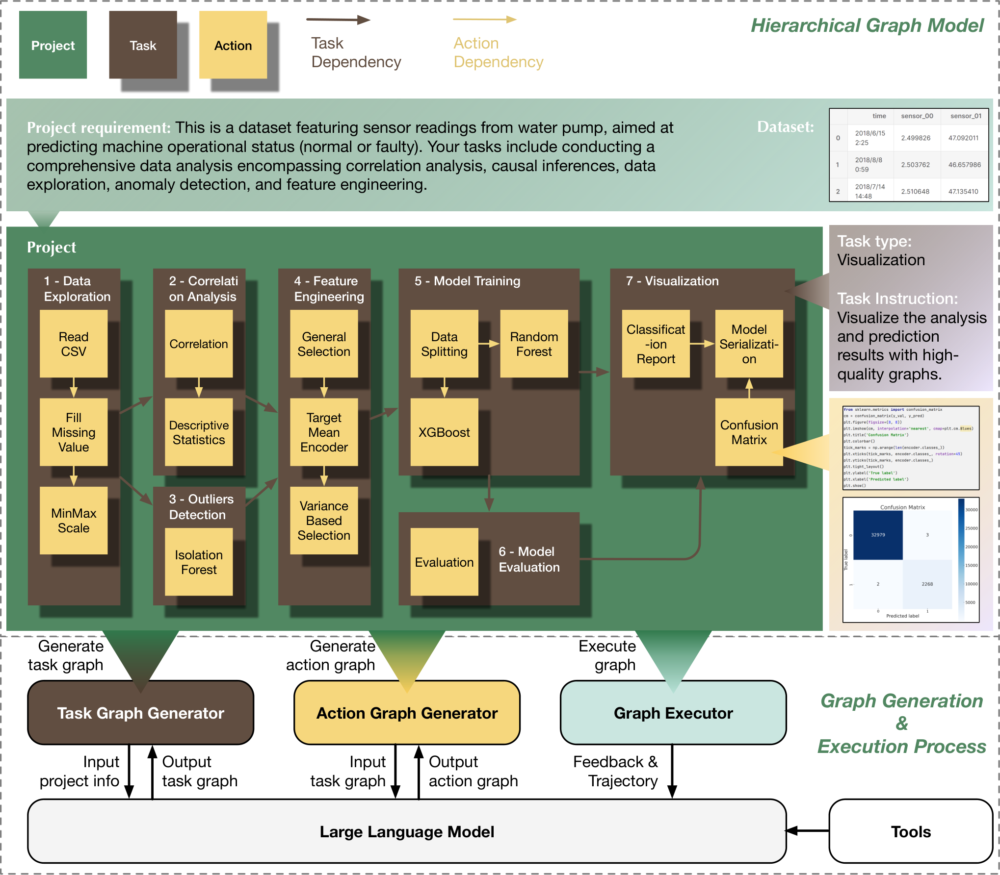
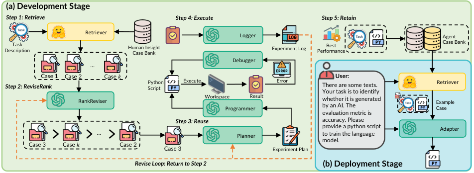
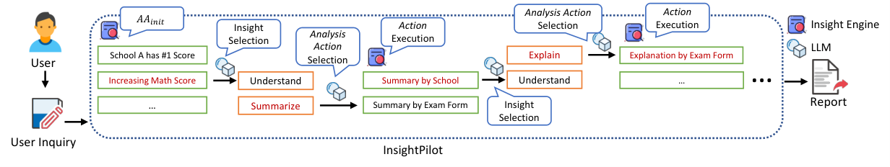
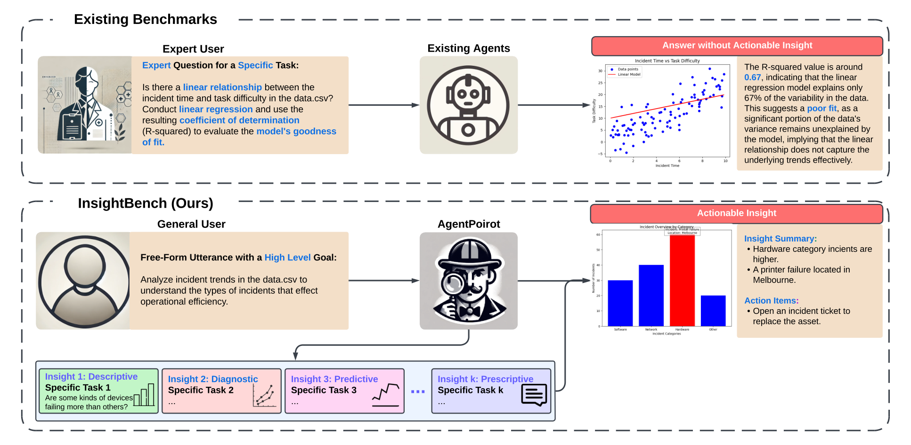
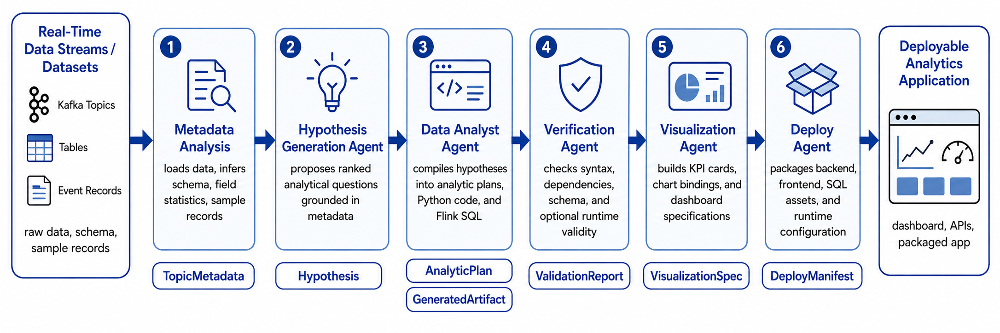

## 1. EDA Harness 的基本框架

EDA agent 的输入本身是高度固定的：一个数据表和一个粗略的方向性问题，而期望的输出是一组【能用的洞察(insight)】。通用框架构成大概是：

<b>意图理解 → 数据 grounding → 探索规划 → 执行计算 → 洞察综合 → 叙事报告</b>

对比之前auto-research和coding系列来说，EDA像是<b>把这两个的能力加起来</b>。在执行段，代码能不能跑+结果数据是否正确，和 coding 一个性质。在洞察段，什么算有价值的洞察<b>没有客观对错</b>，和 research 里的 idea 生成是一个性质。

例如，<b>DiscoveryBench（Majumder et al., 2024）</b> 把「数据驱动的发现」做成了可评测的任务，每个任务从一篇真实论文反推，给定数据集、元数据和一句自然语言目标，按 context、variable、relationship 三层匹配进行打分。这里有它的一道真实任务：

{: loading="lazy" decoding="async"}

<i>左是目标和数据，中间是解题需要的统计与语义推理，右是结果分层次评分</i>

## 2. 目前的四条实现路线

2023 年以前是【<b>统计启发式</b>】。<b>QuickInsight（Ding et al., 2019）</b> 和 <b>MetaInsight（Ma et al., 2021）</b> 里，工程师预设一套「有趣性度量」（=事先设定好的打分死逻辑），系统拿着它在多维子空间里穷举点异常、趋势、单峰分布，把同样的模式归纳为共性&特例。这样做的天花板很明显，<b>静态的规则并不包括业务语义</b>，所有数据还得先组织成一张干净的宽表。

<b>2023 - 2024 年：【LLM 受控协同阶段】。</b>LLM的快速发展，让他有了作为EDA 系统“大脑”的能力。一条路是让 LLM 只负责理解意图和选动作，计算交给确定性引擎，<b>InsightPilot（Ma et al., 2023）</b> 就是这么做的，调用了上一阶段的QuickInsight、MetaInsight作为挖掘引擎；另一条路是让 LLM 直接生成受限代码跑沙箱实验，代表作有TaskWeaver、LIDA 。

<b>目前：【复合智能体阶段】。</b> 这个阶段不再延续单次生成与线性工作流，而换成动态图、树搜索和常驻沙箱里的自主迭代，把优化重心转移到harness侧，其中主要方法分为以下四种：

### 2.1 代码优先，把分析编译成可执行代码

主流做法。LLM 仍然不直接接触数据，生成代码去接触。

<b>TaskWeaver（Qiao et al., 2023）</b> 是这条路的框架化代表。Planner 把用户请求拆成子任务，Code Interpreter 生成带插件的 Python 代码，放进有状态的沙箱执行，结果再回流给 Planner。设计的主要三个特点是：DataFrame 能直接当变量传输，领域知识靠示例和RAG插件注入，中间的结果能够跨轮保留。

{: loading="lazy" decoding="async"}

<b>Data-Copilot（Zhang et al., 2023）</b> 最主要的特点是在代码层之上加了一层<b>接口层</b>。在离线阶段先让 agent 自己设计、自己优化一套接口，涵盖数据获取、表操作、数据处理、可视化……；上线后如果收到实时请求，LLM 只做接口编排。这样的动机很直接，既然LLM读不全数据（上下文与注意力窗口有限），也不擅长算数（复杂逻辑的），那就让它只面对自己定义过的接口。不过这条路像是牺牲探索上限（因为LLM本身不直接参与）换取执行过程的稳定。

{: loading="lazy" decoding="async"}

### 2.2 结构化工作流，线性 pipeline → 动态图

EDA 任务的中间结果是数据，不是文本，上游动一步，下游全变。线性 pipeline 扛不住这种联动，于是有了图。

<b>Data Interpreter（Hong et al., 2024）</b> 用层次图建模。Task Graph Generator <b>把需求拆成带依赖的任务节点</b>，Action Graph Generator 再把每个任务展开成动作节点，Graph Executor 逐节点执行。要紧的是动态节点更新，某个节点失败或数据变了，<b>局部改图重跑</b>。

{: loading="lazy" decoding="async"}

<b>DS-Agent（Guo et al., 2024）</b> 换了个“杠杆”，不动搜索，动记忆。它用案例推理（CBR）把 Kaggle 冠军方案的技术报告和高分代码收进案例库，开发阶段使用 Retrieve、ReviseRank、Reuse、Execute、Retain 一个循环，部署阶段简化成 Adapt。

{: loading="lazy" decoding="async"}

### 2.3 洞察引擎，在预置的洞察空间里导航

<b>InsightPilot（Ma et al., 2023）</b> 把分析动作形式化成 AA: <b>Insight → Insight\\</b><i>，每个动作从一个已有洞察出发，产出一组新洞察，另配初始化和回退两个特殊动作。</i>\*\LLM 负责选动作、选洞察，底下的洞察引擎负责算，最后按单条质量高、相互冗余低做二阶近似排序。论文点了当时自动化 EDA 的两大障碍，幻觉，和上下文放不下，一张表动辄几百万个单元格。洞察引擎的用处，就是把这两件事挡在 LLM 外面。

{: loading="lazy" decoding="async"}

<i>InsightPilot 流程，红色标出被选中的洞察与动作</i>

<b>InsightBench（Sahu et al., 2024）</b> 给这条路立了评测。首先是建立了100 个业务数据集，每个含有人工审校过的多步洞察，按描述、诊断、预测、处方四层组织。基线 agent <b>AgentPoirot</b> 靠「先推荐问题、再从答案里挖洞察」的循环推进，评估器用 LLaMA-3 双向打分。创新点在于给一个目标后，agent 自己走完整条洞察链，交出行动建议。

{: loading="lazy" decoding="async"}

### 2.4 开放式发现与实时化，从答题到自己找题

前三条路线都默认问题已经给定。2025 年之后，这个前提也被拿掉了。

<b>AutoDiscovery（Agarwal et al., 2025）</b> 做无目标探索，agent 自己生成假设、自己决定下一个实验（有点像autoresearch）。这样带来的麻烦和 research harness 的 idea 生成一模一样，<b>interestingness 太主观，当不了 reward</b>。它的办法是 Bayesian surprise，拿 LLM 对假设的先验信念，和实验结果出来后的后验信念，两者之间的认知差当 reward，用 surprisal 驱动 MCTS 搜索，再用 LLM 层次聚类去重。

<b>Discovery Agents for Real-Time Analytics（Rossiello & Subramanian, 2026）</b> 把发现工作流搬到流式数据上。数据流先进元数据分析、转成结构化元数据，再交给假设生成、数据分析、验证、可视化、部署五个 agent，每个环节的产出是契约化工件，Hypothesis、AnalyticPlan、ValidationReport、VisualizationSpec、DeployManifest，最后得到一个可部署的监控应用。分析从一次性会话变成常驻系统，数据在流上变，洞察跟着变。

{: loading="lazy" decoding="async"}

## 3. Runtime 的四层解剖

把单个系统拆开看，复合智能体阶段的 Harness 都差不多是这四层：

| 分层 | 怎么干 | 代表 |
| --- | --- | --- |
| 数据接入 | 百万行压成统计画像再进上下文（数值列留均值、分位数、缺失率，分类列留基数和 top-K）；非标准报表靠结构锚点压缩，能压 25 倍 | SpreadsheetLLM、BRTR |
| 规划 | ReAct 单链超过五步就级联出错；出路是层次图或 MCTS，多步不见信息增益就回溯 | QUIS、R&D-Agent、AFlow |
| 执行 | Firecracker microVM 硬件级隔离，冷启动百毫秒级；Jupyter 内核常驻，DataFrame 不重读盘；报错只补出错那几行 | E2B、Modal |
| 洞察 | 洞察是三元组【子空间、模式类型、有趣性评分】，帕累托过滤边缘扰动；图表交多模态 LLM 审，有缺陷重画 | LIDA、MatPlotAgent |

## 4. 评测的演进

| Benchmark | 时间 | 评测哲学 | 关键数字 |
| --- | --- | --- | --- |
| InfiAgent-DABench（Hu et al.） | 2024-01 | 单轮 CSV 问答，format-prompting 把开放问题转成封闭格式，机器可判 | 257 题 / 52 CSV；GPT-4 78.99%，AutoGen(GPT-4) 71.48% |
| SpreadsheetBench（Ma et al.） | 2024-06 | 非标准工作簿，合并单元格、嵌套表头、公式依赖下的多步精确操纵 | 912 个论坛真实工作簿，在线判题多用例动态断言 |
| InsightBench（Sahu et al.） | 2024-07 | 多步业务洞察，预置洞察链，开源评估器双向打分 | 100 数据集；AgentPoirot 胜过单查询式 Pandas Agent |
| DiscoveryBench（Majumder et al.） | 2024-07 | 数据驱动发现，假设搜索加验证，三层匹配打分 | 264 任务 / 6 领域；最佳系统仅 25% |
| DSBench（Jing et al.） | 2024-09 | 真实化，长上下文、多模态、多表（ModelOff + Kaggle） | 466 分析 + 74 建模任务；最佳 agent 仅解 34.12% 分析任务 |
| DABstep（Egg et al.） | 2025-06 | 真实业务多步推理（Adyen），事实型问题客观判分 | 450+ 任务，84% 为 hard；最强 agent hard 档仅 14.55% |
| DataClawBench（Zhang et al.） | 2026-05 | 低先验，藏 schema 与清洗规则，保留原生噪声，按中间里程碑诊断 | 约 206 万条跨域记录、492 道多步任务 |
| DataGovBench（Hasegawa et al.） | 2026-07 | 政府开放数据，外部政策知识，考叙事深度 | 百万级跨表记录；Table QA + Table Insight 双任务 |
| InsightEval（Zhu et al.） | 2026 | 专家精策，Insight F1 加 novelty 双指标，反过来修评测本身 | 1000 洞察 / 6 类型；F1 比 Insight Recall 更贴近人类评分 |

九个benchmark按时间排开，是一条一路向下（难度递增）的线：

DABench 证明开放式分析能机器判卷；

DiscoveryBench 要完整的假设验证；

DABstep 再加跨文档多步推理；

DataClawBench 把先验藏起来，让 agent 自己从噪声里找证据链。

打分可以分为三层：

1. LLM 裁判对着<b>事实清单</b>打分，<b>AgentGym2（Xi et al., 2026）</b> 实测与人类专家一致性 98.9%。
2. <b>过程</b>，<b>DataClawBench（Zhang et al., 2026）</b> 用<b>中间里程碑定位</b> agent 断在哪，检索、清洗还是归纳。
3. 稳定性，<b>AgentGym2</b> 同时测 Pass@k 和 Pass\^k，<b>（Łabędzki et al., 2026）</b> 在供应链仿真上补了一句，平均分之外，<b>可重复性</b>决定 agent 能不能被信任。

剩下的两个里面，InsightEval 查的是评测器自己。Insight Recall <b>奖励重复洞察、分数虚高</b>，换 Insight F1 后明显判断更加合理。

## 5. 学术界与工业界，赌上限和保底线

两边追求的东西不同，学术界在乎的是认知自主性的上限，工业界注重的是安全合规的底线。

- 学术侧默认白盒探索，比如<b>Data Interpreter（Hong et al., 2024）</b> 和 AIDE 让 agent 可以写任意 Python，靠几十轮报错重试都愿意继续硬闯。而工业侧（Databricks Genie、Microsoft Fabric）认为治理在先，LLM 不许在企业数据上无边界跑脚本，一切自然语言先转成受校验的 SQL 或受限 DSL，还要过 Unity Catalog 的权限和行列掩码等等。

| 维度 | 学术界（Data Interpreter、AIDE） | 工业界（Genie、Fabric 生态） |
| --- | --- | --- |
| 优化目标 | 规划深度、探索上限 | 合规、可复现、低时延 |
| 数据环境 | 本地文件、开放数据集 | 湖仓，统一元数据与 ACL |
| 执行策略 | 自由生成全功能 Python | 优先生成可审查 SQL |
| 抗幻觉机制 | Prompt 自反思、Traceback 迭代 | 语义层强类型、AST 校验、出站阻断 |

