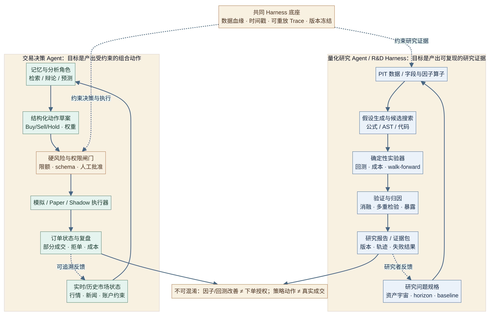
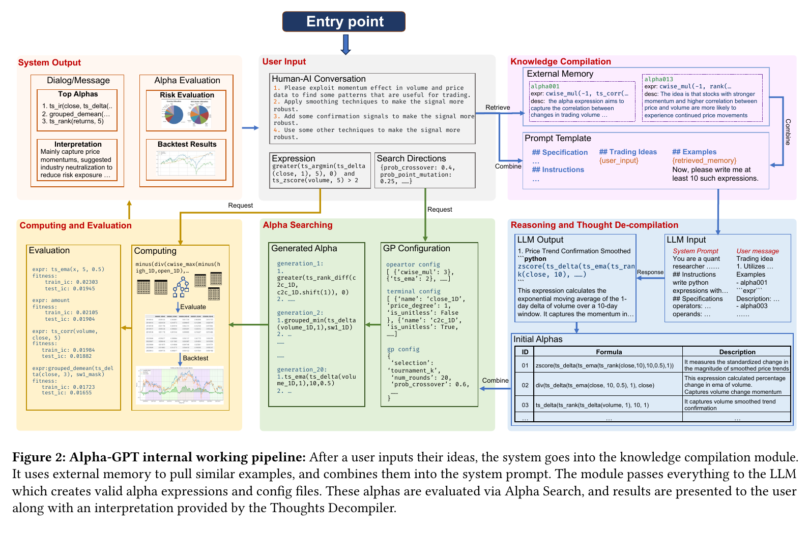
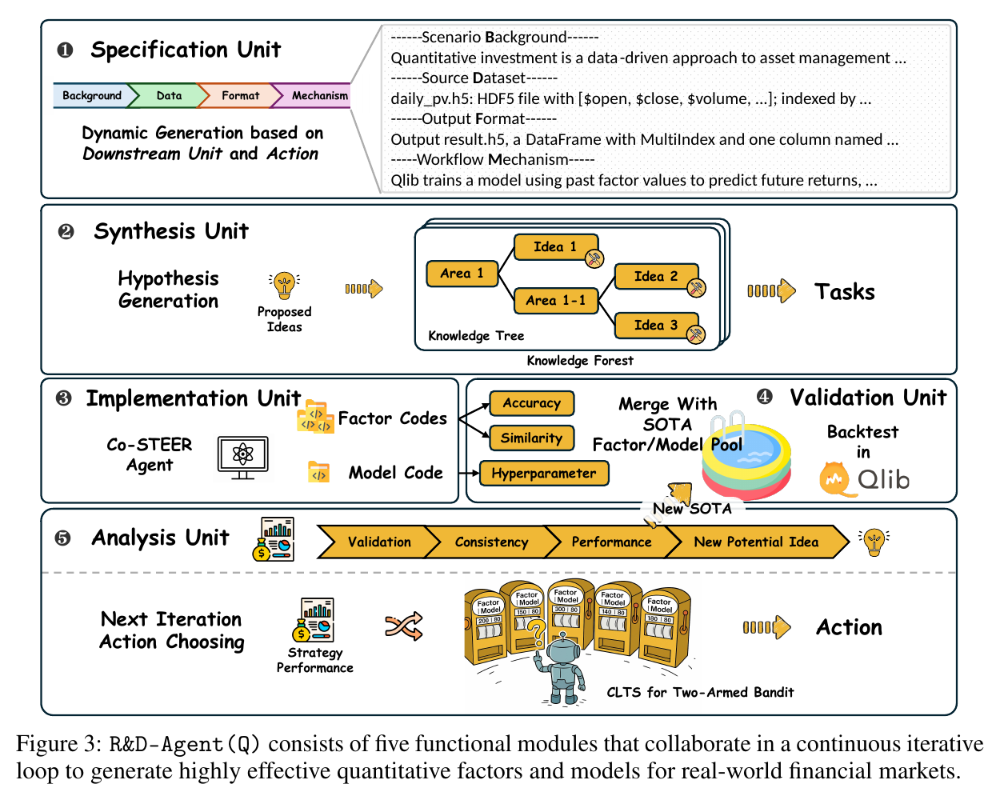
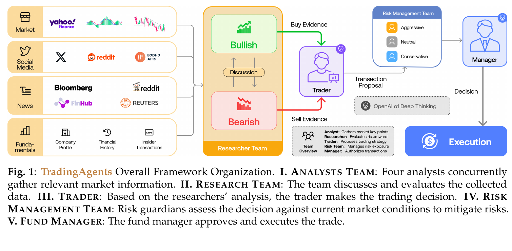
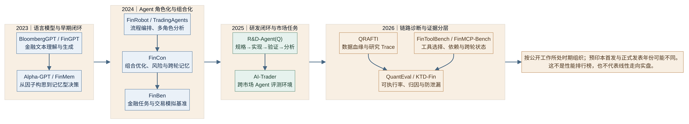
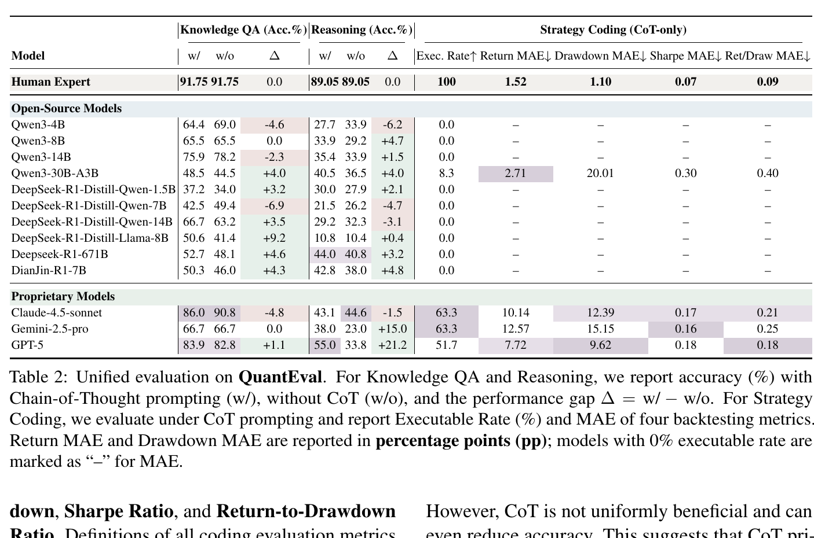
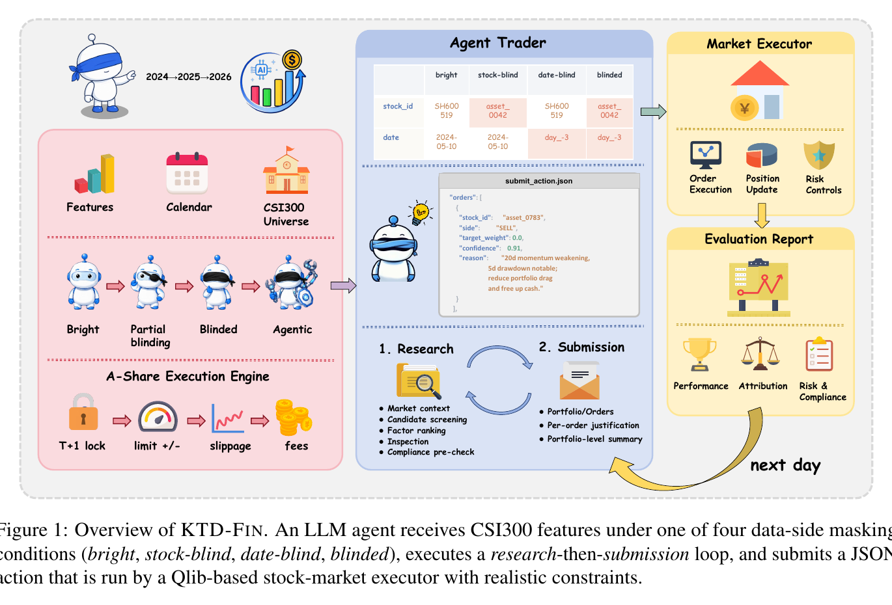
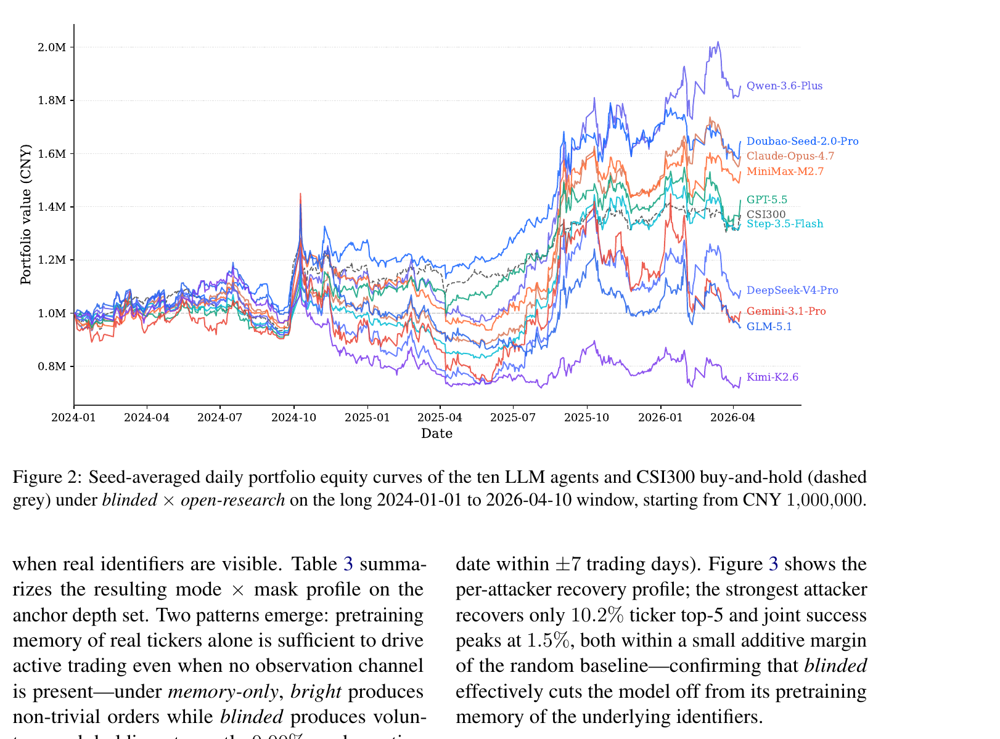

## 1. Basic framework

A quantitative finance harness must carry an investment or research idea through to a result that can be checked. It starts with data that was actually available at the time, followed by executable hypotheses and experiments, and only then constrained portfolio actions and replayable records. Answering financial questions is just the first step. Before a strategy reaches an account with real money, it still has to pass checks on execution, capacity, permissions, and auditing.

<b>Lifecycle</b>

Research question and boundaries → point-in-time data ledger → alpha or trading hypothesis → experiments and backtests → portfolio construction and draft orders → risk approval and execution → review and memory, then return to the question.

| Stage | Required artifact | Evaluation questions and costs |
| --- | --- | --- |
| Intent specification | Asset universe, frequency, objective, holding period, benchmark, constraints, and stopping conditions | Expert review is relatively inexpensive, but people still need to make choices when the objective is unclear |
| Data grounding | event\_time, public\_time, as\_of\_time, source, version, mappings, and hashes | Checking for future information and survivorship bias is costly; data revisions can change the answer |
| Hypothesis generation | Economic mechanism, direction, fields, holding period, expected capacity, and risk exposures | Generating a candidate is cheap; filtering out data mining and false positives from multiple testing is expensive |
| Experiments and backtests | Frozen code, matching rules, costs, random seeds, and out-of-sample reports | Historical data can be rerun; credible point-in-time reconstruction and an independent holdout cost more |
| Portfolio and execution | Target weights, structured orders, limit checks, rejected orders, and fill status | Backtest simulation is cheap; validating real-time latency, market impact, partial fills, and capacity is expensive |
| Review and improvement | Complete traces, failed hypotheses, risk events, and model and prompt versions | Execution logs are easy to store; attribution to alpha, data, execution, or selection bias requires more evidence |

Financial text classification and question answering are the easiest to evaluate, followed by tool trajectories and whether code can execute. Historical portfolio results are harder to verify. Real-time paper or shadow testing takes more effort, while real-money fills and audited P&L have the highest evaluation costs. The closer the result gets to the market, the less a single aggregate benchmark score can tell us.

{: loading="lazy" decoding="async"}

Figure 1 | An end-to-end loop from research intent through risk gates and the execution environment to replayable review

<i>The question, data, experiments, risk decisions, and execution results form a replayable evidence chain. Failures or rejections must return upstream for revision or a safe shutdown; they must not bypass risk controls. This original diagram synthesizes mechanisms from Alpha-GPT, R&D-Agent(Q), TradingAgents, FinCon, QuantEval, and KTD-Fin.</i>

{: loading="lazy" decoding="async"}

Figure 2 | A two-track system for quantitative research agents and trading decision agents

<i>The research track ends with reproducible research evidence. The trading track ends with portfolio actions and order status subject to independent risk and permission controls. Both tracks share data lineage and traces, but a research result does not automatically grant permission to place orders. This original diagram redraws the methodological structures of Alpha-GPT, R&D-Agent(Q), QRAFTI, FinMem, TradingAgents, and FinCon.</i>

## 2. Implementation approaches

### Approach one: financial language models and data adaptation

Around 2023, research began with a basic question: can a model understand financial text and generate content appropriate to a financial context? <b>BloombergGPT</b> (Wu et al., 2023) has 50.6B parameters. Its FinPile financial corpus contains 363B tokens, alongside 345B tokens of general data, with 569B tokens used in actual training. The simple average across five public financial tasks is 62.51. These tasks differ, however, so this arithmetic mean summarizes offline results rather than a unified measure of overall capability, much less strategy returns. The paper also demonstrates BQL query string generation, but does not validate actual query execution, portfolio management, or real orders.

<b>FinGPT</b> (Yang et al., 2023) focuses on an open data pipeline and LoRA adaptation. The official v3 task table reports FPB 0.882, FiQA-SA 0.874, TFNS 0.903, and NWGI 0.643. These are classification metrics for their respective tasks. The official v3.3 table has ambiguous column alignment, while weak labels and class imbalance also affect how the scores should be interpreted. Sentiment classification scores cannot be treated directly as alpha.

### Approach two: quantitative research and development harnesses

From 2023 to 2026, quantitative research systems increasingly connected natural-language ideas to factors, code, and repeatable experiments. <b>Alpha-GPT</b> (Wang et al., 2023; EMNLP System Demonstrations, 2025) connects the Idea Polisher, field retrieval, formulas or ASTs, genetic programming, backtest feedback, and researcher revisions into a research workflow. Across six categories of named ideas in v1, mean out-of-sample IC for the top-20 candidates increases: the initial values range from approximately 0.00951 to 0.01151, and the resulting values from approximately 0.02160 to 0.02763. This IC comes from a specific stock universe and sample; it is not a portfolio return after costs. Greater search freedom also introduces multiple-testing risks.

<b>Screenshot from the original paper | Alpha-GPT: Human-AI Interactive Alpha Mining for Quantitative Investment, Figure 2, PDF page 3.</b>

{: loading="lazy" decoding="async"}

<i>A researcher's idea passes through knowledge compilation, the LLM, and Alpha Search before entering evaluation feedback. What matters is the loop between candidates and validation, rather than generating a formula once.</i>

<b>R&D-Agent(Q)</b> (Li et al., 2025) divides research into Specification, Synthesis, Implementation, Validation, and Analysis so that the same workflow can run repeatedly. In a historical CSI 300 backtest, the o3-mini configuration reports an IC of 0.0532, an annualized compound return ARR of 14.21%, an IR of 1.7382, and a maximum drawdown of −7.42%. The experiment explicitly includes fees and price limits, but the results are still historical simulations.

<b>Screenshot from the original paper | R&D-Agent-Quant: A Multi-Agent Framework for Data-Centric Factors and Model Joint Optimization, Figure 3, PDF page 3.</b>

{: loading="lazy" decoding="async"}

<i>The five modules turn research into a stateful iterative loop. Results from Validation and Analysis should feed back into the specification or candidates, rather than leaving only a final return figure.</i>

<b>QRAFTI</b> (Lim et al., 2026) grounds the research workflow in CRSP and Compustat panels, MCP factor operators, structured schemas, code fallbacks, and traceable computation graphs. Multi-step Sim@1 rises from 0.7435 without reflection planning to 0.9858 with it. This measures success on specific simulation tasks, not OOS alpha or future returns. It shows how research artifacts can be replayed.

### Approach three: memory- and role-driven trading decisions

<b>FinMem</b> (Yu et al., 2023) organizes memories of news, 10-Q reports, and 10-K reports into 14-, 90-, and 365-day layers. A historical TSLA backtest reports a cumulative return of 61.7758%, a Sharpe ratio of 2.6789, and a maximum drawdown of 10.7996%. The paper does not provide sufficient evidence on costs, slippage, liquidity, and capacity to establish production trading.

<b>TradingAgents</b> (Xiao et al., 2024) connects the Analyst, Bull/Bear, Trader, Risk Team, Portfolio Manager, and simulated exchange into a chain of states. In a historical backtest from January 1 to March 29, 2024, paper v7 reports an AAPL cumulative return of 26.62% and a Sharpe ratio of 8.21. The authors also caution that drawdowns were limited in this window. A single prediction requires approximately 11 LLM calls and more than 20 tool calls, and these costs limit the experimental scope.

<b>Screenshot from the original paper | TradingAgents: Multi-Agents LLM Financial Trading Framework, Figure 1, PDF page 3.</b>

{: loading="lazy" decoding="async"}

<i>Analysis, Bull/Bear research, the Trader, the risk team, and manager approval form a trading workflow. Execution in the figure still takes place in a simulated environment. A complete workflow is not evidence of actual fills.</i>

<b>FinCon</b> (Yu et al., 2024) connects analysis to actions through seven types of analyst roles, a portfolio manager, CVaR risk controls, and conceptual belief memory across episodes. The belief-on backtest for Portfolio 1 reports a cumulative return of 113.836%, an SR of 3.269, and an MDD of 16.163%. This is still a historical simulation. The lack of complete code and dependence on commercial data also limit independent reproduction.

These three systems show how states, memory, and approval enter an action workflow. Their backtest windows, assets, costs, and baselines differ, so cumulative returns cannot be used to rank them directly.

### Approach four: platform orchestration and market operating environments

<b>FinRobot</b> (Yang et al., 2024) brings multiple models, financial algorithms, a data layer, task routing, and reflection into one application platform. The original paper does not provide a unified trading benchmark that can be independently reproduced. Features added to the repository later cannot be counted as capabilities already validated by the 2024 white paper.

<b>AI-Trader</b> (Fan et al., 2025) runs agents in a cross-market environment. For October to November 2025, the paper reports a cumulative return of 9.56% for MiniMax on hourly US-market tasks, compared with 1.87% for QQQ in the same period; a daily A-share return of 1.31%, below SSE-50's 1.65%; and a daily cryptocurrency return of −12.18% for DeepSeek, compared with −14.30% for CD5. The markets, frequencies, and windows differ, so these numbers cannot form a single leaderboard. The official README specifies paper trading and simulated execution with 100,000 US dollars in simulated capital. It therefore cannot be described as real-money live trading.

## 3. Runtime anatomy

> To judge whether a quantitative harness is reliable, examine when its data became available, how experiments run, who approves actions, and whether failures can be replayed.

| Runtime component | Role | Examples and boundaries |
| --- | --- | --- |
| Intent compilation and task graphs | Translate natural language into a universe, frequency, objective, constraints, output schema, and stopping conditions | Alpha-GPT's Idea Polisher, R&D-Agent(Q)'s Specification, and FinRobot's Director and Scheduler |
| Data and the point-in-time ledger | Fix event time, publication time, availability time, security mappings, versions, revisions, and hashes | FinMem's layered news and reports, QRAFTI panel alignment, and KTD-Fin masking; a missing timestamp can let a historical simulation look into the future |
| Tool and computation interfaces | Expose retrieval, factor operators, code execution, and market data through schemas, permissions, and dependency graphs | FinToolBench tool manifests, FinMCP-Bench MCP dependency traces, and QRAFTI's Panel API |
| Experiment executor | Compute factors and metrics deterministically, execute frozen backtest protocols, and retain inputs, code, and outputs | Qlib, the QuantEval CTA environment, and R&D-Agent(Q) Validation; successful execution still does not establish strategy effectiveness |
| Memory and research state | Save events, hypotheses, failure experience, trading trajectories, and feedback across rounds, with retrieval by point in time | FinMem's three temporal memory layers, FinCon's CVRF, and R&D-Agent(Q)'s hypothesis, code, and feedback |
| Portfolio and order interfaces | Convert signals into weights or draft orders, then validate securities, quantities, prices, idempotency, timeliness, and permissions | FinCon's external portfolio optimizer, TradingAgents' simulated exchange, and KTD-Fin JSON actions; none replaces broker fill reports |
| Risk and approval gates | Apply deterministic rules for position limits, leverage, CVaR, liquidity, T+1, rejections, and the kill switch | FinCon CVaR, KTD-Fin risk\_check and T+1, and QuantEval's treatment of risk violations as failures; the language model should not be able to override hard gates |
| Traces and auditing | Retain models, prompts, data snapshots, tool calls, code, random seeds, order states, rejection reasons, and human approvals | QRAFTI OpenTelemetry, FinToolBench traces, and KTD-Fin masking and execution logs; missing versions prevent causal review |

Getting code to run is only the inner loop of research. The outer loop must ask whether the data is correct, whether the backtest can be reproduced, and whether the conclusion exceeds the evidence. Without that loop, a mistake that executes successfully can be mistaken for a research finding.

## 4. How evaluation has evolved

Evaluation has expanded from financial text to tool calls, strategy code, and trading outcomes. Each generation of benchmarks exposes failures that earlier ones could not see, so their scores cannot simply be arranged into a single curve of progress.

| Period | Representative benchmarks and evaluation targets | Mechanisms and boundaries |
| --- | --- | --- |
| 2023 and earlier | BloombergGPT, FinGPT, and financial NLP tasks | Offline task scores such as F1, accuracy, and EM are relatively cheap to evaluate, but do not measure toolchains, returns after costs, or order placement |
| 2024 | FinBen's broad financial tasks and FinTrade | The final NeurIPS version contains 42 datasets, 24 tasks, 8 aspects, and 21 models; the trading subtask is still a historical simulation |
| 2025 | Quantitative research loops and multi-role trading simulations | R&D-Agent(Q) connects hypotheses, implementation, validation, and analysis; TradingAgents explicitly shows risk approval and simulated execution, but provides no evidence of real-money fills |
| 2026 | Tool dependencies, strategy code execution, memory controls, and return attribution | FinToolBench, FinMCP-Bench, QuantEval, and KTD-Fin respectively examine trajectory compliance, dependencies across rounds, executability and metric errors, memory leakage, and alpha attribution |

{: loading="lazy" decoding="async"}

Figure 3 | Methodological changes in quantitative finance agents and harnesses from 2023 to 2026

<i>The timeline shows changes in public research topics, not a ranking of returns or publication status. FinMCP-Bench's technical report, arXiv version, and formal ICASSP inclusion have different dates. Alpha-GPT's preprint and system demonstration versions also need separate citations.</i>

<b>FinToolBench</b> (Lu et al., 2026) separates tool trajectories into intent, timeliness, parameters, and call results. For Qwen3-8B, TIR is 0.8712, TESR is 0.2949, and CER is 0.3385. Accurate intent recognition still does not mean task completion.

<b>FinMCP-Bench</b> (Zhu et al., 2026) places multi-tool dependencies and context across rounds in a single trace. The final benchmark table contains 613 samples, 10 scenarios, 33 subscenarios, and 65 financial MCP tools. The best full-benchmark EMR is approximately 25.92%. Multi-tool questions have a median of 8 calls and 5 dependency steps; multi-turn questions have a median of 6 turns. The 10,000 production interaction logs mentioned in the text are the data source, not the number of benchmark questions.

<b>QuantEval</b> (Kang et al., 2026) separately examines whether strategy code can execute and how far its results deviate from expert reference metrics. Its 1,575 samples comprise 660 QA questions, 855 mathematics questions, and 60 strategy coding tasks. GPT-5 achieves a strategy execution rate of 51.7%, compared with the human baseline of 100%. Return MAE is 7.72 percentage points and Sharpe MAE is 0.18. Both are errors relative to expert reference strategies, not returns. The backtest uses 15 assets and daily data from 2010 to 2025, with a commission of 2 bps per side, slippage of 1 bps, a leverage cap of 2, and a per-asset weight cap of 0.20.

<b>Screenshot from the original paper | QuantEval: A Benchmark for Financial Quantitative Tasks in Large Language Models, Table 2, PDF page 6.</b>

{: loading="lazy" decoding="async"}

<i>QA and reasoning accuracy measure different things from strategy execution rates or errors in backtest metrics. GPT-5's 51.7% execution rate should be compared with the human rate of 100%, rather than hidden inside an aggregate score.</i>

<b>KTD-Fin</b> (Zhu et al., 2026) examines contamination from model memory and the sources of returns using four levels of masking, ten attacker probes, and a Barra-style decomposition into Common, Style, and Selection Alpha. In the paper's historical CSI 300 simulation, nine of ten models have negative Selection Alpha. This result applies only to the paper's masking, evaluation window, and linear attribution definition.

<b>Screenshot from the original paper | From Knowing to Doing: A Memory-Controlled Benchmark for LLM Trading Agents on Stock Markets, Figure 1, PDF page 2.</b>

{: loading="lazy" decoding="async"}

<i>The evaluation connects data-side masking, the research and submission loop, the Qlib executor, and evaluation reports. It focuses on controlling answer information that the model may have memorized.</i>

<b>Screenshot from the original paper | From Knowing to Doing: A Memory-Controlled Benchmark for LLM Trading Agents on Stock Markets, Figure 2, PDF page 6.</b>

{: loading="lazy" decoding="async"}

<i>The curves cover historical simulated account equity from January 1, 2024 to April 10, 2026. They must be read alongside Common, Style, and Selection Alpha attribution, not as proof of live trading or independent stock-picking ability.</i>

{: loading="lazy" decoding="async"}

An evidence ladder from text and tool trajectories to strategy execution, attribution, and actual fills

<i>Answering questions, calling tools, executing code, attributing risk and returns, and avoiding cheating through memory should be distinct diagnostic layers. A validation wall separates offline evaluation, historical backtests, paper or shadow testing, and real orders. Public results cannot cross that wall without actual broker or exchange fill reports and continuously audited P&L. This original diagram draws on FinBen, FinToolBench, FinMCP-Bench, QuantEval, KTD-Fin, and AI-Trader.</i>

## 5. Academia and industry

Academic work generally makes variables and ablations more explicit, while industrial systems more often deal with data, permissions, and failure handling. Even a public demo or paper-trading setup does not establish auditable real-money P&L.

| Dimension | Academic research | Industrial systems |
| --- | --- | --- |
| Main objective | Isolate variables, test new mechanisms, and report benchmark metrics | Reliable service, permission governance, observability, and failure recovery |
| Data and baselines | Fixed samples, universes, and comparisons, with reproducible experimental protocols | Vendor data, account state, production mappings, and authorization scope |
| Execution evidence | Offline evaluation, historical backtests, or simulated exchanges | Real-time data, paper trading, or shadow testing are more common; real-money fills still require separate evidence |
| Main strengths | Readable metrics, ablations, and error analysis | Limits, human approval, monitoring, rollback, and operational procedures |
| Common gaps | Costs, impact, capacity, nonstationarity, and selective reporting | Limited public baselines, difficult reproduction, and little material on return attribution and continuous auditing |

## 6. The actual bottlenecks

<b>First, point-in-time data and leakage controls determine whether a result is trustworthy.</b> Tickers, publication dates, financial statement revisions, constituent lists at the time, and even tool response times can introduce future information into historical decisions. KTD-Fin (Zhu et al., 2026) masks tickers and dates, then uses attacker probes to check whether a model has memorized future information. Section 4 covers the specific results. This only covers the paper's defined attacker set and market data; it does not establish that other leakage has been eliminated. In practice, alias mappings, tool inputs, and tool outputs all require temporal consistency handling.

<b>Second, successful tool calls are still some distance from completed financial actions.</b> FinToolBench and QuantEval both show why intent recognition, task completion, and strategy code execution must be examined separately; Section 4 gives the numbers. Even when code runs, spreads, market impact, stock borrowing, latency, partial fills, and capacity remain unresolved. Commissions are only one cost. Rather than adding more roles, these constraints should be written into a deterministic executor.

<b>Third, a larger search space makes it easier to select results that look attractive.</b> Alpha-GPT's genetic programming and R&D-Agent(Q)'s iterative feedback can quickly increase the number of candidates. Without records of failed experiments, data versions, and trial counts, the winning candidate may appear to generalize better than it actually does. TradingAgents' AAPL historical backtest Sharpe of 8.21 comes from a roughly three-month window. FinMem's TSLA cumulative return of 61.78% also lacks evidence of production fills. The point is not to read a short-window backtest as scalable alpha.

## 7. Trends and implementation

The evaluation targets show how the focus of quantitative finance harnesses has changed over time. Before 2023, financial language tasks were the priority. From 2023 to 2024, systems began organizing research intent, memories, and roles. After 2025, executors, tool trajectories, and risk states also entered evaluation. By 2026, dependencies across rounds, strategy executability, memory leakage, and return attribution had become explicit problems. Areas worth watching next include point-in-time data contracts, memory of failed experiments, stress tests for costs and capacity, and verifiable admission gates between paper, shadow, and live trading.

<b>An implementation checklist that can be adopted directly</b>

1. Limit permissions first. Deploy research, backtesting, paper, shadow, and live modes separately. Deny write operations by default, and require an independent risk service and human approval for live orders.
2. Fix the data ledger. For each field, retain event\_time, public\_time, as\_of\_time, retrieval time, source, version, revisions, hashes, and snapshots of the security universe.
3. Freeze the experimental protocol. Specify next-bar or close execution, fees, slippage, spreads, impact, financing, stock borrowing, price limits, order rejections, and partial-fill rules.
4. Establish a search audit. Record all candidates, failed experiments, code, prompts, models, random seeds, out-of-sample windows, and researcher selections. Use walk-forward evaluation, cross-regime tests, and holdouts.
5. Separate signals, weights, and orders. Validate orders against schemas, limits, concentration, liquidity, idempotency, timeliness, and permissions. Any failure must allow a return to hold or human handling.
6. Use paper or shadow testing to validate real-time data delays, rejections, partial fills, order lifecycles, alerts, and the kill switch. Do not expand permissions before these gates are passed.
7. In production, report fill confirmations, net costs, capacity, ongoing P&L, and audit traces. Historical backtests or simulated returns must not substitute for evidence of real-money trading.

## 8. Cross-domain observations

The central loop in [Coding](/blog/harness/coding/en/) combines repairs within a task with harness improvement in an outer loop. Tests, compilation, and rollback can provide relatively cheap evaluation signals for many engineering tasks.

[Auto-Research Harness](/blog/harness/auto-research/en/) deals with hypotheses, experimental design, and new discoveries. Ground truth is more expensive, so the main constraints become budgets, baseline selection, and whether valuable ideas can be evaluated.

[Harnesses for exploratory data analysis](/blog/harness/eda/en/) combine code execution with insight synthesis. Execution results and data can check the former, while the latter often has no single correct answer. Evaluation must consider facts, process, and redundant insights together.

Quantitative finance brings these three kinds of difficulty together. Machines can check code and order schemas. Robust alpha requires evidence across windows. Whether a trade can operate in practice also depends on fills, impact, capacity, and audit records. Historical backtests make economic outcomes somewhat easier to measure, but data revisions and execution biases remain.

| Domain | Evaluability | Main bottlenecks | What the harness outer loop should pursue |
| --- | --- | --- | --- |
| Coding | Many tasks can be verified through tests, compilation, and behavioral assertions | Ambiguous requirements, context localization, environmental differences, and regression risks | Improve tools, skills, verifiers, and rollback according to failure attribution |
| Auto-Research | Discovery value and experimental design usually lack cheap objective ground truth | Baselines, budgets, idea quality, and freedom across research rounds | Compare the additional evidence from candidates, experimental costs, and reproducibility |
| Quantitative finance | Code execution can be evaluated, while economic returns require progressively stronger evidence from out-of-sample, paper, shadow, and fill records | PIT leakage, alpha after costs, capacity, execution, and responsibility for permissions | Bring data, trials, risk, orders, and audit traces together into the gate for promotion |

## Appendix | Complete sources, publication status, versions, and conflicting reporting conventions

1. <b>BloombergGPT</b>, Wu et al., 2023. The main text uses arXiv v3: 50.6B parameters, 569B tokens used in actual training, and a mean of 62.51 across five public financial tasks. It was verified here as an arXiv research paper; formal conference or journal publication was not verified. FinPile is not public, and internal tests may overlap with the training corpus. Sources: [arXiv v3](https://arxiv.org/html/2303.17564v3) and the [official Bloomberg announcement](https://www.bloomberg.com/company/press/bloomberggpt-50-billion-parameter-llm-tuned-finance/).
2. <b>FinGPT</b>, Yang et al., 2023. The specified paper, arXiv:2306.06031, first appeared as v1 in 2023 and was revised to v2 in 2025. Its arXiv comment states acceptance at the IJCAI 2023 FinLLM Symposium. The adjacent works Democratizing Internet-scale Data, Instruct-FinGPT, and Instruction Tuning Benchmark are related but distinct papers. The official v3.3 benchmark table has ambiguous column alignment. Sources: the [paper](https://arxiv.org/abs/2306.06031), [official repository](https://github.com/ai4finance-foundation/fingpt), and [FinNLP documentation](https://ai4finance-foundation.github.io/FinNLP/).
3. <b>Alpha-GPT</b>, Wang et al., first released in 2023 and formally published at EMNLP System Demonstrations in 2025. The figure and v1 numbers correspond to arXiv v1; v2 updates the model and experiments. Alpha-GPT 2.0 is a separate 2024 working draft, not the same formally published version. Sources: [arXiv v1](https://arxiv.org/html/2308.00016v1), the [formal EMNLP page](https://aclanthology.org/2025.emnlp-demos.14/), and [Alpha-GPT 2.0](https://arxiv.org/abs/2402.09746).
4. <b>FinMem</b>, Yu et al., 2023. The experimental mechanisms follow arXiv v2. There is a formal paper entry in the AAAI Symposium Series. Its ICLR 2024 appearance is an LLM Agents workshop poster, not an ICLR main-conference paper. The historical backtests lack complete evidence on costs, impact, capacity, and live trading. Sources: [arXiv v2](https://arxiv.org/html/2311.13743v2), the [AAAI Symposium Series](https://ojs.aaai.org/index.php/AAAI-SS/article/view/31290), and the [official code](https://github.com/pipiku915/finmem-llm-stocktrading).
5. <b>FinRobot</b>, Yang et al., 2024. The original platform paper is an arXiv v2 white paper; formal journal or conference publication was not verified. The November 2024 follow-up on equity research is a separate work. Later features in repository V1 through V3 cannot be attributed retrospectively to the original white paper. Sources: the [original paper](https://arxiv.org/html/2405.14767v2), [official code](https://github.com/ai4finance-foundation/finrobot), and [follow-up research](https://arxiv.org/html/2411.08804v1).
6. <b>TradingAgents</b>, Xiao et al., first released in 2024. These notes use arXiv v7. The paper's window is January 1 to March 29, 2024. The project page describes a different period inconsistently, so the main text uses only paper v7. It was verified here as an arXiv preprint; formal proceedings publication was not verified. Sources: [arXiv v7](https://arxiv.org/html/2412.20138v7), the [official repository](https://github.com/TauricResearch/TradingAgents), [CHANGELOG](https://github.com/TauricResearch/TradingAgents/blob/main/CHANGELOG.md), and the [project page](https://tradingagents-ai.github.io/).
7. <b>FinCon</b>, Yu et al., 2024. This is a formal NeurIPS 2024 Main Conference paper, with arXiv v3 used for additional verification. The data end dates in Appendices A.5 and A.8 conflict. The complete system is not open source, and backtests do not establish actual fills. Sources: the [formal NeurIPS page](https://papers.nips.cc/paper_files/paper/2024/hash/f7ae4fe91d96f50abc2211f09b6a7e49-Abstract-Conference.html), [arXiv v3](https://arxiv.org/html/2407.06567v3), and the [official repository](https://github.com/The-FinAI/FinCon).
8. <b>FinBen</b>, Xie et al., 2024. Formally published in the NeurIPS 2024 Datasets and Benchmarks Track. The final version contains 42 datasets, 24 tasks, 8 aspects, and 21 models; arXiv v2 lists 36, 24, 7, and 15. These two sets of numbers correspond to different versions. Sources: the [formal NeurIPS page](https://proceedings.neurips.cc/paper_files/paper/2024/hash/adb1d9fa8be4576d28703b396b82ba1b-Abstract-Datasets_and_Benchmarks_Track.html), [arXiv v2](https://arxiv.org/html/2402.12659v2), and the [official code](https://github.com/The-FinAI/FinBen).
9. <b>R&D-Agent(Q)</b>, Li et al., 2025. Accepted at NeurIPS 2025 and listed as an official poster; the materials checked do not show a proceedings DOI. The poster's author string omits Minrui Xu, while arXiv and Microsoft Research list all seven authors. The paper's backtest results and the execution window in the official documentation are described differently. These notes report the results only as historical simulations, following the paper's results table. Sources: [arXiv v2](https://arxiv.org/html/2505.15155v2), the [NeurIPS poster](https://neurips.cc/virtual/2025/poster/121804), [Microsoft Research](https://www.microsoft.com/en-us/research/publication/rd-agent-quant-a-multi-agent-framework-for-data-centric-factors-and-model-joint-optimization/), and the [official repository](https://github.com/microsoft/RD-Agent).
10. <b>AI-Trader</b>, Fan et al., first released in 2025, arXiv v1. The paper refers to live markets, but the official README specifies paper trading and simulated execution with 100,000 US dollars in simulated capital. Real funds, broker orders, and audited P&L were not verified. Sources: [arXiv v1](https://arxiv.org/html/2512.10971v1) and the [official repository](https://github.com/HKUDS/AI-Trader).
11. <b>FinToolBench</b>, Lu et al., 2026, using arXiv v2. Its verification status here is a preprint; formal acceptance was not verified. TIR, TESR, and CER relate to tool intent, execution success, and task completion respectively, and cannot be interpreted as returns. Sources: [arXiv v2](https://arxiv.org/html/2603.08262v2) and the [official repository](https://github.com/Double-wk/FinToolBench).
12. <b>FinMCP-Bench</b>, Zhu et al., 2026. The IEEE Xplore DOI and official ICASSP 2026 schedule confirm formal publication. The technical report is dated October 11, 2025; arXiv v1 is dated March 26, 2026; and IEEE Xplore inclusion is dated April 21, 2026. The final benchmark table has 613 samples. The 10,000 items in the text are production interaction logs, while the number of rows in a public dataset snapshot is also not the paper's benchmark sample size. Sources: the [IEEE DOI](https://doi.org/10.1109/ICASSP55912.2026.11460653), [ICASSP schedule](https://www.cmsworkshops.com/ICASSP2026/view_paper.php?PaperNum=17786&bare=1), [arXiv](https://arxiv.org/abs/2603.24943), [dataset card](https://huggingface.co/datasets/DianJin/FinMCP-Bench), and [Qieman MCP tools](https://qieman.com/mcp/tools).
13. <b>QuantEval</b>, Kang et al., 2026, using arXiv v2. It was verified here as a preprint; formal acceptance was not verified. The strategy task contains only 60 samples. Return MAE of 7.72 percentage points and Sharpe MAE of 0.18 are errors against expert references, not returns. Sources: [arXiv v2](https://arxiv.org/html/2601.08689v2) and the [PDF](https://arxiv.org/pdf/2601.08689).
14. <b>KTD-Fin</b>, Zhu et al., 2026, using arXiv v1. It was verified here as a preprint; formal acceptance was not verified. Whether Selection Alpha is positive or negative depends on the Barra factors, evaluation window, and limitations of linear attribution. Trading is a historical CSI 300 simulation. Sources: [arXiv v1](https://arxiv.org/html/2605.28359v1) and the [PDF](https://arxiv.org/pdf/2605.28359).
15. <b>QRAFTI</b>, Lim et al., 2026, using the arXiv v1 preprint. Formal publication was not verified. Sim@k is historical reference Panel cosine similarity or a simulation-task metric, not a rate of return. Access to CRSP and Compustat data requires institutional eligibility. Sources: [arXiv v1](https://arxiv.org/html/2604.18500v1) and the [official repository](https://github.com/terence-lim/quant-agents).

<b>A consistent boundary:</b> without actual broker or exchange order reports and continuously audited P&L, describe results as NLP or tool benchmarks, historical simulations, backtests, paper trading, or shadow testing, not real-money live-trading profits. Preprints, technical reports, conference acceptance, formal proceedings, and IEEE Xplore inclusion are not interchangeable either.
