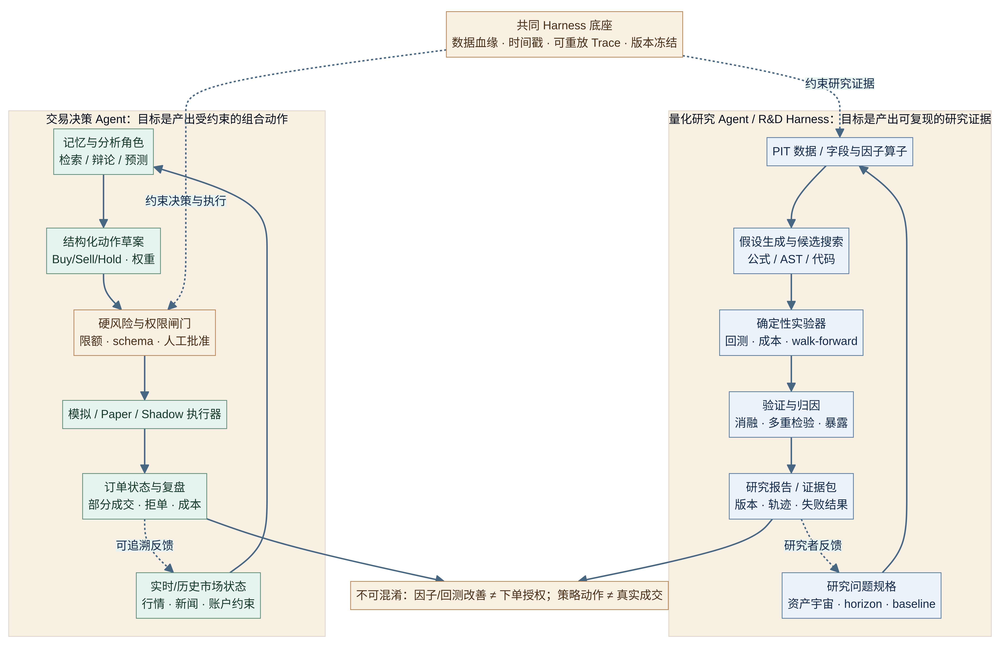
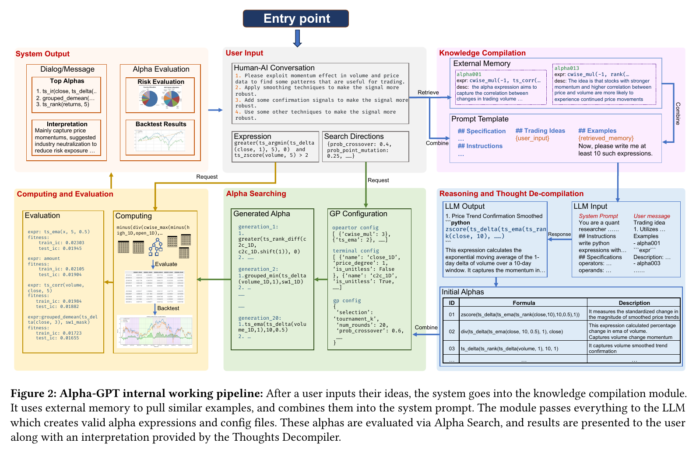
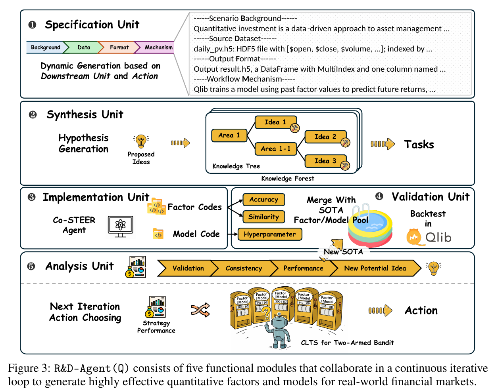
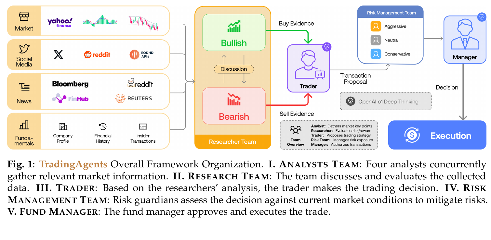
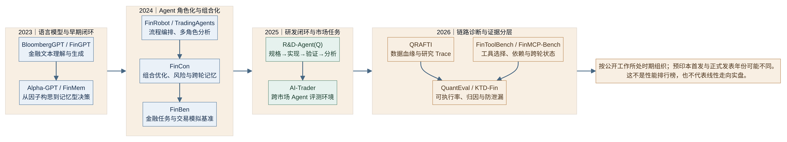
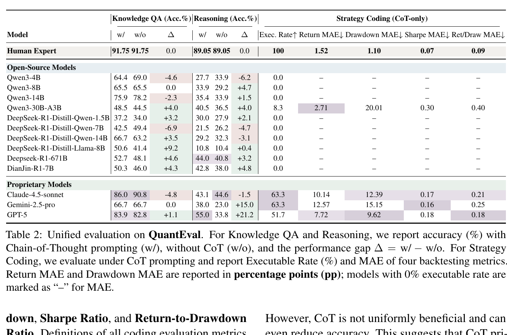
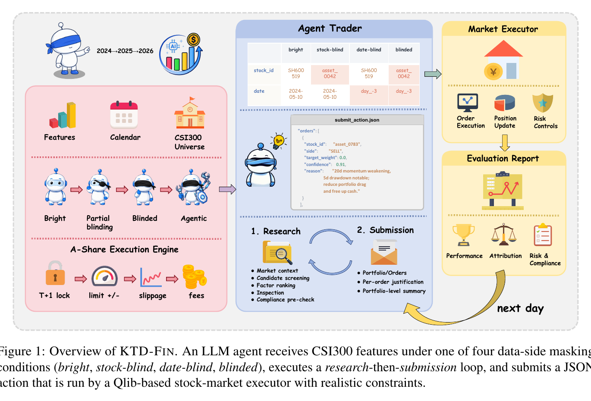
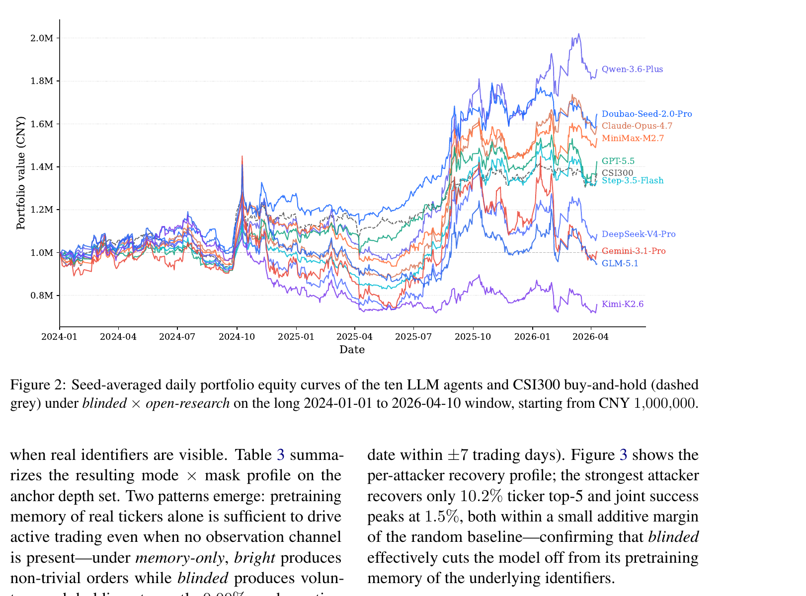

## 1. 基本框架

量化金融 Harness 要把投资或研究想法一路带到可核查的结果。起点是当时确实可见的数据，接着是能执行的假设和实验，再往后才是受约束的组合动作与可重放记录。模型会答金融问题，只算走到第一步。策略进入真钱账户前，还得过成交、容量、权限和审计这几关。

<b>生命周期</b>

研究问题与边界 → point-in-time 数据账本 → alpha 或交易假设 → 实验与回测 → 组合构建与订单草案 → 风险审批与执行 → 复盘记忆并回到问题。

| 阶段 | 必须留下的产物 | 判卷问题与成本 |
| --- | --- | --- |
| 意图规格 | 资产宇宙、频率、目标、持有期、基准、约束和停止条件 | 规格可由专家审阅，成本较低，目标说不清时仍需人选择 |
| 数据 grounding | event\_time、public\_time、as\_of\_time、来源、版本、映射和哈希 | 检查未来信息与幸存者偏差不便宜，数据修订会改变答案 |
| 假设生成 | 经济机制、方向、字段、持有期、预期容量和风险暴露 | 单次生成很便宜，筛掉数据挖掘和多重检验假阳性很贵 |
| 实验回测 | 冻结的代码、撮合规则、成本、随机种子、样本外报告 | 历史数据可重复运行，可信的 point-in-time 重建和独立 holdout 更贵 |
| 组合与执行 | 目标权重、结构化订单、限额检查、拒单与成交状态 | 回测模拟便宜，实时延迟、冲击、部分成交和容量验证很贵 |
| 复盘与改进 | 全量 trace、失败假设、风险事件、模型和提示版本 | 运行日志易存，归因到 alpha、数据、执行或选择偏差需要更多证据 |

金融文本分类和问答最容易判，接下来是工具轨迹和代码能否执行。历史组合结果更难核实，实时 paper 或 shadow 更费力，真钱成交与审计 P&L 的判卷成本最高。越靠近市场结果，单靠 benchmark 总分就越不够。

{: loading="lazy" decoding="async"}

图 1｜从研究意图到风险闸门、执行环境与可重放复盘的端到端闭环

<i>问题、数据、实验、风险决策和执行结果组成可回放证据链。失败或拒绝要返回上游修订或安全停机，不能绕过风控。机制综合 Alpha-GPT、R&D-Agent(Q)、TradingAgents、FinCon、QuantEval 与 KTD-Fin，本文原创重绘。</i>

{: loading="lazy" decoding="async"}

图 2｜量化研究 Agent 与交易决策 Agent 的双轨系统

<i>研究轨终点是可复现的研究证据，交易轨终点是经过独立风险与权限控制的组合动作及订单状态。两轨共享数据血缘和 trace，研究结果不会自动获得下单授权。依据 Alpha-GPT、R&D-Agent(Q)、QRAFTI、FinMem、TradingAgents 与 FinCon 的方法结构原创重绘。</i>

## 2. 实现路线

### 路线一，金融语言模型与数据适配

2023 年前后，研究先从一个基础问题入手。模型能不能读懂金融文本，也能不能按金融语境生成内容？<b>BloombergGPT</b>（Wu et al., 2023）有 50.6B 参数，FinPile 金融语料 363B tokens、通用语料 345B tokens，实际训练 569B tokens；五个公开金融任务的简单平均为 62.51。不过任务彼此不同，这个算术平均只是离线结果的汇总，不能当作统一的综合能力分，更不是策略收益。论文还展示了 BQL 查询字符串生成，但没有验证查询实际执行、组合管理或真实订单。

<b>FinGPT</b>（Yang et al., 2023）把重点放在开放数据管线和 LoRA 适配上。官方 v3 任务表列出 FPB 0.882、FiQA-SA 0.874、TFNS 0.903、NWGI 0.643，这些都是各自任务的分类指标。官方 v3.3 表格存在列对齐歧义，弱标签和类别不均衡也会影响分数的解释。情绪分类分数不能直接当成 alpha。

### 路线二，量化研发 Harness

从 2023 到 2026 年，量化研发系统逐渐把自然语言想法接到因子、代码和可重复实验上。<b>Alpha-GPT</b>（Wang et al., 2023；EMNLP System Demonstrations, 2025）把 Idea Polisher、字段检索、公式或 AST、遗传编程、回测反馈和研究者修订串成一条研究链。v1 六类命名想法的 top-20 样本外 IC 均值从约 0.00951 至 0.01151，升到约 0.02160 至 0.02763。这个 IC 来自特定股票池和样本，不能读成扣除成本后的组合收益。搜索自由度同时带来多重检验风险。

<b>原论文截图｜Alpha-GPT: Human-AI Interactive Alpha Mining for Quantitative Investment，Figure 2，PDF 第 3 页。</b>

{: loading="lazy" decoding="async"}

<i>研究者想法经知识编译、LLM 与 Alpha Search 后进入评测反馈；关键是候选与验证构成闭环，而非单次生成公式。</i>

<b>R&D-Agent(Q)</b>（Li et al., 2025）把研究拆成 Specification、Synthesis、Implementation、Validation 和 Analysis 五个环节，让同一套流程可以反复执行。CSI 300 历史回测中，o3-mini 配置的 IC 为 0.0532、年化复合收益 ARR 为 14.21%、IR 为 1.7382、最大回撤为 −7.42%。实验明确写入费用和价格限制，但结果仍是历史模拟。

<b>原论文截图｜R&D-Agent-Quant: A Multi-Agent Framework for Data-Centric Factors and Model Joint Optimization，Figure 3，PDF 第 3 页。</b>

{: loading="lazy" decoding="async"}

<i>五个模块把研究过程变成带状态的迭代闭环；Validation 与 Analysis 的结果应能回到规格或候选，而不是只留下最终收益数。</i>

<b>QRAFTI</b>（Lim et al., 2026）把研究流程落到 CRSP 与 Compustat panel、MCP 因子算子、结构化 schema、代码 fallback 和可追踪计算图上。multi-step Sim@1 从无 reflection planning 时的 0.7435 升到使用 reflection planning 时的 0.9858。这个数字衡量特定模拟任务的成功率，不是 OOS alpha，也不是未来收益。它说明研究产物可以怎样被重放。

### 路线三，记忆与角色驱动的交易决策

<b>FinMem</b>（Yu et al., 2023）把新闻、10-Q 和 10-K 记忆按 14、90、365 天分层。TSLA 历史回测报告累计收益 61.7758%、Sharpe 2.6789、最大回撤 10.7996%。论文没有给出足以证明生产交易的成本、滑点、流动性和容量证据。

<b>TradingAgents</b>（Xiao et al., 2024）把 Analyst、Bull/Bear、Trader、Risk Team、Portfolio Manager 和模拟交易所串成一条状态链。论文 v7 在 2024 年 1 月 1 日至 3 月 29 日的历史回测中报告，AAPL 累计收益 26.62%、Sharpe 8.21。作者也提醒，这段窗口里的回撤较少。单次预测约需 11 次 LLM 调用和 20 次以上工具调用，调用成本限制了实验范围。

<b>原论文截图｜TradingAgents: Multi-Agents LLM Financial Trading Framework，Figure 1，PDF 第 3 页。</b>

{: loading="lazy" decoding="async"}

<i>分析、Bull/Bear 研究、Trader、风险团队与经理审批串成交易链；图中的执行仍处于模拟环境，流程完整不等于真实成交。</i>

<b>FinCon</b>（Yu et al., 2024）用七类分析角色、组合经理、CVaR 风险控制和跨 episode 的概念信念记忆，把分析接到动作上。Portfolio 1 的 belief-on 回测报告累计收益 113.836%、SR 3.269、MDD 16.163%。这仍是历史模拟，完整代码和商业数据依赖也让独立复现受到限制。

这三套系统展示了状态、记忆和审批怎样进入动作链。它们的回测窗口、标的、成本和基线各不相同，累计收益不能直接拿来排高低。

### 路线四，平台编排与市场运行环境

<b>FinRobot</b>（Yang et al., 2024）把多模型、金融算法、数据层、任务路由和反思放进同一个应用平台。原论文没有提供可独立复现的统一交易 benchmark。仓库后来加入的功能，也不能算作 2024 白皮书已经验证的能力。

<b>AI-Trader</b>（Fan et al., 2025）让 agent 在跨市场环境中运行。论文列出的 2025 年 10 月至 11 月结果是，美国小时级 MiniMax 累计收益 9.56%，同期 QQQ 为 1.87%；A 股日级收益 1.31%，低于 SSE-50 的 1.65%；加密日级 DeepSeek 为 −12.18%，优于 CD5 的 −14.30%。市场、频率和窗口都不同，这些数字不能合成一个排行榜。官方 README 写明使用 100,000 美元模拟资本进行 paper trading 和 simulated execution，因此不能称为真钱实盘。

## 3. Runtime 解剖

> 判断一个量化 Harness 是否可靠，要看数据何时可见、实验如何执行、动作由谁批准，以及失败后能不能重放。

| 分层构件 | 作用 | 代表与边界 |
| --- | --- | --- |
| 意图编译与任务图 | 把自然语言改写为宇宙、频率、目标、约束、输出 schema 和停止条件 | Alpha-GPT 的 Idea Polisher，R&D-Agent(Q) 的 Specification，FinRobot 的 Director 与 Scheduler |
| 数据与 point-in-time 账本 | 锁定事件时间、公开时间、可见时间、证券映射、版本、修订和哈希 | FinMem 分层新闻与财报，QRAFTI panel 对齐，KTD-Fin masking；缺任一时间戳都可能让历史模拟偷看未来 |
| 工具与计算接口 | 以 schema、权限和依赖图暴露检索、因子算子、代码执行和市场数据 | FinToolBench 的工具 manifest，FinMCP-Bench 的 MCP 依赖轨迹，QRAFTI 的 Panel API |
| 实验执行器 | 确定性计算因子与指标，执行冻结的回测协议，留下输入、代码和输出 | Qlib、QuantEval CTA 环境、R&D-Agent(Q) Validation；执行成功仍不等于策略有效 |
| 记忆与研究状态 | 保存事件、假设、失败经验、交易轨迹和跨轮反馈，并能按时点检索 | FinMem 的三层时间记忆，FinCon 的 CVRF，R&D-Agent(Q) 的 hypothesis、code、feedback |
| 组合与订单接口 | 将 signal 转为权重或订单草案，验证证券、数量、价格、幂等、时效与权限 | FinCon 外部组合优化器，TradingAgents 模拟交易所，KTD-Fin JSON action；都不能替代券商成交回报 |
| 风险与审批闸门 | 用确定性规则执行限仓、杠杆、CVaR、流动性、T+1、拒单和 kill switch | FinCon CVaR，KTD-Fin risk\_check 与 T+1，QuantEval 风险违规判失败；语言模型不应能覆盖硬门 |
| Trace 与审计 | 保留模型、提示、数据快照、工具调用、代码、随机种子、订单状态、拒绝理由和人工批准 | QRAFTI OpenTelemetry，FinToolBench trace，KTD-Fin masking 与执行日志；版本缺失就无法做因果复盘 |

代码跑通只是研究流程的内环。外环还要追问数据对不对、回测能不能复现、结果有没有越过证据边界。少了这层，执行成功的错误也可能被当成研究发现。

## 4. 评测演进

评测对象已经从金融文本，走到工具调用、策略代码和交易结果。每一代基准都多拆出一些以前看不见的失败，所以分数不能简单排成一条进步曲线。

| 时期 | 代表基准与测量对象 | 关键机制与边界 |
| --- | --- | --- |
| 2023 年及以前 | BloombergGPT、FinGPT 及金融 NLP 任务 | F1、准确率、EM 等离线任务分数，判卷较便宜，不测工具链、成本后收益和下单 |
| 2024 年 | FinBen 综合金融任务与 FinTrade | NeurIPS 终稿为 42 个数据集、24 项任务、8 个方面、21 个模型；交易子项仍是历史模拟 |
| 2025 年 | 量化研发闭环与多角色交易模拟 | R&D-Agent(Q) 把假设、实现、验证、分析串起来，TradingAgents 明确展示风险审批与模拟执行，但不提供真钱成交证据 |
| 2026 年 | 工具依赖、策略代码执行、记忆控制与收益归因 | FinToolBench、FinMCP-Bench、QuantEval、KTD-Fin 分别测轨迹合规、多轮依赖、可执行率与指标误差、记忆泄漏和 alpha 归因 |

{: loading="lazy" decoding="async"}

图 3｜2023 至 2026 量化金融 Agent 与 Harness 的方法演进

<i>时间线表示公开研究主题迁移，不是收益或发表状态排序。FinMCP-Bench 的 technical report、arXiv 版本与 ICASSP 正式收录日期不同；Alpha-GPT 预印本和系统演示版本也需分开引用。</i>

<b>FinToolBench</b>（Lu et al., 2026）把工具轨迹拆成意图、时效、参数和调用结果几个环节。Qwen3-8B 的 TIR 为 0.8712，TESR 为 0.2949，CER 为 0.3385。意图识别得准，仍不等于任务完成。

<b>FinMCP-Bench</b>（Zhu et al., 2026）把多工具依赖和跨轮上下文放进同一条 trace。最终 benchmark 表包含 613 个样本、10 个场景、33 个子场景和 65 个金融 MCP 工具。全量最高 EMR 约 25.92%；多工具题的调用中位数为 8，依赖步骤中位数为 5；多轮题的轮数中位数为 6。正文提到的 10,000 条生产交互日志是数据来源，不是 benchmark 题量。

<b>QuantEval</b>（Kang et al., 2026）分别看策略代码能否执行，以及结果与专家参考指标相差多少。1,575 个样本包括 660 个 QA、855 个数学题和 60 个策略编码题。GPT-5 的策略执行率为 51.7%，人类基线为 100%。Return MAE 为 7.72 个百分点，Sharpe MAE 为 0.18，二者都是相对专家参考策略的误差，不是收益。回测使用 15 个资产和 2010 年至 2025 年的日频数据，设定每边 2 bps 佣金、1 bps 滑点、杠杆上限 2 和单资产权重上限 0.20。

<b>原论文截图｜QuantEval: A Benchmark for Financial Quantitative Tasks in Large Language Models，Table 2，PDF 第 6 页。</b>

{: loading="lazy" decoding="async"}

<i>QA、推理准确率与策略执行率或回测指标误差属于不同维度；GPT-5 的 51.7% 执行率应与人类 100% 执行率对照，不可被一个总分掩盖。</i>

<b>KTD-Fin</b>（Zhu et al., 2026）用四级 masking、十个攻击者 probe，以及 Barra 风格的 Common、Style、Selection Alpha 分解，检查模型记忆污染和收益来源。在论文设定的 CSI 300 历史模拟里，十个模型有九个 Selection Alpha 为负。这个结果只适用于论文采用的 masking、窗口和线性归因定义。

<b>原论文截图｜From Knowing to Doing: A Memory-Controlled Benchmark for LLM Trading Agents on Stock Markets，Figure 1，PDF 第 2 页。</b>

{: loading="lazy" decoding="async"}

<i>评测将数据侧 masking、研究与提交循环、Qlib 执行器与评估报告连起来，重点是控制模型可能记住的答案信息。</i>

<b>原论文截图｜From Knowing to Doing: A Memory-Controlled Benchmark for LLM Trading Agents on Stock Markets，Figure 2，PDF 第 6 页。</b>

{: loading="lazy" decoding="async"}

<i>曲线覆盖 2024 年 1 月 1 日至 2026 年 4 月 10 日的历史模拟账户权益，必须与 Common、Style、Selection Alpha 归因一起读，不能当作实盘或独立选股能力证明。</i>

{: loading="lazy" decoding="async"}

从文本与工具轨迹到策略执行、归因，再到真实成交的证据阶梯

<i>应把会答、会调用、可执行、风险与收益可归因、没有靠记忆作弊分成可诊断层。离线评测、历史回测、paper 或 shadow 到真实订单之间有验证墙。公开结果没有真实券商或交易所成交回报和持续审计 P&L 时，不能跨越这道墙。来源包括 FinBen、FinToolBench、FinMCP-Bench、QuantEval、KTD-Fin 与 AI-Trader，本文原创重绘。</i>

## 5. 学术与工业

学术研究通常把变量和消融摆得更清楚，工业系统则更常涉及数据、权限和故障处理。公开材料里即使有 demo 或 paper trading，也不足以证明存在可审计的真钱 P&L。

| 维度 | 学术研究 | 工业系统 |
| --- | --- | --- |
| 主要目标 | 隔离变量、检验新机制、报告 benchmark 指标 | 稳定服务、权限治理、可观测性与故障恢复 |
| 数据与基线 | 固定样本、宇宙和比较方法，复现实验协议 | 供应商数据、账户状态、生产映射与授权范围 |
| 执行证据 | 离线、历史回测或模拟交易所 | 实时数据、paper 或 shadow 更常见，真钱成交仍需单独举证 |
| 主要优势 | 可读的指标、消融与误差分析 | 限额、人工审批、监控、回滚和运营流程 |
| 常见缺口 | 成本、冲击、容量、非平稳与选择性报告 | 公开基线不足、难以复现、收益归因与持续审计材料少 |

## 6. 真瓶颈

<b>第一，point-in-time 数据和泄漏控制决定结果能不能信。</b> 股票代码、发布日期、财报修订、当期成分股，甚至工具返回时间，都可能把未来信息带进历史决策。KTD-Fin（Zhu et al., 2026）通过遮蔽 ticker 与日期，再用攻击者 probe 检查模型是否记住未来信息，具体结果见第 4 节。不过这只覆盖论文定义的攻击者集合和市场数据，不能说明其他泄漏也已排除。落地时，别名映射、工具入参和返回值都要做时间一致性处理。

<b>第二，工具调用成功，离完成金融动作还有一段。</b> FinToolBench 和 QuantEval 都说明，意图识别、任务完成和策略代码执行要分开看，具体数字见第 4 节。代码即使跑通，价差、冲击、借券、延迟、部分成交和容量也还没解决，佣金只是其中一项。与其继续加角色，不如把这些约束写进确定性执行器。

<b>第三，搜索空间越大，越容易挑出看起来漂亮的结果。</b> Alpha-GPT 的遗传编程和 R&D-Agent(Q) 的迭代反馈都能快速增加候选数量。若失败实验、数据版本和试验次数没有留下记录，最后胜出的候选就可能显得比实际更能泛化。TradingAgents 的 AAPL 历史回测 Sharpe 8.21 来自约三个月窗口，FinMem 的 TSLA 累计收益 61.78% 也没有生产成交证明。关键是别把短窗口回测读成可规模化 alpha。

## 7. 趋势与落地

沿着评测对象看，量化金融 Harness 的关注点在逐年变化。2023 年以前，重点是金融语言任务。2023 到 2024 年，系统开始组织研究意图、记忆和角色。2025 年之后，执行器、工具轨迹和风险状态也进入评测。到 2026 年，多轮依赖、策略可执行性、记忆泄漏和收益归因都成了明确问题。接下来值得盯的是 point-in-time 数据契约、失败实验记忆、成本与容量压力测试，以及 paper、shadow 到 live 之间可验证的准入门。

<b>可以直接采用的落地清单</b>

1. 先限定权限，研究、回测、paper、shadow、live 分开部署，写操作默认拒绝，live 订单需独立风险服务和人工审批。
2. 固化数据账本，为每个字段保存 event\_time、public\_time、as\_of\_time、抓取时间、来源、版本、修订、哈希和证券宇宙快照。
3. 冻结实验协议，写明 next-bar 或 close、费用、滑点、价差、冲击、融资、借券、涨跌停、拒单和部分成交规则。
4. 设立搜索审计，记录全部候选、失败实验、代码、提示、模型、随机种子、样本外窗口和研究者选择，使用 walk-forward、跨 regime 与 holdout。
5. 把 signal、权重、订单拆开，订单经过 schema、限额、集中度、流动性、幂等、时效和权限校验，任何失败都能退回 hold 或人工处理。
6. 用 paper 或 shadow 验证实时数据延迟、拒单、部分成交、订单生命周期、告警和 kill switch，未过门槛不升级权限。
7. 生产阶段按成交回报、净成本、容量、持续 P&L 和审计 trace 汇报，禁止用历史回测或模拟收益替代实盘证据。

## 8. 跨领域观察

[Coding](/blog/harness/coding/) 的核心循环是任务内修复与 Harness 外环改进。测试、编译和回滚能给不少工程任务提供相对便宜的判卷信号。

[Auto-Research Harness](/blog/harness/auto-research/) 面对的是假设、实验设计和新发现，地面真值更贵，关键约束变成预算、基线选择和有价值的 idea 是否能被评估。

[EDA（探索性数据分析） Harness](/blog/harness/eda/) 把代码执行与洞察综合放在一起。前者可由运行结果和数据校验，后者往往没有唯一正确答案，评测需要同时看事实、过程和洞察冗余。

量化金融把这三类难题都带了进来。代码和订单 schema 可以由机器检查，alpha 是否稳健要看跨窗口证据，交易能否落地还得看成交、冲击、容量和审计记录。历史回测让经济结果更容易测量一些，但数据修订和执行偏差仍然存在。

| 领域 | 可判卷性 | 主要瓶颈 | Harness 外环该追什么 |
| --- | --- | --- | --- |
| Coding | 较多任务可由测试、编译和行为断言验证 | 需求歧义、上下文定位、环境差异和回归风险 | 按失败归因改进工具、技能、验证器与回滚 |
| Auto-Research | 发现价值与实验设计通常缺少便宜的客观真值 | 基线、预算、idea 质量和多轮研究自由度 | 比较候选的证据增量、实验成本和可重复性 |
| 量化金融 | 代码执行可判，经济收益需逐层升到样本外、paper、shadow 与成交 | PIT 泄漏、成本后 alpha、容量、执行和权限责任 | 把数据、试验、风险、订单与审计 trace 一起纳入升级门 |

## 附录｜完整来源、发表状态、版本与口径冲突

1. <b>BloombergGPT</b>，Wu et al.，2023。主文采用 arXiv v3，50.6B 参数、实际训练 569B tokens 和五项公开金融任务平均 62.51。当前核验为 arXiv 研究论文，未核实正式会议或期刊发表。FinPile 不公开，内部测试可能与训练语料重叠。来源为 [arXiv v3](https://arxiv.org/html/2303.17564v3) 与 [Bloomberg 官方发布](https://www.bloomberg.com/company/press/bloomberggpt-50-billion-parameter-llm-tuned-finance/)。
2. <b>FinGPT</b>，Yang et al.，2023。指定论文 arXiv:2306.06031 v1 首发于 2023，v2 于 2025 修订，arXiv 注释称获 IJCAI 2023 FinLLM Symposium 接收。相邻的 Democratizing Internet-scale Data、Instruct-FinGPT 与 Instruction Tuning Benchmark 是相关但不同论文。官方 v3.3 benchmark 表有列对齐歧义。来源为 [论文](https://arxiv.org/abs/2306.06031)、[官方仓库](https://github.com/ai4finance-foundation/fingpt) 与 [FinNLP 文档](https://ai4finance-foundation.github.io/FinNLP/)。
3. <b>Alpha-GPT</b>，Wang et al.，2023 首发，2025 正式发表于 EMNLP System Demonstrations。图和 v1 数字对应 arXiv v1；v2 更新了模型与实验。Alpha-GPT 2.0 是 2024 年另一个工作草稿，不是同一正式发表版本。来源为 [arXiv v1](https://arxiv.org/html/2308.00016v1)、[EMNLP 正式页](https://aclanthology.org/2025.emnlp-demos.14/) 与 [Alpha-GPT 2.0](https://arxiv.org/abs/2402.09746)。
4. <b>FinMem</b>，Yu et al.，2023，实验机制以 arXiv v2 为准。AAAI Symposium Series 有正式论文条目，ICLR 2024 是 LLM Agents workshop poster，不是 ICLR 主会论文。历史回测无完整成本、冲击、容量和实盘证据。来源为 [arXiv v2](https://arxiv.org/html/2311.13743v2)、[AAAI Symposium Series](https://ojs.aaai.org/index.php/AAAI-SS/article/view/31290) 与 [官方代码](https://github.com/pipiku915/finmem-llm-stocktrading)。
5. <b>FinRobot</b>，Yang et al.，2024，原始平台论文为 arXiv v2 白皮书，未核实正式期刊或会议发表。2024 年 11 月的 equity research 后续论文为独立工作；仓库 V1 至 V3 的后续功能不能回填到原白皮书。来源为 [原论文](https://arxiv.org/html/2405.14767v2)、[官方代码](https://github.com/ai4finance-foundation/finrobot) 与 [后续研究](https://arxiv.org/html/2411.08804v1)。
6. <b>TradingAgents</b>，Xiao et al.，2024 首发，使用 arXiv v7。论文窗口为 2024 年 1 月 1 日至 3 月 29 日，项目页对另一段时间的描述不一致，主文仅采用论文 v7。当前核验为 arXiv 预印本，未核实正式论文集。来源为 [arXiv v7](https://arxiv.org/html/2412.20138v7)、[官方仓库](https://github.com/TauricResearch/TradingAgents)、[CHANGELOG](https://github.com/TauricResearch/TradingAgents/blob/main/CHANGELOG.md) 与 [项目页](https://tradingagents-ai.github.io/)。
7. <b>FinCon</b>，Yu et al.，2024。NeurIPS 2024 Main Conference 正式论文，使用 arXiv v3 辅助核验。论文附录 A.5 与 A.8 的数据结束日期存在冲突，完整系统未开源；回测不证明真实成交。来源为 [NeurIPS 正式页](https://papers.nips.cc/paper_files/paper/2024/hash/f7ae4fe91d96f50abc2211f09b6a7e49-Abstract-Conference.html)、[arXiv v3](https://arxiv.org/html/2407.06567v3) 与 [官方仓库](https://github.com/The-FinAI/FinCon)。
8. <b>FinBen</b>，Xie et al.，2024。NeurIPS 2024 Datasets and Benchmarks Track 正式发表。终稿 42 个数据集、24 项任务、8 个方面、21 个模型；arXiv v2 为 36、24、7、15。两组数字对应不同版本。来源为 [NeurIPS 正式页](https://proceedings.neurips.cc/paper_files/paper/2024/hash/adb1d9fa8be4576d28703b396b82ba1b-Abstract-Datasets_and_Benchmarks_Track.html)、[arXiv v2](https://arxiv.org/html/2402.12659v2) 与 [官方代码](https://github.com/The-FinAI/FinBen)。
9. <b>R&D-Agent(Q)</b>，Li et al.，2025。NeurIPS 2025 已接收并列官方 poster，所核验资料未显示 proceedings DOI。poster 作者串漏列 Minrui Xu，arXiv 与微软研究页列出七位完整作者。论文回测结果和官方文档的执行窗口存在表述差异，本文仅按论文结果表写为历史模拟。来源为 [arXiv v2](https://arxiv.org/html/2505.15155v2)、[NeurIPS poster](https://neurips.cc/virtual/2025/poster/121804)、[Microsoft Research](https://www.microsoft.com/en-us/research/publication/rd-agent-quant-a-multi-agent-framework-for-data-centric-factors-and-model-joint-optimization/) 与 [官方仓库](https://github.com/microsoft/RD-Agent)。
10. <b>AI-Trader</b>，Fan et al.，2025 首发，arXiv v1。论文称 live markets，但官方 README 写明 100,000 美元模拟资本 paper trading 与 simulated execution；未核实真实资金、经纪商订单或经审计的 P&L。来源为 [arXiv v1](https://arxiv.org/html/2512.10971v1) 与 [官方仓库](https://github.com/HKUDS/AI-Trader)。
11. <b>FinToolBench</b>，Lu et al.，2026，使用 arXiv v2。当前核验状态为预印本，未核实正式接收。TIR、TESR、CER 分别是工具意图、执行成功与任务完成相关指标，不能解释成收益。来源为 [arXiv v2](https://arxiv.org/html/2603.08262v2) 与 [官方仓库](https://github.com/Double-wk/FinToolBench)。
12. <b>FinMCP-Bench</b>，Zhu et al.，2026。IEEE Xplore DOI 和 ICASSP 2026 官方日程确认正式发表。technical report 日期为 2025 年 10 月 11 日，arXiv v1 为 2026 年 3 月 26 日，IEEE Xplore 收录为 2026 年 4 月 21 日。最终 benchmark 表是 613 条样本，正文的 10,000 条是生产交互日志；公开数据集快照行数也不是论文 benchmark 样本量。来源为 [IEEE DOI](https://doi.org/10.1109/ICASSP55912.2026.11460653)、[ICASSP 日程](https://www.cmsworkshops.com/ICASSP2026/view_paper.php?PaperNum=17786&bare=1)、[arXiv](https://arxiv.org/abs/2603.24943)、[数据集卡](https://huggingface.co/datasets/DianJin/FinMCP-Bench) 与 [Qieman MCP tools](https://qieman.com/mcp/tools)。
13. <b>QuantEval</b>，Kang et al.，2026，使用 arXiv v2。当前核验为预印本，未核实正式接收。策略任务只有 60 个样本；7.72 个百分点 Return MAE 与 0.18 Sharpe MAE 是专家参考误差，不是收益。来源为 [arXiv v2](https://arxiv.org/html/2601.08689v2) 与 [PDF](https://arxiv.org/pdf/2601.08689)。
14. <b>KTD-Fin</b>，Zhu et al.，2026，使用 arXiv v1。当前核验为预印本，未核实正式接收。Selection Alpha 的正负受 Barra 因子、评测窗口与线性归因限制；交易为 CSI 300 历史模拟。来源为 [arXiv v1](https://arxiv.org/html/2605.28359v1) 与 [PDF](https://arxiv.org/pdf/2605.28359)。
15. <b>QRAFTI</b>，Lim et al.，2026，使用 arXiv v1 预印本，未核实正式发表。Sim@k 是历史 reference Panel cosine similarity 或模拟任务指标，不是收益率；CRSP 与 Compustat 数据访问有机构门槛。来源为 [arXiv v1](https://arxiv.org/html/2604.18500v1) 与 [官方仓库](https://github.com/terence-lim/quant-agents)。

<b>统一边界</b>，没有真实券商或交易所订单回报与持续审计 P&L 时，统一称 NLP 或工具 benchmark、历史模拟、回测、paper trading 或 shadow testing，不称真钱实盘盈利。预印本、technical report、会议接收、正式论文集与 IEEE Xplore 收录也不互相替代。

